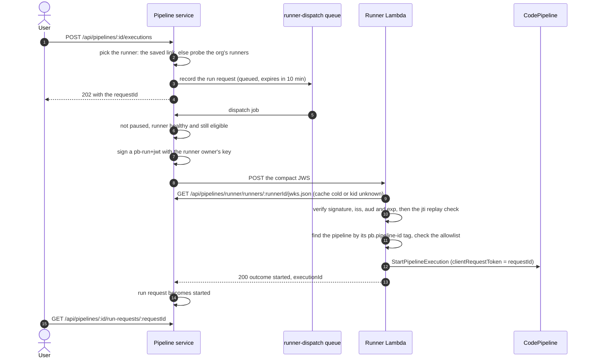

<!--
Copyright 2026 Pipeline Builder Contributors
SPDX-License-Identifier: Apache-2.0
-->

# AWS Deployment

Two targets: **EC2** (a single Minikube instance) or **EKS** (managed Kubernetes, Auto Mode).

## Highlights

- **A domain and a public Route 53 zone are always required.** Both targets front the workload with an ALB terminating TLS using a DNS-validated ACM cert.
- **Compute is always in private subnets.** "Public" and "private" describe the ALB, not the workload.
- **Private mode is the default**, and its URL resolves only inside the VPC.
- **`infra provision` is the recommended entry point**, wrapping the `bin/setup.sh` scripts that remain the source of truth.
- **The cert validates mid-deploy.** The stack reaching `CREATE_COMPLETE` is not the same as the platform being reachable.
- **Observability is the native `/dashboard/observability` page**, seeded at cold start as system-org public dashboards — not a separate tool to stand up.
- **Panels you can't see are hidden, not empty.** Fleet-wide queries render only for system admins, and a dashboard with no visible panel disappears.
- **Post-deploy steps are not optional on AWS** — storing the service credentials and wiring event reporting are what make pipelines and analytics work.

## Overview

This guide is for operators standing up Pipeline Builder on AWS. It covers both targets in either **public** (internet-facing ALB) or **private** (internal ALB, the default) mode, plus email via SES, platform initialization, execution reporting and drift detection.

Both targets deploy the full stack: app services, databases, observability (Prometheus + Loki, surfaced in-app) and admin tools.

### What you get for observability

Five dashboards — Platform Overview, Plugin Builds, Queue Health, Registry Activity, Audit Activity — are seeded into the database at ops-center cold start as public rows owned by the system org (`org_id` = the configured `SYSTEM_ORG_ID`, default `000000000000000000000001`), so they appear automatically for any logged-in org at `/dashboard/observability/<id>`.

| Who | Sees |
|---|---|
| Org member | Plugin Builds, and the org-scoped part of Platform Overview |
| Org admin | The above plus Audit Activity, reading the MongoDB audit trail scoped to their org |
| System admin | Everything, including Queue Health and Registry Activity |

Panels backed by fleet-wide queries are shown only to system admins, and a dashboard with no panel the caller can render is hidden entirely. Audit Activity also has a dedicated page at `/dashboard/observability/audit-activity`.

## How it works

1. **Pick a target and a mode** — EC2 or EKS; public or private. Both need `--domain` and `--hosted-zone-id`.
2. **Provision.** [`pipeline-manager infra provision`](#ai-assisted-install-infra-provision) is recommended; `bin/setup.sh` or raw CloudFormation work too. It requests a DNS-validated ACM cert and fronts the private compute with an ALB.
3. **The cert validates mid-deploy**, then instances or pods pass health checks a few minutes later.
4. **The URL is `https://<your-domain>`** — publicly resolvable in public mode, in-VPC only in private mode.
5. **Initialization registers the first admin** and, with the right flags, loads the plugin, compliance and sample catalogs.
6. **Post-deploy wiring makes AWS-specific things work** — the stored service credentials and the EventBridge reporting path.
7. **Execution events flow back** to the reporting service, which is what fills the Reports page and DORA.

## Configuration

1. **Have a domain in a public Route 53 hosted zone.** Without it there is no cert and no deployment.
2. **Choose the mode.** Private (default) puts the ALB inside the VPC; public makes it internet-facing. See [Deployment modes](#deployment-modes-public-vs-private).
3. **Provision** with [`infra provision`](#ai-assisted-install-infra-provision), or the target's `bin/setup.sh`. Use `--plan` first to see what will happen.
4. **Decide about email.** `--email` is the default on both AWS targets and provisions the whole SES path; `--no-email` opts out. See [Email (SES)](#email-ses).
5. **Complete the [post-deploy steps](#post-deploy-steps)** — they are not optional: store the four service credentials, then deploy the EventBridge reporting infrastructure.
6. **Verify at the [access points](#access-points)**. The admin consoles are **on by default** on AWS (`ADMIN_CONSOLES_ENABLED=true`) and each sits behind its own permission plus the system org and an AAL2 session; set the flag `false` to make all five 404 instead.
7. **Wire a backup before you need one** — nothing is scheduled by default. See [Deploy Operations](deploy-operations.md#configuration).

## Table of Contents

- [AI-assisted install (`infra provision`)](#ai-assisted-install-infra-provision) -- The recommended way to install the platform
- [Deployment modes](#deployment-modes-public-vs-private) -- Public vs private, and what each changes
- [Public deployment (quickstart)](#public-deployment-quickstart) -- Internet-facing install, EC2 or EKS
- [Private deployment (quickstart)](#private-deployment-quickstart) -- Inside-AWS-only install, EC2 or EKS
- [EC2](#ec2) -- Single Minikube instance (dev/staging, [~$610-680/mo at the default m5.4xlarge](#ec2-cost))
- [EKS](#eks) -- Managed Kubernetes, EKS Auto Mode (production, [~$850-950/mo measured](#eks-cost))
- [Email (SES)](#email-ses) -- Transactional email (provisioned by default; `--no-email` to skip)
- [Post-Deploy Steps](#post-deploy-steps) -- Platform init, credentials, EventBridge reporting
- [Drift Detection (`audit stacks`)](#drift-detection-audit-stacks) -- Reconcile registry vs live CloudFormation
- [Cross-account pipeline runner](#cross-account-pipeline-runner) -- the only way pipelines run: one runner per AWS account per org, with no platform access to them
- [Report API Endpoints](#report-api-endpoints) -- Execution and plugin analytics
- [Access Points](#access-points) -- Service URLs after deployment
- [File Structure](#file-structure) -- Deployment file layout
- [Troubleshooting](#troubleshooting) -- Common issues and fixes

| | EC2 | EKS |
|--|-----|-----|
| Runtime | Minikube on EC2 | EKS Auto Mode (Karpenter-scaled EC2 nodes) |
| Infra | 1 CloudFormation stack | eksctl cluster + Kubernetes manifests |
| TLS | ACM cert at the ALB | ACM cert at the ALB Ingress |
| Public surface | ALB only (instance private) | ALB Ingress only (nodes private) |
| Storage | hostPath PVCs on EBS | EBS (RWO) + EFS (RWX) via CSI |
| Scaling | Vertical (instance resize) | Horizontal (Karpenter nodes + pod autoscaling) |
| Cost | [~$610-680/mo](#ec2-cost) at the default m5.4xlarge; ~$145-215 on t3.xlarge | [~$850-950/mo measured](#eks-cost), 24/7 |
| Best for | Dev/staging | Production |

---

## AI-assisted install (`infra provision`)

The **recommended** way to install the platform is `pipeline-manager infra provision`. It picks the target, runs prerequisite checks (AWS CLI + working credentials for EC2/EKS — plus `kubectl`, `openssl`, and `envsubst` for EKS (`eksctl` is auto-installed by `setup.sh`); Docker etc. for local), assembles the **exact, validated `setup.sh` command** (secrets masked, missing inputs reported rather than guessed), prints the plan, and then **deploys it — gated by confirmation prompts** (`--yes` to auto-accept for CI; `--json` prints the plan and runs nothing). With an AI key configured it also parses a natural-language goal and diagnoses CloudFormation failures.

```bash
npm install -g @pipeline-builder/pipeline-manager

# Deploy (shows the plan, then confirms; add --yes for non-interactive CI):
pipeline-manager infra provision --target eks \
  --domain pipeline.example.com --hosted-zone-id Z123 --ghcr-token ghp_xxx --email

# Inspect the plan as JSON without running anything:
pipeline-manager infra provision --target eks --json \
  --domain pipeline.example.com --hosted-zone-id Z123 --ghcr-token ghp_xxx --email

# Or describe the goal (needs an AI key — see Environment Variables):
pipeline-manager infra provision --prompt "deploy to EKS in us-east-1 with email enabled"

# Diagnose a failed deploy:
pipeline-manager infra provision --target eks --diagnose ./stack-events.txt
```

> **Always deploys (gated).** `infra provision` checks, assembles, prints the plan, and runs the deploy — it **refuses** on failed prerequisites or missing inputs, asks for confirmation before deploying (**`--yes`** auto-accepts for CI), streams the deploy to your terminal, then verifies `/health` + `/ready` on the application URL. On the **AWS targets the deploy self-inits** (EC2 on first boot; EKS in `setup.sh`'s final phase), so `infra provision` surfaces it rather than running it separately; on **local/minikube** `infra provision` runs `init-platform` for you. **`--json`** is the only non-executing mode — it prints the plan and exits (for tooling).
>
> **On failure it troubleshoots.** It matches known CloudFormation signatures and prints the likely cause + fix — and for a few it can **auto-fix and retry** (e.g. an existing SES identity → re-run with `--skip-ses-identity`; an ACM/DNS-propagation timeout → resume). Retries are gated and bounded by **`--retries <n>`** (default 1; the scripts are idempotent so a re-run resumes). With an AI key it adds a free-form diagnosis on top. When SES is enabled, a successful deploy prints DKIM/sandbox next-steps.
>
> Flags: **`--yes`** auto-approves (CI), **`--retries <n>`** auto-fix/retry budget, **`--init <mode>`** controls post-deploy initialization (`auto` default / `manual` / `skip` — see below), **`--skip-ses-identity`** for an already-verified SES domain, **`--stack-name <name>`** (EC2) / **`--cluster-name <name>`** (EKS) to deploy/manage a second environment.
>
> **Init mode (`--init <mode>`).** One flag controls how the platform initializes after deploy:
> - **`auto`** (default) — `init-platform` runs once the platform is up, registering the admin (with the **default** password) and loading plugins/compliance/samples. The **AWS targets self-run it as part of the deploy**: **EC2** on first boot (UserData → on the box as the `minikube` user — watch with `aws ssm start-session … && sudo tail -f /var/log/user-data.log`); **EKS** in `setup.sh`'s final phase, reaching the cluster over a `kubectl port-forward`. **local/minikube** run it from `infra provision`.
> - **`manual`** — don't init; `infra provision` surfaces the exact step for you to run yourself (do this to set real admin credentials `PLATFORM_IDENTIFIER`/`PLATFORM_PASSWORD` instead of the default).
> - **`skip`** — don't initialize at all (no register, no loads).
>
> **Teardown.** Add **`--teardown`** to remove a deployment. `local`/`minikube` stop the stack (on-disk / PVC data persists). **EC2 DELETEs its CloudFormation stack and EKS runs `bin/shutdown.sh` (deletes the cluster, EFS, ACM cert + Route 53 alias) — both irreversible** — so the destructive path is gated harder than deploy: you must **type the resource id** to confirm (a y/N is too easy to fat-finger), and **`--yes` alone does *not* bypass it** — only **`--force`** does (for CI). When you pass a custom **`--stack-name <name>`** (EC2) or **`--cluster-name <name>`** (EKS), the confirmation binds to that name — you type the **stack/cluster name**, not the target id, so a wrong name can't be confirmed by habit. The region comes from **`--region`** / `AWS_REGION`. As always, `bin/shutdown.sh` (local/minikube/EKS) and `aws cloudformation delete-stack` (EC2) can be run directly.
>
> ```bash
> # Teardown — prints the destroy plan, then prompts (type "eks" to confirm):
> pipeline-manager infra provision --target eks --teardown
> ```
>
> **Bootstrap a fresh machine (`--repo`).** Without a checkout, `--repo` git-clones the platform repo first and runs from it. The clone is **sparse + partial** — `git clone --filter=blob:none --no-checkout` + cone `sparse-checkout` (git ≥ 2.27; older git falls back to a full clone) — so it materializes **only the deploy folders the selected target + options need**, not the whole repo (`packages/`, `api/`, `frontend/`, … are never downloaded). The common base is just `deploy/bin`; each target adds its own folder (`deploy/local/docker`, `deploy/local/minikube` — self-contained — `deploy/aws/ec2`, `deploy/aws/eks`), and each post-install load adds its folder. Re-syncs are **additive** (`sparse-checkout add`), so one `--workdir` can accumulate multiple targets. Override with `--repo <url>`, `--ref <branch|tag>`, `--workdir <dir>`. (`--ref` is a branch/tag; arbitrary SHAs may not fetch under the shallow clone.)
>
> **Post-install steps.** After deploy + health, `infra provision` registers the admin (non-interactive with `--admin-email`/`--admin-password`, which set `PLATFORM_IDENTIFIER`/`PLATFORM_PASSWORD`) and runs **opt-in** loads — each also pulls its folder into the sparse clone: `--with-plugins` (build + load plugins; adds `deploy/plugins`), `--with-compliance` (`deploy/compliance`), `--with-samples` (`deploy/samples`), or `--with-all`. Also `--build-bootstrap` (`build-plugin-images.sh --only pipeline-bootstrap`), `--with-smoke-test` (read-only API check), `--with-events` (EC2/EKS event ingestion — a five-step bundle: four **`infra store-token --schedule`** runs writing the platform, `registry:push`, `pipeline_registry:write` and `reporting:ingest` service-account keys to Secrets Manager at the `pipeline-builder/{orgId}/…` pattern, then **`infra setup-events --scoped-ingest`** deploying the EventBridge → SQS → Lambda that reads the ingest key; all pull AWS creds from the standard env / `~/.aws` chain, and need `PLATFORM_PASSWORD` for the step-up each key write requires), and repeatable `--post-step "<cmd>"`. The default is **register-only** (minimal clone); the loads are deterministic + idempotent, so re-running with more options just layers them on. On the AWS targets these loads run **deploy-side by default** (so `infra provision` doesn't prompt for them locally) — EC2 on first boot, EKS in `setup.sh`'s final phase over a `kubectl port-forward`. Pass `--init manual` to drive them yourself.
>
> ```bash
> # Fresh box → sparse-clone just deploy/bin + deploy/local/docker, deploy, register, load samples:
> pipeline-manager infra provision --target docker --repo --with-samples --yes \
>   --admin-email admin@acme.com --admin-password 's3cret'
> ```

The underlying `bin/setup.sh` scripts remain the source of truth and can always be run directly — the rest of this guide documents them.

On **EKS**, `bin/setup.sh` runs ten phases and accepts `--from-phase` /
`--to-phase` / `--only-phase`, so a re-deploy does not have to re-walk the ~25
minutes of cluster, EFS and ACM work in phases 1-3. `bin/startup.sh` is the
shorthand for phases 4-8 — secrets, IAM, operators, workloads and the Route 53
alias — which is what a config change, a new image tag or an edited manifest
actually needs, and it gives EKS the `startup.sh` the EC2 and minikube targets
already have. It does not run `init-platform.sh` or the smoke checks; both are
separate scripts and neither follows from re-applying config.

---

## Service mesh (Istio ambient)

Both AWS targets run an **Istio ambient service mesh** (STRICT mTLS + identity-based
L4 authorization between all services). `bin/setup.sh` (EKS) / `bin/startup.sh` (EC2)
install it right after KEDA; policies live in `k8s/istio.yaml`. See
[Service Mesh](service-mesh.md) for the full model. AWS-target specifics:

- **EKS** uses **Auto Mode + ambient** (AWS-recommended). istiod runs HA (2 replicas
  + PDB). The node SecurityGroups **must allow node↔node HBONE `:15008`** (cross-node
  mTLS) plus istiod xDS `:15012` / webhook `:15017`. If AWS's Auto Mode guidance pins
  different CNI conf/bin dirs, pass them via `--set values.cni.cniConfDir/cniBinDir`
  in `setup.sh`. Validate capture across all nodes and under a Karpenter scale-up.
- **EC2** is single-node Minikube; ambient installs trivially. The mesh adds
  ~0.3–0.7 GiB (istiod + ztunnel). The default is **m5.4xlarge** — the smallest
  allowed instance on which every HPA can reach maxReplicas at once alongside the
  self-hosted 7B ask-model; **t3.2xlarge** still runs the stack at steady state (lower
  the ResourceQuota to match — see `k8s/resource-limits.yaml`). To run a **t3.xlarge**
  instead, deploy with **`LEAN=1`** — it drops the
  optional observability/admin services and single-replicas every workload so the core
  stack + mesh fits. Set it at launch (CFN `Lean` param): `LEAN=1 deploy/aws/ec2/bin/setup.sh`
  (or `pipeline-manager infra provision --target ec2 --lean --instance-type t3.xlarge`),
  or on the box: `LEAN=1 sudo -E bash deploy/aws/ec2/bin/startup.sh` (`-E` preserves the
  env through `sudo`). See [Service Mesh: LEAN mode](service-mesh.md#lean-mode-trimming-the-footprint).
- **Ingress**: the ALB terminates TLS (ACM) and forwards plain HTTP to `nginx:8080`,
  which is carved out of STRICT (PERMISSIVE) — the ALB health check on `:8080/health`
  rides the same carve-out.
- **Redis** runs as Sentinel HA on both targets (`redis-sentinel.yaml`); clients reach
  `redis-sentinel:26379` + `redis:6379`, both meshed.

## Deployment modes (public vs private)

Either target (EC2 or EKS) deploys in one of two modes. **Both** put the compute in **private subnets** and terminate TLS at an ALB with a publicly-trusted, **DNS-validated ACM cert** — so both **require `--domain` + `--hosted-zone-id`** (the public Route 53 zone is where ACM validates the cert). The mode flips only the **ALB scheme** and the **DNS record**:

| | `private` (inside-AWS-only, **default**) | `public` |
|---|---|---|
| ALB scheme | internal, private subnets | internet-facing, public subnets |
| Compute (instance / tasks) | private subnet, no public IP | private subnet, no public IP |
| DNS | Route 53 **private** zone alias → internal ALB | public Route 53 alias → ALB |
| Reachable from | inside the VPC (peered / VPN / Direct Connect) | the public internet |
| CodeBuild | **VPC-attached** (`PIPELINE_VPC_ID` / `SUBNET_IDS` / `SECURITY_GROUP_IDS`) | AWS-managed network, reaches the ALB over the internet |
| Plugin pull | `https://<domain>/v2/` (resolves in-VPC) | `https://<domain>/v2/` (public) |

In **`private`** mode, **EC2** folds the VPC interface endpoints (S3, Logs, Secrets Manager, KMS, STS, CodeBuild, ECR) **and** the Route 53 private-zone alias to the internal ALB into its single stack, gated on `DeployMode=private` (no separate prereqs stack). **EKS** sets the ALB Ingress to `scheme: internal` and aliases the domain to it; eksctl provisions the cluster VPC (public + private subnets, NAT). Both request a DNS-validated ACM cert and alias the domain to the ALB (public alias or private zone). For VPC-attached CodeBuild plugin pulls, supply `PIPELINE_VPC_ID` / `SUBNET_IDS` and build-dependency egress (NAT / internal mirrors).

Use the matching quickstart below: **[Public](#public-deployment-quickstart)** or **[Private](#private-deployment-quickstart)**.

---

## Public deployment (quickstart)

A **public** deployment uses an **internet-facing ALB** so the dashboard, API, and plugin registry are reachable from the internet over HTTPS (the compute still stays private behind it). See [Deployment modes](#deployment-modes-public-vs-private) for the full comparison.

### Prerequisites (both targets)

- **AWS CLI** configured with credentials for the target account/region.
- A **registered domain** and its **public Route 53 hosted zone** — required. The stack requests a DNS-validated ACM cert for the domain against this zone, so setup.sh refuses to start without `--domain` + `--hosted-zone-id`.
- A **GitHub account + personal access token (PAT)**. The service images live on GitHub Container Registry (`ghcr.io/mwashburn160/*`); they're public, but GitHub rate-limits *anonymous* pulls (60/hr) which trips mid-deploy when all 10 images pull at once. **Generate your own PAT under your GitHub account**: on GitHub go to **Settings → Developer settings → Personal access tokens → Tokens (classic) → Generate new token (classic)** (https://github.com/settings/tokens) and check only the `read:packages` scope. Then pass `--ghcr-token <your-pat>` (ghcr.io validates only the token for PAT auth — there is no username flag to set; the deploy uses a fixed internal value). Don't reuse a token from these docs or another deployment. See [GhcrToken rejected](#troubleshooting) for the fine-grained-PAT option and details.
- **EC2 only:** an EC2 **key pair** in the target region (`--key-pair`) for break-glass serial-console access (routine access is via SSM).

### 1. Deploy in public mode

Pick the target. Both take `--deploy-mode public`; everything else matches the private flow.

```bash
# EC2 — single Minikube instance behind an internet-facing ALB
cd deploy/aws/ec2
bash bin/setup.sh --deploy-mode public \
  --key-pair my-keypair \
  --domain pipeline.example.com \
  --hosted-zone-id Z1234567890 \
  --ghcr-token ghp_xxxxxxxxxxxx

# EKS — managed Kubernetes (Auto Mode) behind an internet-facing ALB Ingress
cd deploy/aws/eks
bash bin/setup.sh --deploy-mode public \
  --domain pipeline.example.com \
  --hosted-zone-id Z1234567890 \
  --ghcr-token ghp_xxxxxxxxxxxx
```

The ACM cert DNS-validates **during** the deploy, so expect `setup.sh` to wait a few minutes for the cert to reach `ISSUED` (EC2: while CloudFormation is `CREATE_IN_PROGRESS`; EKS: `aws acm wait certificate-validated`). `setup.sh` runs from your machine with your credentials. The EC2 [Deploy](#deploy) section also shows the raw-CloudFormation equivalent.

### 2. Get the URL

The URL is simply `https://<your-domain>` (the value you passed to `--domain`), reachable once the Route 53 alias resolves and the target(s) pass health checks — a few minutes after the stack completes, while the instance bootstraps / tasks start. To read it back from the stack outputs:

```bash
# EC2 — ApplicationURL output is the full https:// URL
aws cloudformation describe-stacks --stack-name pipeline-builder \
  --query 'Stacks[0].Outputs[?OutputKey==`ApplicationURL`].OutputValue' --output text

# EKS — the URL is https://<your-domain> (the Route 53 alias setup.sh creates → the ALB Ingress).
# Confirm the ALB hostname the Ingress was assigned:
kubectl get ingress pb-ingress -n pipeline-builder \
  -o jsonpath='{.status.loadBalancer.ingress[0].hostname}'
```

### 3. Initialize the platform

Public install is otherwise identical to private — by default the admin user is registered and plugins loaded automatically (EC2 self-inits on first boot; EKS self-inits in `setup.sh`'s final phase over a `kubectl port-forward`). To do it yourself, deploy with `--init manual` and follow [Post-Deploy Steps](#post-deploy-steps).

> **Note:** "public" exposes only the ALB. The instance/nodes have **no public IP and no inbound SSH**; admin access is still **SSM Session Manager** (EC2) or `kubectl` (EKS). To make a deployment internal-only later, redeploy with `--deploy-mode private` (default). See [Deployment mode (`DEPLOY_MODE`)](#deployment-mode-deploy_mode) for the full mode comparison.

---

## Private deployment (quickstart)

A **private** deployment uses an **internal-scheme ALB** — reachable only from inside your AWS network (the VPC, peered VPCs, or via VPN / Direct Connect), never the public internet. **This is the default mode.** See [Deployment modes](#deployment-modes-public-vs-private) for the full comparison.

### Prerequisites (both targets)

Identical to the [Public quickstart](#prerequisites-both-targets) above: AWS CLI, a registered **domain + public Route 53 hosted zone**, a GitHub **PAT** (`--ghcr-token`), and — EC2 only — an EC2 **key pair**.

> The **public** Route 53 hosted zone is still required even in private mode: ACM validates the cert via a public DNS record. The *private* hosted zone (for in-VPC resolution of your domain) is created automatically by the stack — you don't supply it.

### 1. Deploy in private mode

`private` is the default, so `--deploy-mode private` is optional (shown for clarity). Same flags as public, minus the public exposure.

```bash
# EC2 — single Minikube instance behind an internal ALB
cd deploy/aws/ec2
bash bin/setup.sh --deploy-mode private \
  --key-pair my-keypair \
  --domain pipeline.example.com \
  --hosted-zone-id Z1234567890 \
  --ghcr-token ghp_xxxxxxxxxxxx

# EKS — managed Kubernetes (Auto Mode) behind an internal ALB Ingress
cd deploy/aws/eks
bash bin/setup.sh --deploy-mode private \
  --domain pipeline.example.com \
  --hosted-zone-id Z1234567890 \
  --ghcr-token ghp_xxxxxxxxxxxx
```

In private mode, **EC2** also folds the VPC interface endpoints (S3, Logs, Secrets Manager, KMS, STS, CodeBuild, ECR) and the Route 53 private-zone alias to the internal ALB into its single stack (gated on `DeployMode=private`, no separate prereqs stack). **EKS** sets the ALB Ingress to `scheme: internal` and aliases the domain to it. Either way the ACM cert still DNS-validates during the deploy, so expect a few minutes of waiting for it to issue.

### 2. Get the URL

The URL is the same `https://<your-domain>`, but it **resolves only from inside the VPC** (via the private hosted zone) — it will not resolve from your laptop or the public internet. For EC2, read it back from the stack output (`ApplicationURL`); for EKS the URL is `https://<your-domain>` from the Route 53 alias, and you can confirm the ALB hostname as in the [public step 2](#2-get-the-url).

### 3. Initialize the platform

**By default this happens automatically.** EC2 runs `init-platform.sh ec2` on first boot (as the `minikube` user, in-VPC); EKS runs `init-platform.sh eks` from `setup.sh`'s final phase over a `kubectl port-forward` to `svc/nginx`. Both register the admin (default password) and load plugins/compliance/samples — watch EC2 with `sudo tail -f /var/log/user-data.log` (after SSM).

If you deployed with **`--init manual`** (or want to re-run / set real admin creds):

- **EC2** — SSM into the instance (`aws ssm start-session --target <instance-id>`), `sudo -iu minikube`, `cd /opt/pipeline/pipeline-builder`, then run `./deploy/bin/init-platform.sh ec2`; it's already in-VPC.
- **EKS** — run `./deploy/bin/init-platform.sh eks` with `kubectl` access to the cluster. It port-forwards `svc/nginx` (8080), so it works without the domain resolving — no VPC-attached host required.

Then load plugins per [Post-Deploy Steps](#post-deploy-steps).

> **Note:** private mode also wires CodeBuild into the VPC (`PIPELINE_VPC_ID` / `SUBNET_IDS` from the foundation VPC) so it can reach the internal ALB and pull plugin images over `https://<domain>/v2/`. You still supply egress (NAT / package mirrors) for build dependencies. See [Deployment mode (`DEPLOY_MODE`)](#deployment-mode-deploy_mode) for the full comparison.

---

## EC2

Single hardened EC2 instance running Minikube with all services.

### Prerequisites

- AWS CLI configured
- EC2 key pair in target region
- A registered domain + its **public Route 53 hosted zone** (required — the template requests a DNS-validated ACM cert against it; required in both `public` and `private` mode)

### Deploy

For the one-command happy path, use the [Public](#public-deployment-quickstart) or [Private](#private-deployment-quickstart) quickstart — both run `bin/setup.sh` from your machine with your credentials (so the instance role needs no CloudFormation permissions). An **ALB fronts the always-private instance** and terminates TLS with an **ACM cert** the template DNS-validates against your zone, so `--domain` + `--hosted-zone-id` are required; `setup.sh` refuses to start without them.

**Manual alternative (raw CloudFormation).** Deploys the same single stack — nothing to follow up with. The ACM cert DNS-validates during stack creation, so expect a few minutes in `CREATE_IN_PROGRESS`:

```bash
cd deploy/aws/ec2

aws cloudformation deploy \
  --stack-name pipeline-builder \
  --template-file template.yaml \
  --parameter-overrides \
    DeployMode=private \
    DomainName=pipeline.example.com \
    HostedZoneId=Z1234567890 \
    KeyPairName=my-keypair \
    GhcrToken=ghp_xxxxxxxxxxxx \
  --capabilities CAPABILITY_IAM
# (DeployMode=public for an internet-facing ALB; domain + zone still required.)
```

Get the URL:

```bash
aws cloudformation describe-stacks --stack-name pipeline-builder \
  --query 'Stacks[0].Outputs[?OutputKey==`ApplicationURL`].OutputValue' --output text
```

### Parameters

| Parameter | Required | Default | Description |
|-----------|----------|---------|-------------|
| `KeyPairName` | Yes | — | EC2 key pair (serial-console/break-glass; routine access is via SSM) |
| `GhcrToken` | Yes | — | GHCR token for pulling images |
| `DomainName` | **Yes** | — | FQDN — ACM cert + Route 53 alias to the ALB |
| `HostedZoneId` | **Yes** | — | Public Route 53 zone ID (ACM DNS validation + alias) |
| `InstanceType` | No | `m5.4xlarge` | EC2 instance type (16 vCPU / 64 GiB) — the smallest size on which every HPA can reach `maxReplicas` alongside the mesh and the self-hosted ask-model. `t3.2xlarge` (8 vCPU / 32 GiB) runs the stack at steady state with less headroom; use `t3.xlarge` only with `Lean=true`. |
| `Lean` | No | `false` | When `true`, omit the optional observability/admin services + single-replica everything so the core stack + mesh fits a `t3.xlarge`. Pair with `InstanceType=t3.xlarge`. See [Service Mesh: LEAN mode](service-mesh.md#lean-mode-trimming-the-footprint). |
| `EbsVolumeSize` | No | `60` | Root volume size in GiB (OS, binaries) |
| `DataVolumeSize` | No | `580` | Data volume size in GiB (`/opt/pipeline`, gp3 encrypted) — Docker, plugins, registry, databases. **Minimum 520**, which is 2x what the stack commits to this volume: 180 GiB of declared PersistentVolume claims (9 x 20 GiB) plus the 80 GiB minikube node disk, which lives here because Docker's data-root does. Two of those claims are the Postgres read replica — one per ordinal its KEDA autoscaler may reach, because automation must not be able to scale into a Pending pod. A standby holds a FULL copy of the database, not a subset; hostPath capacity is nominal, so unused ordinals consume nothing in practice. |
| `GitRepo` | No | *(this repo)* | Git repository URL |
| `GitBranch` | No | `main` | Branch to deploy |

### Storage Requirements

The EC2 deployment uses two EBS volumes:

| Volume | Default | Mount | Contents |
|--------|---------|-------|----------|
| **Root** | 60 GiB | `/` | OS, Docker/minikube binaries, app code |
| **Data** | 580 GiB | `/opt/pipeline` | Docker layers, plugin artifacts, registry, databases, logs |

Data volume breakdown:

| Component | build_image | prebuilt | prebuilt + --cleanup |
|-----------|-------------|----------|---------------------|
| Docker build cache + images | 20-30 GB | 60-90 GB | 60-90 GB |
| Plugin artifacts (image.tar + plugin.zip) | 0 GB | 130-190 GB | 0 GB |
| Registry (pushed images) | 40-60 GB | 40-60 GB | 40-60 GB |
| PostgreSQL + MongoDB | 5-15 GB | 5-15 GB | 5-15 GB |
| Minikube + logs + metrics | 15-25 GB | 15-25 GB | 15-25 GB |
| **Total** | **80-130 GB** | **250-380 GB** | **120-190 GB** |

The figures above are OBSERVED usage. The volume is sized from what the stack
*commits* instead, at a 2x minimum — 180 GiB of declared PV claims (nine
hostPath PVs in `k8s/`, all under `/opt/pipeline/pipeline-data`, each claiming
20 GiB; two are the Postgres read-replica ordinals) plus the 80 GiB minikube
node disk, so the floor is 520 GiB. Postgres
and MongoDB using 5-15 GB today does not lower it: the claims are what a CSI
would enforce if this target ever stopped using hostPaths, and the node disk is
a real file on this volume either way.

**Recommendations:**

| Plugin strategy | Data volume | Notes |
|----------------|-------------|-------|
| `build_image` (default) | 520 GB | The floor. Builds from Dockerfile at upload time |
| `prebuilt` with `--cleanup` | 580 GB | Removes artifacts after upload |
| `prebuilt` without cleanup | 740 GB | Keeps 130-190 GB of artifacts for re-runs |

Daily runtime operations (after initial plugin load) add ~1-5 GB/month from database growth and logs. Add a weekly Docker prune cron to reclaim build cache:

```bash
# /etc/cron.weekly/docker-prune
docker system prune -af --filter "until=168h"
```

### Expanding EBS Volume

If you need more storage after deployment (e.g., switching to prebuilt), expand the data volume live — no reboot required:

```bash
# 1. Find the data volume ID
INSTANCE_ID=$(curl -s -H "X-aws-ec2-metadata-token: $(curl -s -X PUT \
  http://169.254.169.254/latest/api/token -H 'X-aws-ec2-metadata-token-ttl-seconds: 21600')" \
  http://169.254.169.254/latest/meta-data/instance-id)

VOL_ID=$(aws ec2 describe-volumes \
  --filters "Name=attachment.instance-id,Values=$INSTANCE_ID" "Name=tag:Name,Values=*data*" \
  --query 'Volumes[0].VolumeId' --output text)

# 2. Expand to desired size (e.g., 740 GiB for prebuilt without cleanup)
aws ec2 modify-volume --volume-id $VOL_ID --size 740

# 3. Wait for modification to complete (~30s)
watch -n5 "aws ec2 describe-volumes-modifications --volume-ids $VOL_ID \
  --query 'VolumesModifications[0].ModificationState' --output text"
# Wait until it shows "optimizing" or "completed"

# 4. Grow the partition and filesystem (on the EC2 instance)
DEVICE=$(lsblk -no PKNAME $(findmnt -n -o SOURCE /opt/pipeline))
PART=$(lsblk -no PARTNUM $(findmnt -n -o SOURCE /opt/pipeline) 2>/dev/null)
[ -n "$PART" ] && sudo growpart /dev/$DEVICE $PART
sudo xfs_growfs /opt/pipeline    # XFS filesystem
# or: sudo resize2fs $(findmnt -n -o SOURCE /opt/pipeline)   # ext4 filesystem

# 5. Verify
df -h /opt/pipeline
```

Deploy with a larger data volume upfront:
```bash
aws cloudformation deploy \
  --stack-name pipeline-builder \
  --template-file template.yaml \
  --parameter-overrides \
    DataVolumeSize=580 \
    KeyPairName=my-key \
    GhcrToken=ghp_xxx \
  --capabilities CAPABILITY_IAM
```

### What Happens

1. CloudFormation creates the VPC (2 AZs: public + private subnets), NAT gateway, ALB + ACM cert, security groups, the **private** EC2 instance, and the Route 53 alias to the ALB
2. EC2 UserData clones the repo and runs `bootstrap.sh`, which:
   - Updates OS, installs fail2ban, disables SSH password auth
   - Installs Docker, Minikube, kubectl
   - Generates `.env` with random secrets (JWT keys, DB passwords)
   - Runs `startup.sh` — **creates** Minikube (fresh, no cluster yet), installs the mesh/KEDA, deploys all K8s manifests
   - Sets one iptables bridge: instance `:30080` → Minikube NodePort `30080` (the ALB target). TLS is terminated at the ALB (ACM) — no cert on the box.

> **First boot always CREATES a fresh cluster** — `startup.sh` finds no existing profile, so it never prompts (the `RECREATE` prompt is TTY-gated and only reached on an *existing* cluster; a non-interactive UserData run has no TTY). If you later SSH onto the box and re-run `startup.sh` against a running/stopped cluster, it **resumes** by default; force a cluster rebuild with **`RECREATE=y sudo -u minikube deploy/aws/ec2/bin/startup.sh`**. The EC2 data lives on the host (`$DATA_DIR`), so a rebuild re-mounts the same data — to truly wipe, clear `$DATA_DIR` on the host first.

### Post-Deploy

The instance is private (no public IP); use **SSM**:

```bash
# Watch bootstrap progress
aws ssm start-session --target <instance-id>   # then: sudo tail -f /var/log/user-data.log

# Check pods
aws ssm start-session --target <instance-id>   # then: sudo -u minikube kubectl get pods -n pipeline-builder
```

The ALB target reports **unhealthy (503)** until the instance finishes bootstrapping Minikube + services — expected; it self-heals.

### Scripts

All in `deploy/aws/ec2/bin/`. On the instance the repo is checked out under the
data volume, so the scripts live at `/opt/pipeline/pipeline-builder/deploy/aws/ec2/bin/`.

| Script | Purpose | Run as |
|--------|---------|--------|
| `setup.sh` | Deploy the stack (private mode folds endpoints + private zone into it) — from your machine | operator |
| `bootstrap.sh` | Full EC2 setup (runs automatically via UserData) | root |
| `startup.sh` | Start Minikube + deploy K8s manifests + the ALB-target iptables bridge | root (sudo) |
| `shutdown.sh` | Stop Minikube + remove iptables rules | root (sudo) |
| `boot-recover.sh` | Bring the cluster back after an instance stop/start (`ExecStart` of the `pipeline-minikube` systemd unit `bootstrap.sh` installs; `shutdown.sh` is its `ExecStop`) | systemd |
| `backup.sh` / `restore.sh` | Database backup and restore (wrappers over `deploy/bin/backup.sh` / `restore.sh` via kubectl; see [Deploy Operations](deploy-operations.md)) | the `minikube` user (kubectl context) |

The instance has **no public IP / no SSH** — connect with SSM Session Manager first:

```bash
aws ssm start-session --target <instance-id>   # then, on the instance:

# Start (after bootstrap or reboot)
sudo bash /opt/pipeline/pipeline-builder/deploy/aws/ec2/bin/startup.sh

# Stop
sudo bash /opt/pipeline/pipeline-builder/deploy/aws/ec2/bin/shutdown.sh

# Check pod status
sudo -u minikube kubectl get pods -n pipeline-builder
```

### Security

- **Instance is always private** — no public IP; the internet-facing ALB is the only public surface
- **Instance SG: only the ALB SG → `30080`** — no `0.0.0.0/0`, no public SSH (port 22 closed; access via **SSM Session Manager**)
- **TLS terminated at the ALB with an ACM cert** (no private key on the box); HTTPS-only (TLS1.2+), `80`→`443` redirect at the ALB
- IMDSv2 required (token-based metadata); encrypted gp3 EBS; automatic security updates (dnf-automatic)

### TLS

TLS is terminated at the **ALB** with an **ACM certificate** the template requests and DNS-validates against `HostedZoneId`. ACM auto-renews it; there is no certbot/Let's Encrypt and no cert on the instance. nginx serves plain HTTP behind the ALB.

### Deployment mode (`DEPLOY_MODE`)

See [Deployment modes](#deployment-modes-public-vs-private) for the public/private comparison and what each changes. `DEPLOY_MODE` defaults to `private`; pass `--deploy-mode public` (or `DEPLOY_MODE=public`) for the internet-facing posture. The instance is always private and TLS is always ACM-at-the-ALB regardless of mode; the private-mode VPC endpoints + private-zone alias are folded into the single stack (gated on `DeployMode=private`) — no separate prereqs stack.

`DEPLOY_MODE` and the VPC identity (`PIPELINE_VPC_ID` / `PIPELINE_SUBNET_IDS`) are **injected into the instance `.env` automatically** by `bootstrap.sh` (exported from the template's UserData, from the stack's VPC + private subnets) — and passed through to the first-boot init — so the synthesized CodeBuild attaches to the VPC and `init-platform.sh`'s private-mode preflight passes with no manual step. (If you run `init-platform.sh` by hand on the box, the values are already in `.env`.)

### Teardown

```bash
aws cloudformation delete-stack --stack-name pipeline-builder
aws cloudformation wait stack-delete-complete --stack-name pipeline-builder
```

---

## EKS

Managed Kubernetes on **Amazon EKS Auto Mode** — AWS-managed, Karpenter-scaled EC2 nodes with the AWS Load Balancer Controller, EBS CSI, and CoreDNS built in (EFS CSI added by the deploy). One orchestrator script stands up the cluster and applies the same Kubernetes workloads as the minikube/ec2 targets, tuned for multi-node (PVC storage, ALB Ingress).

> **Why EKS Auto Mode?** Plugin/base images are built with **rootless BuildKit**, which needs an *unconfined seccomp profile* to create its user namespace — only possible on **EC2-backed** Kubernetes nodes (`securityContext.seccompProfile: Unconfined`). Auto Mode keeps node management hands-off while running on EC2, so BuildKit works and the proven k8s manifests are reused as-is.

### Prerequisites

- **AWS CLI** + working credentials for the target account/region.
- **`eksctl`** (creates/destroys the Auto Mode cluster) — **auto-installed** by `setup.sh`/`shutdown.sh` (latest binary) when it isn't already on PATH.
- **`kubectl`** (applies the manifests), **`openssl`** (registry token keypair), and **`envsubst`** (renders `cluster.yaml` + the manifests). `infra provision` checks all of these; `deploy/bin/provision-docker.sh --target eks` installs them in a throwaway container if you'd rather not put them on your host.
- A registered domain + its **public Route 53 hosted zone** (required — the deploy requests a DNS-validated ACM cert against it).

### Deploy

Use the [Public](#public-deployment-quickstart) or [Private](#private-deployment-quickstart) quickstart for the one-command path — `bin/setup.sh` runs all phases end to end. It requests a **DNS-validated ACM cert** for `--domain` and terminates TLS at the **ALB Ingress** (no certbot, no self-signed cert), so `--domain` + `--hosted-zone-id` are required in both modes. The cert validates mid-deploy (`aws acm wait certificate-validated`), so expect a few minutes of waiting there.

### Parameters

| Parameter | Required | Default | Description |
|-----------|----------|---------|-------------|
| `--domain` | **Yes** | — | FQDN — ACM cert + Route 53 alias to the ALB Ingress |
| `--hosted-zone-id` | **Yes** | — | Public Route 53 zone ID (ACM DNS validation + alias) |
| `--ghcr-token` | Yes | — | GHCR token for pulling the service images |
| `--deploy-mode` | No | `private` | `public` (internet-facing ALB) or `private` (internal) |
| `--cluster-name` | No | `pipeline-builder` | EKS cluster name (set a second one to run multiple environments) |
| `--no-email` | No | — | Skip SES (transactional email is provisioned **by default**) |
| `--email-from` | No | `noreply@<domain>` | From address SES sends as |
| `--email-from-name` | No | `pipeline-builder` | Display name on outbound email |
| `--no-create-ses-identity` | No | — | Skip creating the SES identity (domain already verified in this account) |
| `--alert-email` | No | — | Subscribe an address to the SES bounce/complaint SNS topic |
| `--region` | No | `us-east-1` | AWS region |

### Deployment mode (`DEPLOY_MODE`)

See [Deployment modes](#deployment-modes-public-vs-private) for the public/private comparison. `DEPLOY_MODE` defaults to `private`; set it in the env before `setup.sh` or use `--deploy-mode public`. On EKS it controls only the **ALB Ingress scheme** — `internal` (private) vs `internet-facing` (public) — and the Route 53 record. For VPC-attached CodeBuild plugin pulls in private mode, supply `PIPELINE_VPC_ID` / `SUBNET_IDS` (the eksctl cluster VPC).

### Phases

`bin/setup.sh` runs these in order — there are no per-component CloudFormation stacks (eksctl manages the cluster's own stacks under the hood):

| Phase | Contents |
|-------|----------|
| **1. Cluster** | `eksctl` creates the EKS Auto Mode cluster (`cluster/cluster.yaml`), then the custom NodeClass + NodePool (NetworkPolicy enforcement, the compute ceiling) and the cluster addons (incl. `aws-efs-csi-driver`) |
| **2. EFS** | Encrypted EFS filesystem + security group (NFS from the nodes) + mount targets in the private subnets → the `pb-efs` (RWX) StorageClass |
| **3. ACM** | DNS-validated ACM cert for `--domain` (publishes the validation record to Route 53, waits for `ISSUED`) |
| **4. Secrets** | Namespace + the secret/ConfigMap set the manifests expect (JWT, DB creds, registry token keypair, app-env, DB init, observability configs) — same layout as the ec2 target |
| **5. Pod Identity** | SES `ses:SendEmail`/`ses:SendRawEmail` association for the platform ServiceAccount (when email is enabled) |
| **6. KEDA, metrics-server, mesh** | Installs the KEDA operator (the `ScaledObject` autoscaler — Auto Mode doesn't bundle it), metrics-server (HPA and KEDA cpu/memory triggers) and the Istio ambient mesh |
| **7. Workloads** | `kubectl kustomize k8s | kubectl apply` — all services: Nginx, Platform, Pipeline, Plugin, Quota, Billing, Message, Reporting, Compliance, Frontend, the in-cluster image-registry, observability (Prometheus, Loki, Alertmanager — surfaced via `/dashboard/observability`), admin tools (PgAdmin, Mongo Express), and the ALB Ingress |
| **8. Route 53** | A-alias `--domain` → the ALB the Ingress provisions |
| **9. Init** | `init-platform.sh eks` over a `kubectl port-forward` (skipped with `--no-auto-init` / `AUTO_INIT=false`) |
| **10. Smoke checks** | Post-provision checks; non-fatal |

### Post-Deploy

`setup.sh` applies the manifests, then the pods need a minute or two to pull, start, and pass readiness. The ALB target group reports **unhealthy (503)** until nginx and the platform are ready — expected; it self-heals.

```bash
# Watch the rollout reach a steady state
kubectl get pods -n pipeline-builder -w

# Wait on the gateway + core services
kubectl rollout status deploy/nginx deploy/platform deploy/pipeline deploy/plugin -n pipeline-builder

# Shell into a running pod (platform)
kubectl exec -it deploy/platform -n pipeline-builder -- /bin/sh
```

Plugin **base images** are seeded by `init-platform.sh eks` (the post-deploy step) — built by the in-cluster rootless buildkitd and pushed to the in-cluster registry; `setup.sh` itself doesn't build them. By default `infra provision` runs that init for you over a `kubectl port-forward`; with the raw script, run `./deploy/bin/init-platform.sh eks` once the registry is up (see [Post-Deploy Steps](#post-deploy-steps)). It works from anywhere with `kubectl` access — no VPC-attached host needed, even in private mode.

### Storage Requirements

Persistent state lives on **PVCs** provisioned by the EBS/EFS CSI drivers — no EBS volumes to hand-manage. PostgreSQL, MongoDB, Redis, and the rest run as Kubernetes workloads (the `postgres`/`mongo`/`redis` images), not as RDS/DocumentDB/ElastiCache. Plugin images are built by an in-cluster **rootless BuildKit** sidecar and pushed to the **in-cluster registry** (there is no ECR dependency).

| Resource | Storage class | Size | Notes |
|----------|---------------|------|-------|
| PostgreSQL | pb-ebs (RWO) | 5-15 GB | Pipelines, plugins, compliance, messages |
| MongoDB | pb-ebs (RWO) | 10-20 GB | Quota + billing records |
| Prometheus / Alertmanager / PgAdmin | pb-ebs (RWO) | 1-10 GB each | Metrics, alert state, admin UI |
| In-cluster registry | none — RustFS | — | Stateless: images go to the `registry` bucket via the S3 storage driver |
| Loki | none — RustFS | — | Chunks + index ship to the `loki` bucket |
| Redis | pb-ebs (RWO) | 1-5 GB | Sentinel HA StatefulSet (3 Redis + 3 Sentinel) — queues + cache |
| Plugin builds / uploads | pb-efs (RWX) | per-pod | BuildKit layer cache + upload staging (shared in-pod with the sidecar) |

**Recommendations:**

| Resource | Setting |
|----------|---------|
| pb-ebs PVCs | gp3, `ReclaimPolicy: Retain` — data survives a PVC/pod delete (clean up orphans manually) |
| pb-efs | Elastic — grows automatically; no pre-provisioning |
| Registry growth | Prune old plugin image tags from the in-cluster registry periodically |

<a id="ec2-cost"></a>
**Monthly cost — from the AWS Pricing API (us-east-1, 2026-10-09), at the
template's own defaults.**

The default `InstanceType` is **m5.4xlarge**, the TOP of the range this doc
used to quote as "$140-265/mo" — so a deploy that changes nothing pays the
high end, not the low one. Storage was omitted entirely: `EbsVolumeSize=60` +
`DataVolumeSize=580` is 640 GiB of gp3, about $51/mo on its own.

| Shape | Compute | 560 GiB gp3 | Total 24/7 |
|-------|---------|-------------|------------|
| **Default** — m5.4xlarge | ~$561 | ~$45 | **~$610-680/mo** |
| t3.2xlarge | ~$243 | ~$45 | ~$290-360/mo |
| t3.xlarge (LEAN, smaller volumes) | ~$121 | ~$20 | ~$145-215/mo |

Ranges include the ALB, EIP and data transfer, which vary with use. As with
EKS, stopping the instance when idle beats every other saving — this target is
a single instance, so stopping it costs only the EBS.

<a id="eks-cost"></a>
**Monthly cost — MEASURED, not estimated.**

Taken from AWS Cost Explorer on 2026-10-09 for the cluster as it actually runs
(6 nodes: 4x c6a.xlarge + 2x m5a.xlarge, ~34 workloads). The figures that used
to sit here were a bottom-up estimate totalling ~$150-400/mo, and they were low
by roughly 2-3x — the node line in particular assumed far fewer nodes than
Karpenter actually schedules for this workload.

| Resource | Cost |
|----------|------|
| EC2 compute (Karpenter, on-demand) | ~$560-640 |
| EC2 - Other (EBS, NAT, data transfer) | ~$190-240 |
| EKS control plane + Auto Mode | ~$73-80 |
| ALB | ~$10-30 |
| VPC, WAF, Secrets Manager, CloudWatch | ~$15-25 |
| **Total, running 24/7** | **~$850-950/mo** |

Two things move this number far more than any tuning:

- **Shut it down when idle.** Measured days with the cluster down came in at
  **$3-6/day** against ~$29/day running (`deploy/aws/eks/bin/shutdown.sh`).
  For a dev or demo cluster this dwarfs every other saving available.
- **The GPU node for Ask is the single largest line if enabled.** The pool
  prefers **g4dn.xlarge at ~$0.53/hr — ~$384/mo on its own** at 24/7, with
  g5.xlarge (~$1.00/hr, ~$734/mo) as the fallback when g4dn capacity is short.
  It is not included above; see `deploy/aws/eks/k8s/ask-model.yaml` and the
  `ask-model-gpu` NodePool in `cluster/nodepool.yaml` for how it is enabled.

  Most of that is recoverable without giving the feature up. `ask-model` is
  scheduled to business hours by default on this target
  (`k8s/ask-model-schedule.yaml`): two CronJobs scale it to 0 outside the
  window, which is what lets Karpenter deprovision the node, taking the line to
  roughly **$106/mo** for the default Mon-Fri 07:45-17:00 UTC window (201
  h/month against 730); every day instead of weekdays is **~$148/mo**
  (`ASK_SCHEDULE_UP` / `ASK_SCHEDULE_DOWN` / `ASK_SCHEDULE_ENABLED` in `.env` —
  see [Environment Variables](environment-variables.md)). Outside the window
  Ask's model calls fail rather than queue — answered as a 503 naming the
  window, not a raw connection error — so set `ASK_SCHEDULE_ENABLED=false` if
  out-of-hours use matters.

Node cost is the dominant, workload-dependent term: Karpenter scales nodes to
fit scheduled pods, and the NodePool ceiling in `cluster/nodepool.yaml`
(48 vCPU / 96Gi) is what bounds the worst case rather than the typical one.

### Expanding EKS Storage

**pb-ebs PVCs (postgres / mongodb / prometheus / …):** the gp3 StorageClass allows volume expansion, so grow a volume by raising the PVC request and letting the EBS CSI driver expand it online:
```bash
kubectl patch pvc postgres-data -n pipeline-builder \
  -p '{"spec":{"resources":{"requests":{"storage":"30Gi"}}}}'
# the EBS CSI driver expands the volume + filesystem online (gp3) — no pod restart needed
```

**pb-efs (plugin build uploads) — no expansion needed:** EFS is elastic and grows automatically. (The registry, Loki, and message attachments now live in **RustFS** (this target's S3-compatible object store), not EFS — the registry is stateless S3, Loki ships chunks/index to S3; only plugin build uploads still use pb-efs.) Cap object-store growth via bucket lifecycle rules + Loki `retention_period`; check EFS usage via `aws efs describe-file-systems`.

**Cluster capacity:** node capacity is managed by **Karpenter** (Auto Mode) — it provisions and removes EC2 nodes to fit scheduled pods, so there is no instance to resize.

### EKS vs the other k8s targets

EKS reuses the same Kubernetes manifests as minikube/ec2, with these AWS-managed substitutions:

| minikube / ec2 | EKS |
|----------------|-----|
| hostPath volumes | EBS (RWO) + EFS (RWX) PVCs via CSI |
| NodePort + iptables bridge | ALB Ingress (`target-type: ip` → nginx:8080) |
| Single node | Karpenter-scaled EC2 nodes (Auto Mode) |
| EC2 instance role (SES) | EKS Pod Identity association |
| Self-managed addons | Auto Mode: AWS LB Controller, EBS CSI, CoreDNS built in (EFS CSI added) |

### Scripts

All in `deploy/aws/eks/bin/`. Run from your local machine (or via `infra provision`).

| Script | Purpose |
|--------|---------|
| `setup.sh` | Full deploy, phases 1-10: cluster → EFS → ACM → secrets → IAM → operators + mesh → manifests → Route 53 → init → smoke checks (`--from-phase` / `--to-phase` / `--only-phase`) |
| `startup.sh` | Phases 4-8 only: re-apply secrets, IAM, operators, workloads and the Route 53 alias after a config or image change |
| `shutdown.sh` | Teardown: Ingress/ALB → Route 53 → EFS → cluster → ACM cert |
| `backup.sh` / `restore.sh` | Database backup and restore (wrappers over `deploy/bin/backup.sh` / `restore.sh`; see [Deploy Operations](deploy-operations.md)) |

### Monitoring

```bash
# Pod / service status
kubectl get pods,svc -n pipeline-builder

# Tail logs for a service
kubectl logs -f deploy/nginx -n pipeline-builder
```

### TLS Renewal

The ACM cert is **DNS-validated and auto-renews** — nothing to do (ACM rotates it as long as the validation CNAME stays in the hosted zone). The ALB Ingress picks up the renewed cert automatically.

### Teardown

```bash
cd deploy/aws/eks
bash bin/shutdown.sh --cluster-name pipeline-builder --region us-east-1 \
  --domain pipeline.example.com --hosted-zone-id Z123 --yes
```

Deletes the Ingress/ALB, the Route 53 alias, the EFS filesystem, the cluster (`eksctl delete cluster`), and the ACM cert — in dependency order.

> **EBS volumes on the `pb-ebs` (Retain) StorageClass are *not* auto-deleted** (they're reported at the end). Remove leftovers manually if you don't need the data.

---

## Email (SES)

The platform sends transactional email (invitations, email verification, password
resets) via Amazon SES. It's **enabled by default** — every AWS deploy provisions
it; pass `--no-email` to skip it:

```bash
# EC2 — SES is provisioned by default
bash bin/setup.sh --key-pair my-keypair --domain pipeline.example.com \
  --hosted-zone-id Z123 --ghcr-token ghp_xxx

# EKS — pass --no-email to opt out
bash bin/setup.sh --domain pipeline.example.com \
  --hosted-zone-id Z123 --ghcr-token ghp_xxx --no-email
```

By default the deploy wires up everything in one shot:

- **Identity (Easy DKIM):** creates an SES domain identity for `--domain` and
  publishes its 3 DKIM CNAMEs to your Route 53 zone, so the domain
  **self-verifies** — no manual click. (EC2: in `template.yaml`; EKS: `setup.sh`
  Phase 5 via `aws sesv2`.) The CNAMEs always go to the **public** hosted zone,
  so this works in private mode too. Pass `--no-create-ses-identity` if the
  domain is already a verified SES identity in this account.
- **Permission:** grants `ses:SendEmail` and `ses:SendRawEmail` on `identity/*`
  and the configuration set, with a `ses:FromAddress` condition equal to the
  From address — that condition is what scopes it (not `AmazonSESFullAccess`).
  On **EC2** it goes to the **instance role** (the platform pod reaches it over
  IMDS; metadata hop limit is already 2); on **EKS** to an **EKS Pod Identity**
  association for the platform ServiceAccount. No access keys are created or
  stored. Each part is required: the platform sends through nodemailer's SES
  transport, which SES authorizes as `SendRawEmail`; SES checks every identity on
  a message, and in the sandbox that includes each **recipient's**; and every
  send routes through the configuration set.
- **App config:** sets `EMAIL_ENABLED=true`, `EMAIL_PROVIDER=ses`,
  `SES_REGION=<deploy region>`, `EMAIL_FROM=noreply@<domain>`,
  `EMAIL_FROM_NAME=pipeline-builder`, `SES_CONFIGURATION_SET`. Override the
  sender with `--email-from` / `--email-from-name`.

| Flag | Default | Purpose |
|------|---------|---------|
| `--no-email` | — | Skip SES (it is provisioned by default: identity + DKIM + role grant + app env) |
| `--email-from` | `noreply@<domain>` | From address SES sends as |
| `--email-from-name` | `pipeline-builder` | Display name on outbound email |
| `--no-create-ses-identity` | — | Skip identity creation when `--domain` is **already** a verified SES identity in this account/region (avoids a "already exists" rollback); IAM + env are still wired |
| `--alert-email` | — | Subscribe this address to the bounce/complaint SNS topic (you must confirm the email AWS sends) |

> **Region** matters: the SES identity is regional and must match the deploy
> region. The deploy pins `SES_REGION` to it automatically (EC2 derives it from
> the stack region in `bootstrap.sh`, not the static `.env` default).

### Verification & the SES sandbox

Two things happen **after** the stack completes, and both need your attention:

1. **DKIM verification is asynchronous** — Route 53 → SES propagation takes
   minutes to hours. Sends before the domain verifies fail gracefully (the
   platform logs it and continues). Check status at **SES console → Verified
   identities**.
2. **New SES accounts are sandboxed** — you can only send to **verified**
   recipients, max 200/day. To send to arbitrary users, request **production
   access** (SES console → Account dashboard). CloudFormation can't do this for
   you. To smoke-test while sandboxed, verify a **real** recipient address —
   never `admin@internal` (it bounces, and sandbox bounces hurt the reputation
   AWS reviews for production approval).

### Bounce & complaint tracking

SES enforces sender reputation at the **account level** — above ~5% bounce or
~0.1% complaint it puts the account *under review* and can **pause all sending**
(including password resets). To make that visible instead of a silent outage,
the deploy provisions a **configuration set** that every send routes through
(`SES_CONFIGURATION_SET` on the platform), with an **SNS topic** receiving every
bounce, complaint, and reject (`pipeline-builder-email-events` on EC2;
`<cluster-name>-email-events` on EKS).

Pass `--alert-email you@example.com` to subscribe an address at deploy time
(confirm the subscription email AWS sends), or subscribe the topic later from the
console. Without a subscription the topic still collects events — you just won't
be alerted. Reputation rates are also on the SES console **Account dashboard**.

### Going to production

The deploy leaves SES verified but sandboxed. These steps finish the job; do 1–6
before requesting production access, because AWS weighs bounce handling and
domain authentication when it reviews the request. `REGION`, `TOPIC_ARN` and the
addresses are yours to substitute.

1. **A mailbox on your domain.** SES sends; it is not a mailbox. Verification
   links, SNS confirmations and DMARC reports all need an address that
   *receives* mail, so point the domain's MX at a mail host (Zoho Mail, Google
   Workspace, Microsoft 365, …) and publish its SPF and DKIM records. Amazon
   WorkMail is not an option for new setups: it took no new customers after
   April 30, 2026 and reaches end of support on March 31, 2027. The mail host's
   SPF lives on the root domain; SES's lives on its own MAIL FROM subdomain
   (step 2), so the two never conflict.
2. **Custom MAIL FROM** — aligns SPF with your domain:
   ```bash
   aws sesv2 put-email-identity-mail-from-attributes --email-identity <domain> \
     --mail-from-domain mail.<domain> --behavior-on-mx-failure USE_DEFAULT_VALUE --region REGION
   ```
   then publish `mail.<domain> MX 10 feedback-smtp.REGION.amazonses.com` and
   `mail.<domain> TXT "v=spf1 include:amazonses.com ~all"`.
3. **DMARC** — `_dmarc.<domain> TXT "v=DMARC1; p=none; rua=mailto:<you>@<domain>"`.
   Easy DKIM already aligns, so this passes from day one; tighten to
   `p=quarantine` after a few weeks of clean reports.
4. **Verify a real recipient** for sandbox testing:
   `aws sesv2 create-email-identity --email-identity <you>@<domain> --region REGION`.
   To resend the link for a pending address, use the v1 API:
   `aws ses verify-email-identity --email-address <you>@<domain>`.
5. **Subscribe and confirm bounce alerts.**
   ```bash
   aws sns subscribe --topic-arn TOPIC_ARN --protocol email \
     --notification-endpoint <you>@<domain> --region REGION
   ```
   Click the confirmation link. Re-running `subscribe` for an address that is
   still pending does **not** reliably resend it, and a pending subscription
   cannot be deleted (it expires after 3 days). Use **Request confirmation** on
   the subscription in the SNS console, or subscribe a plus-address
   (`<you>+alerts@<domain>`) if your mail host supports sub-addressing.
6. **A public privacy policy** on your site. Reviewers look for one; link it in
   the request.
7. **Request production access** (SES console → Account dashboard, or
   `aws sesv2 put-account-details --production-access-enabled --mail-type TRANSACTIONAL …`).
   The first answer is often an automated "needs more information" asking for:
   website URL, email type, expected volume, how recipients opt in, bounce and
   complaint handling, and a sample email. **Reply on the case in Support
   Center** — replying to the notification email bounces, because it comes from
   a no-reply address — and do not submit a second request. AWS uses the volume
   you give to set your initial sending quota, so give a realistic transactional
   estimate; you can request an increase later.

> **Superadmin email.** If you replace `admin@internal` in
> `BOOTSTRAP_SUPERADMIN_EMAILS` with a real address so notifications reach a
> person, **add** it rather than replacing (fresh installs need
> `admin@internal`), and **register that account yourself first**: any account
> that registers with a listed email is promoted to superadmin on registration.

---

## Post-Deploy Steps

After deploying (EC2 or EKS), complete these steps to initialize the platform and enable reporting.

### 1. Initialize the Platform

Register the admin user and load pre-built plugins and sample pipeline templates:

```bash
cd deploy

# Prompts for build strategy + categories. Admin creds come from PLATFORM_IDENTIFIER /
# PLATFORM_PASSWORD (defaulting if unset — export real values on ec2/eks)
bash bin/init-platform.sh ec2         # EC2 (resolves URL from the pipeline-builder stack)
bash bin/init-platform.sh eks         # EKS (port-forwards svc/nginx via kubectl)
bash bin/init-platform.sh docker       # Docker Compose
bash bin/init-platform.sh minikube    # Minikube

# Non-interactive
export PLATFORM_BASE_URL=https://pipeline.example.com
export PLATFORM_IDENTIFIER=admin@internal
export PLATFORM_PASSWORD='<a strong secret you generate>'
bash bin/init-platform.sh ec2

# Non-interactive with prebuilt images
PLUGIN_BUILD_STRATEGY=prebuilt bash bin/init-platform.sh ec2

# Non-interactive with prebuilt + specific categories
PLUGIN_BUILD_STRATEGY=prebuilt PLUGIN_CATEGORY=infrastructure,language bash bin/init-platform.sh ec2

# Control upload parallelism (default: 4, auto-lowered to 1 for prebuilt)
PARALLEL_JOBS=2 bash bin/init-platform.sh docker

# Force rebuild all prebuilt images even if image.tar exists
PLUGIN_BUILD_STRATEGY=prebuilt FORCE_REBUILD=true bash bin/init-platform.sh ec2

# Force a from-scratch rebuild of the base images AND the CodeBuild bootstrap
# image, bypassing the docker-cache / registry-tag skips (equivalent to
# FORCE_REBUILD=true plus --force/FORCE_PUSH on the bootstrap build)
bash bin/init-platform.sh --force ec2

# Clean up plugin.zip and image.tar after upload (reclaim disk space)
./deploy/bin/init-platform.sh --cleanup docker
./deploy/bin/load-plugins.sh --rebuild --cleanup

# EC2 with sudo (required for minikube user context)
sudo -u minikube PLATFORM_BASE_URL=https://your-ip bash /opt/pipeline/pipeline-builder/deploy/bin/init-platform.sh ec2
sudo -u minikube PLATFORM_BASE_URL=https://your-ip bash /opt/pipeline/pipeline-builder/deploy/bin/init-platform.sh --cleanup ec2
```

`init-platform.sh` does: health check → register admin → login → select build strategy → load plugins → load pipelines.

### Environment Variables

| Variable | Default | Description |
|----------|---------|-------------|
| `PLATFORM_BASE_URL` | auto-detected | Platform API URL (skips CloudFormation lookup when set) |
| `PLATFORM_IDENTIFIER` | `admin@internal` | Admin email |
| `PLATFORM_PASSWORD` | `Pipeline-Builder-Dev-2026!` (local targets only) | Admin password. The dev default is REFUSED on `ec2`/`eks` — set a strong secret there. |
| `PLUGIN_BUILD_STRATEGY` | `build_image` | `build_image` or `prebuilt` |
| `PLUGIN_CATEGORY` | all | Comma-separated categories (e.g., `language,security`) |
| `PARALLEL_JOBS` | 4 (1 for prebuilt) | Upload concurrency. Passed through to `load-plugins.sh`. Override with `--parallel N` on CLI. |
| `FORCE_REBUILD` | `false` | Force rebuild all prebuilt image.tar files |
| `PLUGIN_S3_CLEAR` | `false` | Clear S3 bucket before upload (S3 strategy only) |

Use `--cleanup` flag on `init-platform.sh` or `load-plugins.sh` to remove `plugin.zip` and `image.tar` files after upload. Useful on EC2 where prebuilt images can consume 25-75GB of disk.

Use `--force` on `init-platform.sh` to rebuild the base images and the non-managed plugin images from scratch, ignoring the docker-cache / registry-tag idempotency skips (drives `FORCE_REBUILD`). Use it after changing a base `Dockerfile`, when the cached tag would otherwise be reused. It never rebuilds the managed toolchain images (`pipeline-bootstrap`, `cdk-synth`): a version of those is immutable, so a change ships as a new release (below).

| Script | Purpose |
|--------|---------|
| `init-platform.sh` | Register admin + select build strategy + load plugins + pipelines (interactive) |
| `build-plugin-images.sh` | Base images, then the managed toolchain release (`pipeline-bootstrap` + `cdk-synth`), then plugin images (prebuilt strategy); `--only <names>` builds just those |
| `load-plugins.sh` | Upload plugins from `deploy/plugins/` |
| `load-templates.sh` | Upload pipeline templates from `deploy/samples/templates/` |
| `test-plugins.sh` | Validate plugin specs and Dockerfiles |

### Build the managed toolchain release

The **managed toolchain release** is two plugins with one version:
`pipeline-bootstrap` (the CodeBuild runtime for the synth step and for any step
whose own image isn't resolved — Node, AWS CLI v2 and the pinned
pipeline-manager, AWS CDK CLI and cdk-assets) and `cdk-synth`,
built `FROM` it by digest. Both live in `deploy/toolchain/`, the release's own
source root beside the plugin catalog (`deploy/plugins/`).
`init-platform.sh` builds and uploads them on every install; run the build
directly to publish a newer release into a running deployment:

> Synth bundles nothing: every plugin is resolved by the CLI before `cdk synth` runs, so the bootstrap image needs only the AWS CDK CLI, cdk-assets and pipeline-manager (no Docker-in-Docker). If you instead run `cdk synth` / `pipeline deploy` **on your own machine**, only `cdk` must be on `PATH`. See [Pipeline Manager → local deploy prerequisites](pipeline-manager.md#prerequisites-for-local-pipeline-deploys).

```bash
cd deploy/bin

# Build the release: the bootstrap (grype-gated, pushed to library/), then
# cdk-synth FROM it by digest — and save both image.tars
DEPLOY_TARGET=ec2 ./build-plugin-images.sh --only pipeline-bootstrap,cdk-synth

# Upload both halves (pipeline-bootstrap first)
DEPLOY_TARGET=ec2 ./load-plugins.sh --category toolchain
```

**What a release is.** The `version` in both specs is the release version, its
own semver; `toolchain` (the pinned tool versions) and `sourceDigest` (a hash of
both directories' build inputs) sit in the bootstrap spec. All three are
generated by `deploy/bin/sync-image-tags.sh --toolchain-only`, which bumps the
patch of both specs whenever the build inputs change — a pipeline-manager
release, a Renovate `node:` digest bump, a `cdk-synth` edit. Bump minor or major
by hand, in both specs together.

**A version is immutable.** The build refuses to re-push a published
`library/pipeline-bootstrap:<version>` with different bits, `--force` never
rebuilds a managed image in place, and `PIPELINE_MANAGER_VERSION` overrides are
ignored — so a version always names the same bits and the same `toolchain`. To
change anything, produce a new release. Uploading a release never makes it the
platform default.

**Environment variables**

| Variable | Default | Description |
|----------|---------|-------------|
| `DEPLOY_TARGET` | `docker` | Push transport: `docker` \| `minikube` \| `ec2` \| `eks`. `ec2`/`minikube` push via a `kubectl run` crane pod. |
| `PUBLISH_PLATFORM` | host arch (docker/minikube), `linux/amd64` (AWS) | Build/push platform for every image, the bootstrap included; set `linux/arm64` for an all-Graviton stack. |
| `BOOTSTRAP_SCAN` | `true` when grype is on `PATH` | Grype-gate the bootstrap before publishing. |
| `GRYPE_FAIL_ON` | `critical` | Severity of a fixable finding that blocks publishing. |

**Run it on the EC2 instance** — the `ec2` transport runs a `kubectl run` crane pod, so it needs both Docker **and** a kubeconfig that reaches the cluster. Two gotchas:

- **Don't run the whole script under `sudo`.** `sudo` runs as root, whose `$HOME` has no kubeconfig, so the publish fails with *"the deploy-bootstrap service key was not found … Available contexts: (none)"*. Instead grant your user Docker access and run without `sudo`:
  ```bash
  sudo usermod -aG docker "$(whoami)" && newgrp docker
  DEPLOY_TARGET=ec2 ./build-plugin-images.sh --only pipeline-bootstrap,cdk-synth
  ```
  If you must use `sudo`, hand root the kubeconfig + context explicitly:
  ```bash
  sudo KUBECONFIG=/home/minikube/.kube/config KUBECTL_CONTEXT=pipeline-builder \
    DEPLOY_TARGET=ec2 ./build-plugin-images.sh --only pipeline-bootstrap,cdk-synth
  ```
  (Find the context name with `kubectl config get-contexts`; default is `pipeline-builder`.)
- **After a fresh deploy** (which generates a new user-token signing key), re-run `infra store-token` before publishing — otherwise the crane push / CodeBuild image pull can 401.
- **Re-run it for ALL FOUR credentials** — the platform one, `--scope registry:push` (what CodeBuild presents to the registry), `--scope pipeline_registry:write` (what the synth registers its step manifest with) and `--scope reporting:ingest` (what the event Lambda reads). Each is a separate service account with only the authority its job needs; see [Authentication → Stored machine credentials (AWS)](authentication.md#stored-machine-credentials-aws). Each secret holds an opaque `pb_sa_…` key in its `password` field — the full procedure, including the ordering that matters, is in [Access Keys and Machine Credentials](runbooks/access-key-cutover.md).

### 2. Store Service Credentials

The Lambdas and CodeBuild read **service-account keys** from Secrets Manager —
machine identities owned by the org, not a person's token. `infra store-token`
provisions the account and issues the key:

```bash
# First sign in (browser device flow — prints a code, no password on the CLI).
# The session is stored per-platform, so store-token picks it up automatically.
pipeline-manager auth login --no-verify-ssl

# Issuing a service-account key is step-up gated. In a terminal, store-token asks
# you to approve in the browser (--step-up auto, the default); in CI export
# PLATFORM_PASSWORD (keep it out of shell history). --step-up totp prompts for an
# authenticator code instead.
export PLATFORM_PASSWORD='…'

# 1. The org's platform automation credential (synth/deploy, plugin lookup,
#    run-time vulnerability check — the Pipeline Automation Role, not org admin)
pipeline-manager infra store-token --expires-days 30 --schedule --region us-east-1

# 2. The CI registry credential CodeBuild presents as Basic auth (REQUIRED:
#    synth wires this secret into every build image's pull credentials)
pipeline-manager infra store-token --scope registry:push --schedule --region us-east-1

# 3. The pipeline-registration credential (the synth registers its step manifest;
#    without it the synth skips registering and warns)
pipeline-manager infra store-token --scope pipeline_registry:write --schedule --region us-east-1

# 4. The event-ingestion credential
pipeline-manager infra store-token --scope reporting:ingest --schedule --region us-east-1
```

Each run writes its own secret and its own rotation stack:

| Secret | Service account | Authority |
|---|---|---|
| `pipeline-builder/{orgId}/platform` | `platform-automation` | **Pipeline Automation** Role (unscoped key) |
| `pipeline-builder/{orgId}/registry-push` | `registry-push` | `registry:push` key scope, no Role |
| `pipeline-builder/{orgId}/pipeline-registry-write` | `pipeline-register` | **Pipeline Registration** Role (unscoped key) |
| `pipeline-builder/{orgId}/reporting-ingest` | `reporting-ingest` | `reporting:ingest` key scope, no Role |

See [Permissions → Automation service accounts](permissions.md#automation-service-accounts).

> On a headless host with no browser, export `PLATFORM_IDENTIFIER` /
> `PLATFORM_PASSWORD` instead: `store-token` still has a non-interactive
> password login of its own for exactly that case (it is provisioning a *machine*
> credential, with nobody present to approve anything). Without a terminal,
> `PLATFORM_PASSWORD` is also the step-up factor; an account with no password
> issues the key on the **Service accounts** page and hands it over with
> `--from-key -` (no step-up needed).

By default `infra store-token` **only writes the secret** — you must re-run it before the
key expires (`audit tokens` warns you in advance). To avoid that, add `--schedule`
to also deploy a small **daily key-rotation stack** named
`pipeline-builder-token-renew-<leaf>-<hash>` — `<leaf>` is the secret name's last
path segment (`platform`, `registry-push`, `pipeline-registry-write`,
`reporting-ingest`; non-alphanumerics become `-`, trimmed so the names fit
AWS's 64-character limit), `<hash>` the first
8 hex characters of the SHA-256 of the **full** secret name — e.g.
`pipeline-builder-token-renew-platform-1a2b3c4d`. The stack's IAM role, Lambda
function and EventBridge rule carry the same name, so every credential — including
the same leaf for another org rotated from the same AWS account — gets its own stack:

```bash
# Custom rotation time (5-field cron, UTC; minimum every 15 minutes).
# Default: TOKEN_RENEW_SCHEDULE, else '0 0 * * *' (daily at midnight).
pipeline-manager infra store-token --schedule --cron '0 3 * * *' --region us-east-1
```

The rotation stack is a scheduled Lambda that mints a **sibling** key on the same
account, writes it to the secret, and only then retires its predecessor — in that
order, so a failure at any step leaves a working credential behind. Each key it
mints lives `--expires-days` days (the stack's `KeyLifetimeDays` parameter, the
Lambda's `KEY_TTL_DAYS`). It installs nothing at runtime. See
[Authentication → Self-rotation](authentication.md#self-rotation--how-an-unattended-machine-replaces-its-own-key).
(The `--with-events` provision bundle opts into `--schedule` automatically, since
the event-ingestion Lambda depends on its key.)

### 3. Deploy EventBridge Reporting Infrastructure

Set up pipeline execution reporting to track success rates, stage performance, and build analytics:

```bash
export PLATFORM_BASE_URL=https://pipeline.example.com

pipeline-manager infra setup-events --scoped-ingest --region us-east-1
```

`--scoped-ingest` points the Lambda at the `reporting:ingest` key (`store-token --scope reporting:ingest --schedule`); without it the Lambda uses the unscoped platform key and every batch is refused with 403.

This creates a CloudFormation stack (`pipeline-builder-events`) containing:

- **EventBridge rule** matching all CodePipeline and CodeBuild state changes
- **SQS queue** with dead-letter queue for failed events
- **Lambda handler** that authenticates via Secrets Manager and POSTs events to the reporting API

#### What is (and isn't) forwarded to the platform

The Lambda runs **inside your AWS account** and forwards only **pipeline-execution
telemetry** — enough to compute success rates, stage/action timing, and DORA metrics.

> **Not forwarded — stays in your AWS account:**
> - **Your AWS account number** — explicitly stripped from every event (`delete detail.account`).
> - **The pipeline ARN** (`arn:aws:codepipeline:<region>:<account>:<name>`) — built only as a
>   transient handle to resolve the pipeline's `pb.pipeline-id` tag via
>   `codepipeline:ListTagsForResource`, then discarded; never stored or sent.
> - **AWS credentials / IAM** and any account-identifying details.
>
> The platform stores **no AWS account id** anywhere (schemas, JWTs, and APIs are
> account-id-free by design), so there is nothing to mask.

**Forwarded payload** (`POST /api/reports/events`, batched):

| Field | Notes |
|---|---|
| `pipelineId` | The **platform** pipeline id (from the `pb.pipeline-id` tag) — not the ARN |
| `eventSource` / `eventType` | `codepipeline` · `PIPELINE`/`STAGE`/`ACTION` |
| `status` | CodePipeline state (`SUCCEEDED`/`FAILED`/…) |
| `executionId` · `stageName` · `actionName` | Execution GUID + stage/action names |
| `errorMessage` | Human-readable failure summary (capped), on failures |
| `startedAt` · `completedAt` · `durationMs` | Timing |
| `commitSha` · `commitRef` · `commitTimestamp` · `commitCount` | Source revision + commit time/count for measured lead time (DORA), when `--with-dora` is enabled |
| `environment` | The deploy stage's env, from the pipeline's `pb.deploys` tag |
| `detail` | Raw CodePipeline event detail **with `account` removed** (log URL / error code for drill-down) |

Reference: [`@pipeline-builder/pipeline-events`](https://github.com/mwashburn160/pipeline-builder/blob/main/packages/pipeline-events/README.md#data-forwarded-to-the-platform).

### 4. Verify Reporting

```bash
# Check the EventBridge stack
aws cloudformation describe-stacks --stack-name pipeline-builder-events \
  --query 'Stacks[0].StackStatus' --output text

# Check the EventBridge rule
aws events describe-rule --name pipeline-builder-codepipeline-events

# Check the Lambda
aws lambda get-function --function-name pipeline-builder-event-ingestion \
  --query 'Configuration.LastModified'
```

### How Reporting Works

```
Synth  → CDK tags the CodePipeline `pb.pipeline-id=<pipelineId>` (+ `pb.deploys`) (stable, set at creation)
Deploy → pipeline-manager registers the pipeline (by pipelineId) in pipeline_registry
Execute → CodePipeline runs → EventBridge captures state changes
Ingest  → SQS → Lambda resolves the pb.pipeline-id tag → POST /api/reports/events (keyed by pipelineId)
Store   → Reporting API matches the registry by pipelineId → inserts into pipeline_events
View    → Dashboard Reports page or GET /api/reports/...
```

> The pipeline ARN and AWS account number **never leave AWS** — the Lambda attributes events via the pipeline's `pb.pipeline-id` tag (= the opaque `pipelineId`), so nothing sensitive is stored and there is no masking key to manage. The Lambda's execution role needs `codepipeline:ListTagsForResource`.

> Plugin Docker builds are captured automatically by the plugin service (no EventBridge needed).

### Drift Detection (`audit stacks`)

The `pipeline_registry` table is written only when `pipeline-manager pipeline deploy` succeeds. CloudFormation stacks can be created or destroyed outside of that path — manual `aws cloudformation delete-stack`, console operations, side-channel deploys — and over time the registry can drift from reality.

The `audit stacks` command joins your org's registry rows for ONE region (every page of them) against the live CloudFormation stacks in that region whose **stack** tags include `pipeline-builder` (the `PipelineBuilder` construct puts `pipeline-builder`, `OrgId` and `pb.pipeline-id` on the stack itself), skipping stacks tagged with another `OrgId`. It surfaces two categories of drift:

| Finding | Meaning | Typical cause |
|---------|---------|---------------|
| **Orphaned stack** | Tagged stack exists in CloudFormation, but no matching row in `pipeline_registry` | Pipeline was deleted from the dashboard but the CDK stack stayed in AWS |
| **Missing stack** | Registry row exists, but no matching CloudFormation stack | Stack was deleted manually (e.g. `aws cloudformation delete-stack`) without going through the platform |

#### Usage

```bash
# Audit your org in one region
pipeline-manager audit stacks --region us-east-1

# JSON output (suitable for piping into jq / cron alerting)
pipeline-manager audit stacks --region us-east-1 --json

# Another org's registry — only for a credential the platform lets list it (a system admin)
pipeline-manager audit stacks --org <orgId> --region us-east-1 --json

# With a specific AWS profile
pipeline-manager audit stacks --profile production --region us-east-1
```

Flags:

| Flag | Purpose |
|------|---------|
| `--region <region>` | AWS region to scan. Defaults to `AWS_REGION` env, then `CDK_DEFAULT_REGION`, then `us-east-1`. |
| `--org <orgId>` | Audit this org instead of your own: sent as `?orgId=` on `GET /api/pipelines/registry` (403 unless you are a system admin) and used to filter the stacks' `OrgId` tag. If the platform answers for a different org, the command fails (exit `2`) rather than report that org's stacks as orphaned. |
| `--max-pages <n>` | Safety cap on CloudFormation DescribeStacks pages (~100 stacks each; default 200). Hitting it marks the scan `truncated` and exits `1`. |
| `--profile <profile>` | AWS CLI profile (default: the standard AWS credential chain). |
| `--json` | Emit a single JSON document instead of human output. |

#### Exit codes

The command is designed to be cron-friendly:

| Exit code | Meaning |
|-----------|---------|
| `0` | No drift |
| `1` | One or more findings (orphaned and/or missing stacks), or an incomplete (`truncated`) scan |
| `2` | AWS or platform error, or a scan failure |

A typical alerting setup runs the audit nightly and pages on non-zero exit:

```bash
# /etc/cron.d/pipeline-builder-audit
0 6 * * * deploy-bot pipeline-manager audit stacks --region us-east-1 --json > /var/log/pb-audit.json || alert-on-call "pipeline-builder drift detected"
```

#### Remediation

Drift is **not auto-fixed** — the command reports, and prints with each finding the command that reconciles it (`fix` in the JSON):

- **Orphaned stack**: if the stack is still wanted, `pipeline-manager pipeline register --id <pb.pipeline-id tag> --region <region>` adds its registry row back. If it is a leftover (the pipeline definition really was deleted), `aws cloudformation delete-stack --stack-name <name> --region <region>`.
- **Missing stack**: `pipeline-manager pipeline deregister --id <registryId> --yes` removes the stale row (`DELETE /api/pipelines/registry/:id`; the `registryId` is in the finding). To recreate the stack instead, redeploy it (`pipeline-manager pipeline deploy --id <pipelineId>`), which refreshes the row.

#### What it doesn't catch

- **Out-of-region drift** — only scans the region you pass with `--region`, and compares only that region's registry rows (rows of other regions are counted in `registryEntriesOtherRegions`, rows with no region in `registryEntriesWithoutRegion`). Run once per region you deploy to.
- **Stack content drift** — doesn't detect when a stack's resources have been edited in-console but the template still matches the last deploy. Use `aws cloudformation detect-stack-drift` for that.
- **Mid-deploy states** — only `*_COMPLETE` statuses are considered active. A stack stuck in `CREATE_IN_PROGRESS` or `ROLLBACK_FAILED` will look like a missing stack.

---

## Cross-account pipeline runner

Runners are the **only** way the platform starts and stops pipelines. The platform never has pipelines in its own AWS account and holds no CodePipeline permission on any deploy target: every Run, Stop and plugin-upgrade redeploy becomes a queued **run request** that the platform signs and pushes to the **runner** installed in the pipeline's account, a small Lambda that acts with its own IAM role. Until an org installs a runner, Run answers `NO_RUNNER` and the pipeline page links to **Settings → Organization → Pipeline runners** with the install command; onboarding puts *Install a runner* before *Run your first pipeline*.

```bash
# In the pipelines' account, with that account's credentials:
pipeline-manager infra setup-runner --region us-east-1 --regions us-east-1,eu-west-2 --dry-run   # the plan + exact IAM, no calls
pipeline-manager infra setup-runner --region us-east-1 --regions us-east-1,eu-west-2 --with-events
```

Runners are on for every org: there is no feature flag and nothing for the operator to provision. Each top-level org signs with its **own** Ed25519 key, created on the platform with its first runner; teams inherit their parent's key unless they switch to their own. Each runner verifies requests against its own key set at `<platform>/api/pipelines/runner/runners/<runnerId>/jwks.json`. Org admins rotate the key from the **Signing key** card or `pipeline-manager runner signing-key` (the new key is published at once, signs 10 minutes later, and the old one is retired an hour after that). In an emergency an operator revokes one org's key from the system org, or turns on **Pause all pipeline runs**, which stops every run on the deployment. The key lifecycle, with a diagram, is in [secret rotation: signing flow at a glance](runbooks/secret-rotation.md#signing-flow-at-a-glance).

#### One runner per AWS account per organization

- **The rule.** Each org has at most one runner in a given AWS account. One runner covers every region in its `--regions`, so an org never needs a second: update the existing one (same `--label` and `--region`). There are no runner groups and no failover.
- **How it is enforced.** `setup-runner` runs with your AWS credentials, lists the runner stacks in the account and reads each one's `RUNNER_ID`. A runner of your own org there makes it refuse and point you at updating it. The platform never learns the account id.
- **Different orgs may share an account.** Each installs its own runner (stacks are named `pipeline-builder-runner-<runnerId>`, so they never collide; the label is the `pb.runner-label` stack tag), and `setup-runner` warns that the account is shared. Runners are never shared across unrelated orgs, and each runner trusts only its owning org's keys.
- **A shared account is a shared trust boundary.** Anyone with AWS access there can reach both orgs' pipelines directly, and each runner's IAM role can act on any pipeline matching its prefixes. Give each org distinct pipeline-name prefixes (`--pipeline-prefix`, the runner's `ALLOWED_PIPELINE_PREFIXES`). The `pb.pipeline-id` tag check still applies to every request, and discovery only probes the requesting org's runners, so one org never sees another's `AMBIGUOUS_RUNNER`.
- **Teams.** A team uses its parent's runner when the parent shares it (`shareWithTeams`, on by default), signed with the parent's key. If the team installs its own runner in the same account, `setup-runner` warns and asks first (`--yes` in scripts), and from then on the team's own runner wins: discovery takes the nearest level with a match (own, then parent, …), and two matches at the same level give `AMBIGUOUS_RUNNER`. Eligibility is checked again just before each delivery: a queued run whose parent runner was un-shared, or whose team moved under another parent, fails with `RUNNER_NOT_ELIGIBLE` instead of being sent, and the pipeline's link to that runner is cleared so the next run finds a runner again.
- **Health.** With no failover, a broken runner stops every pipeline in its account, so the platform sends a signed ping to every active runner each minute (`RUNNER_HEALTH_PING_INTERVAL_SECONDS`). Two failed pings in a row (`RUNNER_UNHEALTHY_AFTER_PINGS`), or one `SIGNATURE_INVALID` / `RUNNER_REFUSED` reply, mark it unhealthy: the owning org's admins (and admins of teams it is shared with) get a notice, the panel and each affected pipeline page show a banner, and `RunnerUnreachable` fires. Queued runs resume when it answers again.

#### Linking pipelines to runners

The runner for a pipeline is always found by its `pb.pipeline-id` tag, which only the runner can see, so nobody picks it by hand. When a pipeline is registered the platform probes the org's runners in the background and saves the link; the pipeline page shows it under **Runs via** (Linked, Not linked yet, Not found, or Two runners matched) with **Find runner again** to re-probe (step-up). An unlinked pipeline is discovered on its first Run, and a stale link is rediscovered once.

### A run request, end to end



A failed delivery (timeout, refused connection, 5xx, 429) is retried with backoff (1, 2, 4, … seconds, capped at 30) until the request expires. A runner's refusal (`SIGNATURE_INVALID`, `RUNNER_REFUSED`, …) fails the request at once, except `NOT_YET_VISIBLE` and `DUPLICATE`, which are retried, and `PIPELINE_NOT_FOUND` from a linked runner, which clears the link and rediscovers once. Stop and the plugin-upgrade redeploy follow the same path. Without Redis the queue runs in-process, which is correct only on one replica. How the signing key is chosen, rotated and revoked is in [secret rotation](runbooks/secret-rotation.md#signing-flow-at-a-glance).

### Trust model

| | |
| --- | --- |
| AWS access the platform holds for your account | **None.** No role, no credentials, no STS grant. The platform needs no new IAM permissions on any deploy target. |
| Your AWS account number | **Never sent or stored.** A Function URL (`<id>.lambda-url.<region>.on.aws`) or API Gateway URL carries none, and the runner never returns an ARN or account id. |
| What the platform stores | The runner's endpoint URL (treated as a secret: shown only to your org's admins, never logged), its label, version, regions and health. |
| What the runner holds | **No platform credential.** Nothing to store, rotate or leak. It trusts a request only because the platform's **signature** verifies. |
| What a request can make the runner do | Start, stop, read an execution's status, or look up a pipeline **inside the allowlist you set** at install. The platform cannot widen it. |
| What the runner sends back | An outcome (`started`, `stopped`, `status`, `match`, `no_match`, `pong`), an execution id and status, or an error code, always with its `runnerVersion`. Nothing else it reads from your account. |

Every request is checked, in this order (steps 1 and 2 before any AWS call):

1. It is a compact JWS (`alg: EdDSA`, `typ: pb-run+jwt`) whose signature verifies against **this runner's own key set** at `<platform>/api/pipelines/runner/runners/<RUNNER_ID>/jwks.json`, which publishes only the keys the runner's owning org signs with: its own, or the parent's it inherits (fetched from that URL only, redirects refused; cached 10 minutes; an unknown key id, or a refresh that failed while keys are cached, refetches at most once a minute; a 404, for an unknown or revoked runner, means no keys and every request is refused). The issuer is `pipeline-builder`, the audience is **this runner's id** (the stack's `RunnerId` parameter is required: `setup-runner` registers the runner first and deploys with its id, and a function without one refuses everything), and it was issued within its 10-minute lifetime (2 minutes of clock skew allowed). Otherwise: `401 SIGNATURE_INVALID`.
2. Its request id was not seen in the last 15 minutes. A repeat gets the earlier result back, or `409 DUPLICATE` while the first is still running. This cache lives in one warm Lambda container (there can be two, and containers are recycled), so it is best effort. What actually keeps an at-least-once delivery from acting twice is CodePipeline: the request id is the start's `clientRequestToken` (the same request starts one execution), and a stop of an execution already stopping or stopped answers `stopped`.
3. The pipeline is found by its **identity tag** (next section), and it is inside the allowlist. Otherwise: `403 RUNNER_REFUSED`.

If the platform itself were compromised, an attacker could send signed start/stop requests, and nothing more: only for pipelines carrying a platform pipeline id, and only inside your allowlist. You can delete the stack (or disable its Function URL) at any time.

### Threats and mitigations

| Threat | What stops it |
| --- | --- |
| A stranger finds the runner's URL | Every unsigned or wrongly signed request gets `401` before any AWS call; reserved concurrency 2 caps the cost. `--api-gateway --allow-ip` also blocks them at the network, and rate-limits each source IP with an AWS WAF rule (`--waf-rate-limit`). |
| A captured request is replayed | `exp` is at most 10 minutes after `iat`; the request id is remembered for 15 minutes; CodePipeline's `clientRequestToken` makes a repeated start start nothing new. |
| A request meant for one runner is sent to another | The audience is the runner's own id (`RunnerId`), so any other runner refuses it with `401`. |
| The platform is made to call an internal or attacker host (SSRF) | A stored endpoint must match `*.lambda-url.<region>.on.aws` or `*.execute-api.<region>.amazonaws.com(.cn)`; delivery pins the resolved public IP and refuses redirects. |
| Another org, or a team, drives your runner | Runner rows are row-level-secured to the owning org; only runners the owner shares with its teams (`shareWithTeams`) are probed for them; registering, editing and revoking need `org_settings:write`, step-up and an MFA-grade session. |
| A signed request names a pipeline outside the allowlist | The IAM role covers only the allowlisted regions and prefixes, and the handler checks the allowlist before acting: `403 RUNNER_REFUSED`. |
| A pipeline is renamed, moved or duplicated to impersonate another | The runner acts only on the pipeline whose `pb.pipeline-id` tag matches; duplicates give `409 AMBIGUOUS_PIPELINE`, a mismatched hint `409 PIPELINE_IDENTITY_MISMATCH`. |
| An org's runner signing key leaks | It signs for that org's runners only. The org's admins rotate it (the new key is published at once and signs 10 minutes later; the old one is retired an hour after that) or revoke it at once from the **Signing key** card; an operator can revoke any org's key from the system org. The private key never leaves the platform and is stored encrypted per org (see [secret rotation](runbooks/secret-rotation.md#runner-signing-keys-per-org-ed25519)). |
| Org B's runner is sent a request signed by org A | The platform signs with the key of the org that owns the runner row (or the key it inherits), never one named in a request, and each runner's JWKS carries only that key's states, so the signature fails with `401`. |
| The JWKS endpoint is spoofed | The runner fetches keys only from the platform URL fixed at install (`PLATFORM_BASE_URL`, which must be HTTPS in production), with redirects refused. |
| Account details leak from the platform | The platform never stores account ids, ARNs or credentials; the endpoint URL is shown only to the owning org's admins and is never logged or audited. |

### Finding the pipeline (tag lookup)

Every pipeline the platform deploys carries the tag `pb.pipeline-id = <platform pipeline id>`, and user tags cannot overwrite it. The runner finds the pipeline **by that tag**, never by name: `tag:GetResources` filtered to `codepipeline:pipeline`, in each allowlisted region (the request's region hint first), following every page.

| Tag lookup finds | The runner |
| --- | --- |
| Exactly one pipeline | Takes its name and region from the result, checks the allowlist, acts. |
| More than one | Refuses: `409 AMBIGUOUS_PIPELINE`. Two deployments in this account carry the same platform id; remove the duplicate. |
| None | Checks the **hint** (the name and region the platform last recorded) with `ListTagsForResource`, and acts only if that pipeline's tag matches. A pipeline with no tag gives `409 PIPELINE_NOT_TAGGED` (redeploy it with `pipeline-manager pipeline deploy`); another pipeline's tag gives `409 PIPELINE_IDENTITY_MISMATCH`; no pipeline there gives `404 PIPELINE_NOT_FOUND` (the platform then clears a stale link and looks for the pipeline across your runners once). With no hint to check, `409 NOT_YET_VISIBLE`. |

The tagging index can trail a fresh deploy by a few minutes; the hint covers that. `NOT_YET_VISIBLE` (only when there is no hint) makes the platform redeliver every 15 seconds for up to a minute before failing the request. A pipeline the index still lists after deletion answers `404 PIPELINE_NOT_FOUND` when started.

`tag:GetResources` cannot be limited to particular resources (an AWS restriction), so the runner can read tags across the account. The call is read-only and its results never leave the account. Every action the runner can **take** is still limited to the allowlisted pipelines.

### The stack

`pipeline-builder-runner-<runnerId>`, with its label (`--label`, default `default`) kept as the stack tag `pb.runner-label`. An account holds at most one runner per org; other orgs' runners may sit beside it:

| Part | |
| --- | --- |
| Lambda | Node.js 26, 30 s timeout, **reserved concurrency 2**, which caps the cost of anyone hammering the endpoint. It runs the bundle shipped with your `pipeline-manager` version and reports that version in every response; the platform flags runners older than its `MIN_RUNNER_VERSION`, and you update one by re-running `setup-runner` with a newer CLI. `setup-runner` prints the bundle's **SHA-256** (in `--json` too), so you can check it against the release notes |
| Execution role | `tag:GetResources`; `codepipeline:StartPipelineExecution`, `StopPipelineExecution`, `GetPipelineExecution`, `ListTagsForResource` (exactly the calls the handler makes) on `arn:<partition>:codepipeline:<region>:<account>:<prefix>*`, one ARN per allowlisted region and prefix; CloudWatch Logs. Nothing else. |
| Allowlist | `--regions` (default: the stack region) and `--pipeline-prefix` (default: your org's pipeline-name prefix, derived from its registered pipelines). `--pipeline-prefix '*'` covers every pipeline in those regions and needs `--yes`. |
| Logs | Each request is logged in the runner's own CloudWatch log group (90-day retention) with the request id and the requesting platform user id, never an ARN, account id or signature. Actions show in CloudTrail as the runner's role. |

### Endpoint protection: Function URL or API Gateway

By default the runner is reached through a **Lambda Function URL with `AuthType NONE`**. That is deliberate. The platform has no AWS identity to sign SigV4 with, so the gate is the request signature, verified before any AWS call, plus the reserved concurrency cap. A stranger who learns the URL can make it answer `401`, and nothing else.

To also restrict *who can reach it*, front it with API Gateway instead:

```bash
pipeline-manager infra setup-runner --region us-east-1 --api-gateway --allow-ip 203.0.113.10/32 --allow-ip 203.0.113.11/32
```

This deploys a regional REST API whose resource policy admits only the given CIDRs (your platform's egress IPs; when the operator has configured them, the **Pipeline runners** settings panel lists them), throttled to 5 requests per second, and **no** Function URL. The signature checks still apply. A resource-policy change takes effect only when the API is redeployed, so `setup-runner` names the API deployment after the allowlist: re-running it with different `--allow-ip` values deploys the new policy.

The API stage also gets an **AWS WAF rate limit**: a regional WAFv2 web ACL with one rate-based rule that blocks any source IP sending more than `--waf-rate-limit` requests (default **1000**) in a 5-minute window, associated with the `runner` stage. It sits in front of the resource policy and the stage throttle, so a flood is dropped by WAF before it reaches API Gateway's own limits or the Lambda. The default leaves room for a busy org (the platform sends a few requests per run and a status read every 15 seconds per watched execution) while staying under the stage throttle of 1500 per 5 minutes; WAFv2 accepts 10 to 2,000,000,000. The rate limit is the stack parameter `WafRateLimit`, so re-running `setup-runner` with a new value changes it in place.

```bash
pipeline-manager infra setup-runner --region us-east-1 --api-gateway --allow-ip 203.0.113.10/32 --waf-rate-limit 500
pipeline-manager infra setup-runner --region us-east-1 --api-gateway --allow-ip 203.0.113.10/32 --no-waf   # no web ACL
```

A web ACL is billed by AWS (per web ACL, per rule and per million requests); `--no-waf` leaves it out, and the resource policy, the stage throttle and the signature checks still apply. `--waf-rate-limit` and `--no-waf` apply only with `--api-gateway`: the Function URL entry point has no WAF (AWS WAF cannot be attached to a Lambda Function URL), and it is unchanged. The dry run shows the rate limit under `waf`. With the WAF on, the credentials that run `setup-runner` must also be allowed to manage AWS WAF web ACLs and their association with the API stage. The runner's own execution role is unchanged.

### How install works

1. Check the platform (runners must be available: not paused by the operator), the account (list its runner stacks, refuse a second runner of your org, warn about other orgs' runners and about a parent's shared runner) and the org's signing key. A top-level org with no key gets one when the runner registers in step 2; `--generate-key` creates one first (step-up); a team that inherits from a parent with no key is refused (the parent's admins generate one, or the team switches to its own key); an unreadable key is refused. Nothing is created in AWS before this passes.
2. Register a **pending** runner: `POST /api/pipelines/runners { label, regions }`, gated by step-up (`--step-up auto|password|totp|browser`, as `store-token`) and an MFA-grade session. The platform returns the runner's id.
3. Deploy the stack **once**, with that id as `RUNNER_ID`, and upload the bundled handler. From its first invocation the runner accepts only requests addressed to itself.
4. Read the endpoint from the stack outputs. It is never printed.
5. Send it: `PATCH /api/pipelines/runners/:id { functionUrl }` (step-up). `setup-runner` prints the runner's own JWKS URL. The platform checks the host and sends a signed ping; a `pong` makes the runner **active**. If the ping fails (`422 RUNNER_PING_FAILED`), the stack stays deployed and the runner stays pending. Check the runner's CloudWatch logs and re-run `setup-runner`, which resumes with the same runner. The platform deletes runners still pending after 24 hours.
6. Check event reporting: without the `pipeline-builder-events` stack in the region, runs the runner starts show as started but report no progress, so `setup-runner` warns. `--with-events` runs `infra setup-events --scoped-ingest` afterwards (it needs the `reporting:ingest` key from `infra store-token --scope reporting:ingest --schedule`).

Re-running `setup-runner` on an installed stack updates it in place: same runner, the new allowlist and code. A still-pending runner, or one whose endpoint changed (for example after switching to `--api-gateway`), gets the endpoint sent again; an active one gets a signed test ping.

### Without the platform: `pipeline run` / `pipeline stop`

The dashboard can't run a pipeline without a runner, but anyone with AWS credentials for the account can start and stop it from a terminal:

```bash
pipeline-manager pipeline run  --id <pipelineId> --profile customer-account
pipeline-manager pipeline stop --id <pipelineId> --execution <executionId> --profile customer-account
```

The CLI asks the platform only where the pipeline is, then performs the same identity check: the CodePipeline's `pb.pipeline-id` tag must equal `--id`.

### Teardown

```bash
pipeline-manager infra setup-runner --region us-east-1 --label default --delete
```

This **revokes the runner on the platform first** (step-up): delivery stops, its pipeline links are cleared and pending requests expire. **Then** it deletes the stack. If the revoke fails for any reason other than "already gone", the stack is left in place, so a runner the platform still believes in never silently disappears. The runner revoked is the one the stack in this account and region names. With no stack there, only a still-**pending** runner of that label is revoked; an active one is refused (it is installed in another account or region, so re-run there or revoke it from the settings panel). Deleting the stack by hand (or disabling the Function URL) also cuts the platform off at once; the runner then shows as Unreachable and can be revoked from **Settings → Organization → Pipeline runners**.


### Runner metrics and alerts

The pipeline service exports these runner series, with no runner, org or URL in any label:

| Metric | Labels |
| --- | --- |
| `pipeline_runner_delivery_total` | `outcome` (the runner's outcome, `refused`, `retry` or `not_yet_visible`) and `code`: a runner error code from the shared catalog (`SIGNATURE_INVALID`, `RUNNER_REFUSED`, …), a delivery failure class (`timeout`, `http_5xx`, `dns_nxdomain`, …), or `none` for a success |
| `pipeline_runner_requests_total` | `status`: `queued`, then the terminal `started`, `stopped`, `failed` or `expired` |
| `pipeline_runners_unhealthy` | (gauge) active runners marked unreachable, exported only by the pipeline replica that currently holds the sweep lock (a replica whose sweep is skipped drops its copy) |
| `pipeline_runner_signing_keys` | (gauge) `state`: `next`, `active`, `retiring`, `retired` |
| `pipeline_runner_signing_key_age_days` | (gauge) age of the oldest active key |
| `pipeline_runner_signing_keys_over_age` | (gauge) active keys older than `RUNNER_KEY_MAX_AGE_DAYS` |
| `pipeline_runner_signing_keys_unreadable` | (gauge) orgs whose effective key failed to decrypt at the last attempt |
| `pipeline_runner_signing_key_invalidations_total` | `source`: `pubsub` or `poll` |

The refusal codes the alerts watch, and `status="expired"`, are created at zero when dispatch starts, so the first one after a restart is seen. Every target ships five alerts on them:

| Alert | Fires when | Severity |
| --- | --- | --- |
| `RunnerUnreachable` | any runner is unhealthy (no hold: the gauge is already debounced by the pings) | warning |
| `RunnerSignatureInvalid` | any `SIGNATURE_INVALID` in 10 minutes: an org's key state, the runner's JWKS reachability, or a runner's clock | critical |
| `RunnerSigningKeyUnreadable` | any org's signing key can't be decrypted; that org's runs fail with `RUNNER_KEY_UNREADABLE` | critical |
| `RunnerRefusalSpike` | more than 5 `RUNNER_REFUSED`, `PIPELINE_IDENTITY_MISMATCH` or `AMBIGUOUS_PIPELINE` refusals of one code in 15 minutes, held 5 minutes | warning |
| `RunnerRequestsExpiring` | any run request expired undelivered in 30 minutes | warning |

### Two-account smoke test

`deploy/bin/runner-smoke.sh` checks the whole path by hand, against a real platform and a real target account: the dry run, the install, the runner turning active, the org's active signing key, the runner's own JWKS publishing it (fetched with no token, and checked to carry no private key member), a Run through the API, and the run request reaching `started` with an execution id. It prints PASS or FAIL per step and exits non-zero at the first failure, running nothing after it.

```bash
export PLATFORM_TOKEN=...          # an org admin's token; never pass it as a flag
export PLATFORM_PASSWORD=...       # for setup-runner's step-up (or --step-up totp|browser)
deploy/bin/runner-smoke.sh --platform-url https://platform.example --profile target-account \
  --region us-east-1 --pipeline-id <pipelineId> --stop --teardown
```

The pipeline must already be deployed in the target account. `--stop` also stops the execution the Re-run started and waits for `stopped`; `--teardown` finally runs `setup-runner --delete` (it does not run after a failure; the script prints the command instead). `--label` (default `smoke`), `--regions`, `--pipeline-prefix` and `--step-up` are passed to `setup-runner`; `RUNNER_SMOKE_PM` points it at a local build (`node packages/pipeline-manager/dist/index.js`). The token is read from `PLATFORM_TOKEN` (or `PLATFORM_TOKEN_FILE`) and reaches `curl` on stdin, never on a command line; the runner's endpoint is never printed, and every relayed line has the token and any Function URL or API Gateway host masked.
---

## Report API Endpoints

All endpoints require authentication and org context. Time range defaults to last 30 days. These are the core execution and plugin reports; the full set (DORA, flaky stages, error patterns, …) is in [API Reference → Reporting Endpoints](api-reference.md#reporting-endpoints).

### Pipeline Execution Reports

| Endpoint | Description | Query Params |
|----------|-------------|--------------|
| `GET /api/reports/execution/count` | Execution count per pipeline with status breakdown | — |
| `GET /api/reports/execution/success-rate` | Pass/fail rate over time | `interval`, `from`, `to`, `tz`, `weekStart` |
| `GET /api/reports/execution/duration` | Average/min/max/p95 execution duration | `from`, `to` |
| `GET /api/reports/execution/stage-failures` | Stage failure heatmap | `from`, `to` |
| `GET /api/reports/execution/stage-bottlenecks` | Slowest stages per pipeline | `from`, `to` |
| `GET /api/reports/execution/action-failures` | Action/step failure rate | `from`, `to` |
| `GET /api/reports/execution/errors` | Error categorization (top N), across every org (operator only) | `from`, `to`, `limit` |

### Plugin Reports

| Endpoint | Description | Query Params |
|----------|-------------|--------------|
| `GET /api/reports/plugins/summary` | Plugin inventory (total/active/public/private) | — |
| `GET /api/reports/plugins/distribution` | Type and compute distribution | — |
| `GET /api/reports/plugins/versions` | Version counts per plugin name | — |
| `GET /api/reports/plugins/build-success-rate` | Docker build success rate over time | `interval`, `from`, `to`, `tz`, `weekStart` |
| `GET /api/reports/plugins/build-duration` | Build time per plugin | `from`, `to` |
| `GET /api/reports/plugins/build-failures` | Build failure reasons (top N), across every org (operator only) | `from`, `to`, `limit` |
| `GET /api/reports/plugins/runtime-success-rate` | Runtime success rate per plugin version (pipeline runs) | `from`, `to`, `name`, `publisher`, `version` |
| `GET /api/reports/plugins/runtime-duration` | Runtime p50/p95 duration per plugin version | `from`, `to`, `name`, `publisher`, `version` |

**Plugin runtime telemetry.** The runtime reports describe how plugins behave when your pipelines run them. The build reports cover building the plugin images. In the dashboard, **Reports → Plugins → Runs** shows both runtime reports as one table per plugin version (runs, success rate, p50/p95 duration, last run), with CSV export. Here is how the data gets there:

1. When `pipeline-manager pipeline deploy` synthesizes a pipeline, it records a **step manifest**: which plugin (`publisher`, `name`, `version`, image digest) each CodePipeline stage and action runs. It writes it as `pb-step-manifest.json` in the cloud assembly.
2. After the deploy, the manifest is sent with the `POST /api/pipelines/registry` registration. The platform re-reads name, version and digest from the plugin row (the CLI's claim isn't trusted), then replaces the pipeline's rows in `pipeline_step_manifests`.
3. Event ingest joins each ACTION/BUILD event on `(pipeline, stage, action)`. It stamps `plugin_publisher`, `plugin_name` and `plugin_version` onto `pipeline_events`.

- A **run** is a terminal ACTION event: `SUCCEEDED` or `FAILED`. Canceled and superseded actions aren't counted.
- `publisher` is `pipeline-builder` for the Official catalog and empty for your org's own plugins. To select only your own plugins, pass `?publisher=` with an empty value.
- A pipeline whose registration was skipped (no `pipeline_registry:write` key) has no manifest, so its events carry no plugin until it is deployed with one.
- These reports are rollup-aware (`?includeDescendants=true` with `reports:rollup`) and capped by your retention window.

**Common query parameters:**

| Param | Values | Default |
|-------|--------|---------|
| `interval` | `day`, `week`, `month`, `quarter` | `week` |
| `from` | ISO 8601 timestamp | 30 days ago |
| `to` | ISO 8601 timestamp | now |
| `limit` | integer | `20` |

---

## Access Points

After deployment, access services at:

| Service | Path |
|---------|------|
| Application | `/` |
| Reports Dashboard | `/dashboard/reports` |
| Observability (native) | `/dashboard/observability` |
| Registry UI | `/dashboard/registry` (`registry:read`) |
| PgAdmin | `/pgadmin/` — **only with `ADMIN_CONSOLES_ENABLED=true`** |
| Mongo Express | `/mongo-express/` — same |
| Grafana | `/grafana/` — same (then its own login, `GRAFANA_ADMIN_USER` / `GRAFANA_ADMIN_PASSWORD`) |
| Kiali (mesh graph) | `/kiali/` — same (read-only) |
| RustFS console (object store) | **`:9001`, not a path** — `https://<domain>:9001/rustfs/console/` on ec2; on eks `kubectl port-forward -n pipeline-builder svc/nginx 9001:9001` (same `ADMIN_CONSOLES_ENABLED` gate, needs `objectstore_console:open`). Listed as a tile on the dashboard's **Operator consoles** card, which renders the link on ec2 and the command on eks |

The admin consoles are **on by default** on AWS (`ADMIN_CONSOLES_ENABLED=true`; set it
`false` in `.env` and re-run setup to make the routes 404). Every request to them first
passes an nginx `auth_request` to platform `GET /admin/console-check` — a live
session holding **that console's own permission**, with the system org as the
**active** org, at **AAL2** — with the token taken from the
`pb_admin_console` cookie and stripped before the console sees the request.
The permission is one of three, by blast radius: `observability_console:open`
(Grafana, Kiali), `database_console:open` (pgAdmin, mongo-express) or
`objectstore_console:open` (RustFS). All three are system-org-only, a superadmin
holds every one implicitly, and the seeded **Console Administrator** Role carries
all three — see [Roles & Permissions](permissions.md#operator-consoles).

Opening a console goes through **`POST /api/admin/console-session`**, which
re-checks all three conditions, writes one **`admin.console.session`** audit row
naming the class entered, and returns the cookie itself. It is the only record of
an admitted console session: the gateway's `auth_request` fires on every asset a
console loads, so auditing the check instead would write dozens of rows per page
view. Query it with `action=admin.console.session` to answer "who opened pgAdmin,
and when". For occasional use prefer
`kubectl -n pipeline-builder port-forward svc/grafana 3000`.

The **RustFS object-store console** rides the same flag and the same
`auth_request`, but on its own port rather than a path, because its UI resolves
its API endpoints from `window.location`, and its S3 client uses the bare origin —
ListBuckets is `GET /` and objects are `/<bucket>/...`, with the admin API at
`/rustfs/admin/v3/*`. Mounted under `/rustfs/console/` on the gateway its assets
would load and every one of those calls would hit the platform instead. On **ec2** the ALB gets a second HTTPS listener on 9001
(same ACM cert) bridged to the nginx NodePort 30901, so it is
`https://<domain>:9001/rustfs/console/`. On **eks** there is deliberately no such
listener: an ALB rule cannot be scoped to a listener, and the alternatives
(`group.name` IngressGroup, or a second LoadBalancer Service) are unverified on
EKS Auto Mode's own ALB controller — a silently ignored `group.name` would
provision a second ALB on a DNS name the cert does not cover. nginx still serves
the port, so reach it with
`kubectl port-forward -n pipeline-builder svc/nginx 9001:9001`. Either way it can
LIST and DELETE objects in the registry, Loki, Thanos, plugin-build and
audit-chain buckets, so treat it as at least as powerful as `/pgadmin/`.

After every provision the setup scripts run `deploy/bin/post-provision-smoke.sh`:
a test alert through Alertmanager to Slack, a test email through platform, the
managed toolchain default, and a probe that a connection the NetworkPolicies
deny is actually denied. There is no CodePipeline check: the platform holds no
CodePipeline access (`deploy/bin/runner-smoke.sh` covers the runner path). Its warnings are
non-fatal — read the summary line.

---

## File Structure

<details>
<summary>EC2 deployment files</summary>

```
deploy/aws/ec2/
├── template.yaml          # CloudFormation stack
├── .env.example           # Reference config
├── postgres-init.sql      # Schema + RLS (identical in every target)
├── mongodb-init.js        # Mongo indexes (identical in every target)
├── services.txt           # Generated by projen: <kind> <name> <dir>
├── bin/
│   ├── setup.sh         # Deploy the stack (from your machine)
│   ├── bootstrap.sh      # EC2 setup + hardening
│   ├── startup.sh        # Minikube + K8s deploy + ALB-target iptables bridge
│   ├── shutdown.sh       # Stop Minikube + remove the iptables rules
│   ├── boot-recover.sh   # Bring the cluster back after an instance stop/start (systemd)
│   ├── backup.sh         # Wrapper over deploy/bin/backup.sh
│   └── restore.sh        # Wrapper over deploy/bin/restore.sh
├── k8s/                   # Kubernetes manifests
│   └── kustomization.yaml # Kustomize entry point
├── nginx/
│   ├── nginx.conf         # Nginx config (routes; drift-checked against the other targets)
│   ├── admin-consoles*.conf, rustfs-console*.conf  # Console routes (enabled/disabled variants)
│   ├── jwt.js             # NJS access-log claim decode (identical in every target)
│   ├── metrics.js         # NJS gateway request counters (identical in every target)
│   └── registry-auth.js   # NJS registry token-realm rewrite
└── config/                # Prometheus, Alloy, Grafana, Loki, Alertmanager, Thanos
```

This target's own copies, read straight out of this tree: `postgres-init.sql`,
`services.txt`, `mongodb-init.js`, `nginx/jwt.js`, `nginx/metrics.js` and
`config/{loki,alertmanager,thanos}`. They are identical in every target, and
`test/deploy-contracts` fails the build if a copy drifts.

</details>

<details>
<summary>EKS deployment files</summary>

```
deploy/aws/eks/
├── bin/
│   ├── setup.sh           # Full deploy orchestrator, phases 1-10 (cluster → … → Route 53 → init → smoke)
│   ├── startup.sh         # Phases 4-8 only (re-apply config / images / manifests)
│   ├── shutdown.sh        # Teardown (Ingress/ALB → Route 53 → EFS → cluster → ACM)
│   ├── backup.sh          # Wrapper over deploy/bin/backup.sh
│   └── restore.sh         # Wrapper over deploy/bin/restore.sh
├── cluster/
│   ├── cluster.yaml       # eksctl ClusterConfig (Auto Mode)
│   ├── addons.yaml        # Cluster addons (incl. aws-efs-csi-driver)
│   ├── nodeclass.yaml     # NodeClass (NetworkPolicy enforcement)
│   └── nodepool.yaml      # NodePools (compute ceiling, ask-model GPU pool)
├── k8s/
│   ├── kustomization.yaml # Standalone manifests (not shared with ec2/minikube)
│   ├── storageclasses.yaml# pb-ebs (RWO) + pb-efs (RWX)
│   ├── ingress.yaml       # ALB Ingress → nginx:8080 (ACM TLS at the ALB)
│   └── *.yaml             # Full workload set, PVC-tuned for multi-node
├── config/                # Prometheus, Alloy, Grafana, Loki, Alertmanager, Thanos
├── nginx/                 # nginx.conf, admin-consoles*.conf, rustfs-console*.conf, registry-auth.js, jwt.js, metrics.js
├── .env.example
├── postgres-init.sql      # Schema + RLS (identical in every target)
├── mongodb-init.js        # Mongo indexes (identical in every target)
├── services.txt           # Generated by projen: <kind> <name> <dir>
└── mongodb-keyfile        # generated per deploy, gitignored
```

postgres-init.sql, services.txt, mongodb-init.js, jwt.js/metrics.js and the
Loki/Alertmanager/Thanos configs are this target's own copies, held identical
across targets by `test/deploy-contracts`.

</details>

---

## Troubleshooting

**Pods stuck Pending (EC2):**
Check CPU requests vs instance capacity. `kubectl describe pod <name>` shows scheduling failures.

**ImagePullBackOff (EC2):**
Verify GHCR credentials and that iptables rules aren't intercepting minikube's outbound traffic. Authenticate with the GitHub Container Registry first if you haven't already:

```bash
echo $YOUR_PAT | docker login ghcr.io -u USERNAME --password-stdin
```

`YOUR_PAT` is a GitHub Personal Access Token with the `read:packages` scope. The `bootstrap.sh` and `startup.sh` scripts pick up `GHCR_TOKEN` and `GHCR_USER` env vars to create the in-cluster `ghcr-secret` automatically.

**`GhcrToken` rejected with `unauthorized` or `denied`:**
The pre-built images at `ghcr.io/mwashburn160/*` are **public** — anonymous pulls succeed — but `GhcrToken` is still requested by the CFN templates because anonymous GHCR pulls are subject to a low per-IP rate limit (60 req/hr) that will trip mid-deploy when EC2 pulls all 10 service images concurrently. Authenticated pulls raise the limit to 5,000 req/hr.

**Use your own GitHub Personal Access Token — do not copy a value from documentation, an example command, or another user's deployment.** Tokens that aren't yours will fail (or worse, succeed temporarily and break later when the original owner rotates them). To create your own:

- **Classic PAT** (simplest): https://github.com/settings/tokens → "Generate new token (classic)" → check only the `read:packages` scope.
- **Fine-grained PAT** (recommended): https://github.com/settings/personal-access-tokens → "Generate new token" → resource owner = your account → permissions: `Packages: Read` (account permissions, not repo).

Pass it as the `GhcrToken` CFN parameter or export it as `GHCR_TOKEN` for `bootstrap.sh`/`startup.sh`. There is no username to set — ghcr.io validates only the token for PAT auth, so the deploy uses a fixed internal value.

If you intentionally want to skip auth for a small test deploy, leave `GhcrToken` empty and the bootstrap scripts will fall back to anonymous pulls — expect occasional 429s on retry-storms across all 10 services.

**CrashLoopBackOff on observability pods (EC2):**
Usually hostPath permission issues. Check pod logs. Init containers handle `chown` for loki (10001) and prometheus (65534).

**Pods stuck Pending / no nodes (EKS):**
Karpenter provisions nodes on demand — a brief Pending is normal at cold start. If it persists, check `kubectl describe pod <name>` for scheduling reasons and `kubectl get events -n pipeline-builder`. A pb-ebs (RWO) PVC is AZ-pinned, so its pod must schedule in the volume's AZ.

**ALB Ingress has no address (EKS):**
The AWS Load Balancer Controller provisions the ALB from `ingress.yaml`. Check `kubectl describe ingress pb-ingress -n pipeline-builder` for controller events, and that the ACM cert reached `ISSUED`. The Route 53 alias is only written once the Ingress reports a hostname.

**Certificate / stack hangs in CREATE_IN_PROGRESS:**
The ACM cert DNS-validates during stack creation (a few minutes). If it never issues, the `--hosted-zone-id` is wrong or not authoritative for `--domain`. Check ACM status: `aws acm describe-certificate --certificate-arn <arn>` (look for `DomainValidationOptions[].ValidationStatus`).

**No reporting data after deploy:**
1. Verify `pipeline-manager infra store-token` was run
2. Check Lambda logs: `aws logs tail /aws/lambda/pipeline-builder-event-ingestion --follow`
3. Check SQS DLQ for failed events
4. Verify pipeline was deployed after `infra setup-events` (it must have a `pipeline_registry` row)
