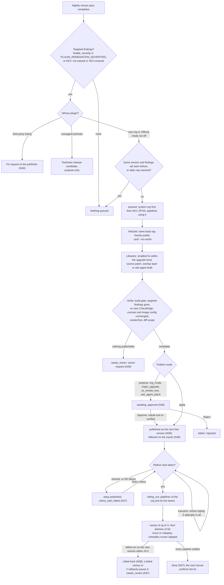
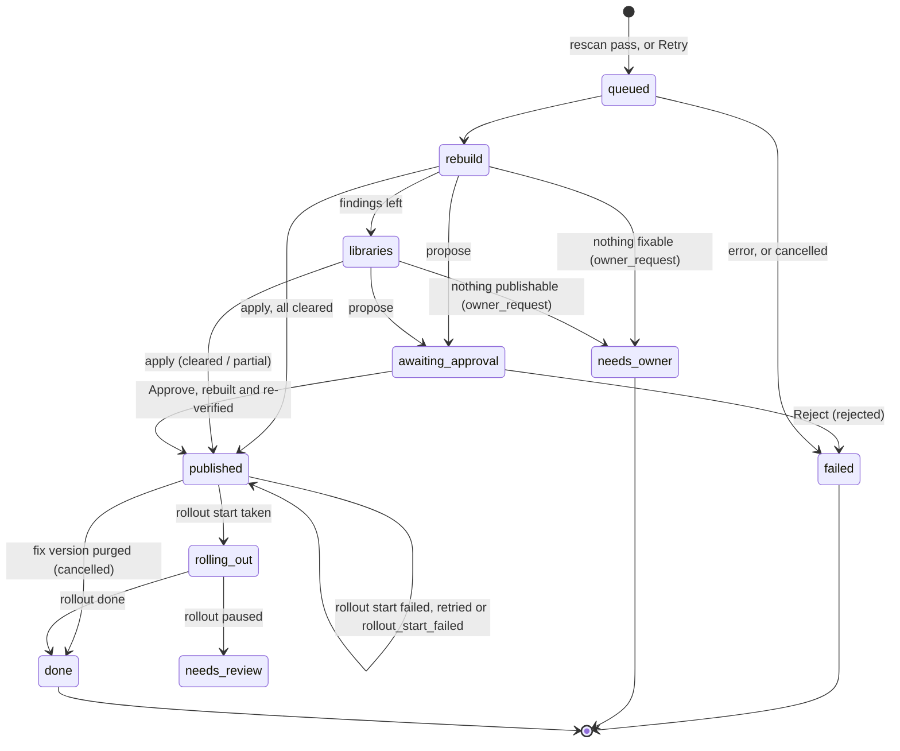

<!--
Copyright 2026 Pipeline Builder Contributors
SPDX-License-Identifier: Apache-2.0
-->

# Plugin Publishing

Putting a plugin in the **plugin ecosystem**: the public, searchable directory every organization on this instance can browse and install from.

## Highlights

- **Only the system organization decides what enters the ecosystem.** You *request*; its Ecosystem Managers approve or reject, by hand or through auto-approval rules.
- **You can always pause your own listing or version immediately**, because that only narrows your own reach.
- **Publishing is separate from sharing inside your org.** The `private` / `org` / `public` visibility ladder never puts anything in the directory.
- **The digest is pinned at request time.** If the image changes underneath, approval fails closed.
- **A team can't own a publisher.** Publishers belong to root organizations.
- **Handle and display-name changes are requests**, not edits, because a new name could impersonate someone.
- **Accepting new publisher terms is required before new requests** — existing listings are unaffected.
- **You can submit without an account**, and claim the listing later.
- **Scan gates apply before anything is listed**, and a listing over its plan's quota can still ship security fixes.
- **Versions with fixable Critical or High findings are fixed automatically where the platform may change them** — rebuilt or library-patched, proposed or published as the next version, and rolled out to pipelines. See [Automatic remediation](#automatic-remediation).
- **Delete plugin removes every version of a name at once**, restorable as one batch. See [Deleting plugins and versions](#deleting-plugins-and-versions).

## Overview

A **listing** is a plugin name published by a publisher, written `@acme/terraform-plan`. This page covers the publisher profile, trust tiers, the request model, scan gates, and the anonymous submission path.

Using listings — installs, version policies and each organization's consumption policy — is covered in [Plugin Installing](plugin-installing.md).

Managing the publisher profile requires `publishers:manage`. Submitting listing and version requests, and pausing, requires `plugins:publish`. Owners and admins hold both.

## How it works

1. **Claim a publisher handle** for your root organization, accepting the current publisher terms.
2. **Build and scan the plugin version** in your own org as usual. Scan gates decide whether it is publishable at all.
3. **Submit a request** — a new listing, a new version, a listing update, a yank, an unpause, a transfer, a claim, a profile change, a Verified application or an advisory.
4. **The digest is pinned into the request.** Approval verifies it still matches, and fails closed if not.
5. **An Ecosystem Manager decides**, or an auto-approval rule does. Some request kinds need two people, and separation of duties stops one person supplying both approvals.
6. **On approval the image is copied into the public namespace**, freshly signed and SBOM-attested, and the listing becomes installable. A large image takes minutes; the request shows as publishing until it finishes, and a transient failure (image-registry unavailable, a timeout) is retried automatically with the approval kept.
7. **You keep unilateral control of reach.** Pausing a listing or a version takes effect immediately without anyone's approval.

## Configuration

1. **Claim your handle** on the **Publisher** page (dashboard → Build → *Publisher*). 2–39 lowercase letters or digits with single hyphens; it names your registry namespace (`public/<handle>/<plugin>`), so choose carefully. See [Your publisher profile](#your-publisher-profile).
2. **Accept the publisher terms.** Re-accept when they change, or new requests are refused.
3. **Check your plan's limits.** The `listings` quota caps active public listings; see [Plans and limits](#plans-and-limits).
4. **Get the version through the scan gates** before submitting — see [Scan gates](#scan-gates).
5. **Decide how metadata is supplied.** The catalog metadata is detected and then accepted or edited; see [Catalog metadata: accept or edit](#catalog-metadata-accept-or-edit).
6. **Submit from the UI, the CLI or a script** — see [Publishing from the CLI](#publishing-from-the-cli).
7. **Apply for Verified** if you are eligible: it needs a Team-or-above plan, a DNS-verified domain and an owner with a second factor. The badge is awarded after review, never bought.

## Your publisher profile

A **publisher** is your organization's public identity. It has a handle (`acme`, shown as `@acme/terraform-plan`), a display name, a description, a homepage and a trust tier. Each root organization has one publisher.

- **Claim a handle** on the **Publisher** page (dashboard → Build → *Publisher*). A handle has 2–39 lowercase letters or digits, with single hyphens between them. It names your registry namespace (`public/<handle>/<plugin>`), so choose it carefully.
- **Reserved handles.** Platform words (`pipeline-builder`, `official`, `community`, `system` and others) can't be claimed. The system org can also reserve names, for example to protect a vendor's brand. If a reserved handle is yours, submit a **claim** request and the system org decides.
- **Publisher terms.** Claiming a handle means accepting the current publisher terms. When the terms change, you must accept them again before you can submit new requests. Your existing listings are unaffected.
- **Teams publish through their root org.** A team can't own a publisher. To publish a team's plugin, move it to the root organization or upload it there.
- **Profile edits.** You can change the description and homepage directly. Changes to the handle or display name are **profile change** requests, because a new name could impersonate someone.

Managing the publisher profile requires `publishers:manage`. Submitting listing and version requests, and pausing, requires `plugins:publish`. Owners and admins hold both.

## Trust tiers

| Tier | Who | How it is earned |
|------|-----|------------------|
| **Official** | The platform's own catalog (the `pipeline-builder` publisher, owned by the system org) | Every listing and version is approved by two Ecosystem Managers, except the one-time initial catalog load and gate-green routine updates from the catalog loader. |
| **Verified** | A publisher on the **Team** or **Enterprise** plan, with a DNS-verified domain and two-factor authentication on every owner, whose application the system org approved | Apply from the Publisher page. The badge is earned through review and can be withdrawn. It is never sold. |
| **Community** | Any signed-in organization, on any plan, within its listings limit | Each listing is approved by the system org. |
| **Unverified** | Anyone, without an account, through [Submitting without an account](#submitting-without-an-account). Listed under the platform's `community` publisher | Every version passes the automated checks and is approved by two Ecosystem Managers. |

The tier travels with every published image as a signed annotation (`pb.trust`), so changing a tier re-signs every image the publisher has published.

## Plans and limits

Two limits apply to a publisher: how many listings you may have, and how many registry bytes your images occupy.

Publishing is available on every plan, within a **listings** limit: the number of live (listed or unmaintained) listings your root organization publishes.

| Plan | Listings | Verified eligibility |
|------|----------|----------------------|
| Developer | 3 | — |
| Pro | 10 | — |
| Team | 25 | Yes |
| Enterprise | 100 | Yes |
| Self-hosted (billing off) | Unlimited | Yes |

- A new-listing request is checked against the limit when you submit it (open new-listing requests count too), and again when it is approved.
- **Downgrades.** If a plan change leaves you over the limit, your listings **stay listed**. New versions and listing updates are refused until you are back under the limit, but the **security-fix lane stays open**, so your users are never stuck on a vulnerable version. You're told once (notice N29).
- **Verified eligibility is checked automatically**, when you apply and again when the system org decides. All three must hold, or the application is refused with the reason:
  - the plan includes Verified publishing (`VERIFIED_PLAN_REQUIRED`);
  - your root organization has at least one **DNS-verified domain** (Settings → Email domains); a domain you name in the application must be one of them (`VERIFIED_DOMAIN_REQUIRED`);
  - **every owner** of the organization has a passkey or an authenticator app (`VERIFIED_OWNER_MFA_REQUIRED`).

  If the checks can't be run at that moment the application is refused as unavailable (503); try again shortly.
- **Verified below Team.** If your plan drops below Team, your Verified badge stays for a **30-day grace period** (notice N29, with reminders at 14 and 3 days left). If the plan still doesn't include Verified publishing when the grace period ends, the tier returns to Community and every image is re-signed.

### Registry storage, which a publisher spends

Your listings' images count against your organization's **registry storage** quota (2 GB on Developer up to 250 GB on Enterprise; see [Registry storage](quotas.md#registry-storage) for the full ladder and how the figure is calculated). Three things matter specifically to a publisher:

- **Publishing does not double your bytes.** The public repository references the same image layers your private copy does, so a layer shared by both is stored and counted once.
- **A published version keeps costing you after you delete your private copy.** The public repository still references those layers, so retiring the private version frees nothing. To stop paying for a publication's bytes you have to **unlist or withdraw it**, which is a different action in a different place.
- **Running out stops new pushes, not your users.** At the cap, image pushes are refused while every published image stays pullable and installable — so your listings keep working, but you cannot ship a new version until you free space or add a Storage Pack. Because the limit never resets on its own, this is the one quota where waiting does not fix anything.

Combined with the downgrade rule above: a plan change that would leave you over either limit is handled rather than silently breaking you — listings stay listed, and a Storage Pack cancellation that would strand you over the storage cap is refused outright.

## Scan gates

Every plugin image is scanned for vulnerabilities when it's built: an SBOM is made with syft and scanned with grype. This applies to every build, not just published ones: uploads, prebuilt images, AI-generated plugins, bulk uploads and the catalog loader. Anonymous submissions go through the same gate.

**Fixable findings.** A finding is **fixable** when the scanner knows a version of the affected package that fixes it. The gates count **fixable Critical** findings, because a Critical with no fix yet can't be resolved by rebuilding. Plugin views show both numbers for Critical and High, for example **2 fixable / 5 Critical**.

**Known-exploited findings block even without a fix.** A Critical that CISA lists as **known exploited** (the KEV catalog, which grype reports per finding alongside its EPSS score) counts against the floor whether or not a fix exists (`PLUGIN_VULN_GATE_KEV`, on by default). "There is nothing to upgrade to" is a reason not to ship an image whose vulnerability is being exploited, not a reason to ship it. The failure message says which findings are KEV-listed.

**What the scan cannot see.** syft identifies packages from package-manager metadata and from build information inside binaries. Some executables carry neither — UPX-packed or stripped Go, Haskell tools such as hadolint and shellcheck, GraalVM native images, Node single-executable bundles, vendored browsers — so their vulnerabilities are invisible to the count. The build lists every executable no SBOM package accounts for as a warning on the build stream and in the version's scan summary (`uncataloguedBinaries`), and exports the count as `plugin_uncatalogued_binaries{plugin}`. It never fails a build: those findings are unknown, not known-bad.

**Operator VEX.** An operator can record that a finding does not apply (an OpenVEX `not_affected` statement) by mounting OpenVEX documents and pointing `PLUGIN_VULN_VEX_DIR` at them; every build scan and rescan passes them to grype.

**The scan summary.** Every scanned version stores its latest scan's summary: every Critical and High finding (fixable or not, up to 500, with a `truncated` flag), the counts at every severity, KEV and EPSS where known, which findings a waiver exempted, the image digest, when the vulnerability DB it matched against was built, and the binaries it could not see into. The build writes the first one; every rescan replaces it.

**A build that can't be scanned fails.** If the scan can't run, the build is retried like any other transient failure. After the last attempt it fails with `IMAGE_SCAN_UNAVAILABLE`: nothing is stored and the plugin quota the upload reserved is released. Build it again once the scanner is back.

The operator can let such builds through with `PLUGIN_ALLOW_UNSCANNED=true`. The version is then stored without a scan, shows an **Unscanned** badge, and the skip is audited (`plugin.scan.skipped`).


**A scoped exemption, when a package genuinely cannot be fixed.** Some images cannot reach zero fixable Criticals however current they are. A browser-bundling test runner is the clear case: `playwright` downloads Firefox pinned to the upstream release, and browsers ship CVE fixes weekly while pinned builds lag by design. (Check first that the browser is needed at all: `artillery` once carried the same exemption for a Chromium its HTTP load tests never used, and now simply skips the download.) Raising `PLUGIN_VULN_MAX_FINDINGS` would exempt *every* plugin from *every* Critical, which is not a trade worth making for one package.

`PLUGIN_VULN_WAIVERS` exempts named packages or advisories for one plugin — or one advisory across every plugin — until a date:

```
PLUGIN_VULN_WAIVERS=playwright:2026-12-31:firefox;*:2026-12-31:GO-2026-6612
```

Entries are `;`-separated; each is `<plugin>[@<version>]:<YYYY-MM-DD>:<target>[,<target>…]`, where a target is a package name (`chromium`) or an advisory id (`GO-2026-6612`, `CVE-…`, `GHSA-…`). Pin the version where you can: a waiver is a judgement about a *specific* image, and left unpinned it carries silently to every future version, including ones whose findings nobody has looked at. These properties are enforced, not merely intended:

- **Fleet-wide `*` takes advisory ids only** — for one advisory that every bundler of a toolchain inherits (a Go stdlib CVE reaches every prebuilt Go binary at once). `*:…:stdlib` is rejected at boot: it would waive every present and future stdlib Critical in every plugin, including ones a rebuild could clear. `*` cannot carry `@<version>`; the system-org bound and the expiry still apply.

- **Scoped** — to one plugin, to named packages, *and* to the system org. A new Critical in any other package still fails the gate, so a waiver cannot grow into "this plugin is exempt". The org bound is load-bearing: plugin names are unique per `(name, version, orgId)` and **not** globally, so without it any tenant could inherit an exemption simply by naming their plugin `playwright`. Waivers cover the Official catalog the operator curates; an organization's own plugin of the same name is unaffected, and so is an organization's stricter compliance rule, which is evaluated after the floor on the raw scan.
- **Expiring** — the entry stops applying after its date, with no action from anyone. The plugin starts failing again, which is the point: a waiver nobody revisits would otherwise be permanent.
- **Visible** — an applied waiver is written to the **audit log** as `plugin.vuln.waived` (the hash-chained record, not just a metric that resets) — at build, and by a rescan when it newly covers a finding — reported on the build stream, logged, counted per advisory by `plugin_vuln_waived_total{plugin,advisory,trigger}`, and shown in the UI both on a blocked build and on a version that passed under one. Malformed entries are logged at boot and counted by `plugin_vuln_waivers_invalid`; remaining lifetime is published per entry as `plugin_vuln_waiver_days_remaining{plugin,targets}`, with `PluginVulnWaiverInvalid` and `PluginVulnWaiverExpiringSoon` alerting on both. An active entry that exempted nothing in the last rescan is reported as `plugin_vuln_waiver_unmatched{plugin,targets}` (`PluginVulnWaiverUnmatched`) — it is no longer needed, or its target is misspelled.
- **Never by package name for a known-exploited Critical** — `playwright:…:firefox` covers Firefox's ordinary churn, not a Firefox CVE CISA lists as exploited. Exempting a KEV-listed finding takes its advisory id.

A malformed entry is **dropped, never treated as a wildcard** — the failure mode of a typo is "the gate still blocks", not "everything is waived". An entry with no package list is malformed for exactly this reason, so it cannot mean "waive this plugin". The nightly rescan applies the same waivers, so it will not flag a version the build gate passed.

The waiver changes what the floor counts; it does not hide the finding. The scan still records it, and it still appears in the version's findings.

**The platform floor.** A version with more fixable (or known-exploited) findings at or above `PLUGIN_VULN_FAIL_ON` (default Critical) than `PLUGIN_VULN_MAX_FINDINGS` fails its build with `PLUGIN_VULN_GATE` (default `0`, so any fixable Critical fails; `-1` turns the floor off). The build's failure message lists the top findings and the versions that fix them. Upgrade those packages, or the base image, and build again. Your organization's compliance rules can be stricter than the floor, but not looser. `PLUGIN_VULN_FAIL_ON` (default `critical`) sets which severity counts: `high` gates fixable High findings alongside Criticals.

**A refused image does not stay signed.** The image is pushed and signed before the gates run (they scan its signed SBOM). When the floor, a terminal scan failure or a compliance rule then refuses the build, the plugin service asks image-registry to delete the image and its signature again, so a refused build does not leave a validly signed image behind. It keeps the image only when an already stored version references the same digest — an identical rebuild of a version that passed. A failed removal never changes the build's outcome; it is counted (`plugin_refused_image_discards_total{outcome}`) and alerted on (`PluginRefusedImageDiscardFailing`).

**The one exception: the setup catalog load.** The Official catalog is loaded once, at install, by `deploy/bin/load-plugins.sh`, whose uploads carry `setupLoad=true`. A Critical published the week before an install would otherwise leave that plugin missing until someone rebuilt it, so a refused image from that load is **kept** — signed, in the registry — instead of removed. Nothing is stored as a version and the refusal stands (the build fails as usual, its stream says the image was kept, the `plugin.build.failed` record carries `details.refusedImage: kept_setup_load`, and the counter's `outcome` is `kept_setup_load`). The marker is honoured for a **system-org** build only; any other organization that sends it gets the normal removal.

A kept image waits for one of two things:

1. **Fix or waive, then promote.** Once the reason is gone — the advisory fixed upstream, a `PLUGIN_VULN_WAIVERS` advisory-id entry added for that plugin version, or an operator VEX statement — a system-org Ecosystem Manager (`plugins:moderate`, MFA session) promotes it. Promotion re-verifies the signature and the signed SBOM, refuses a vulnerability DB older than `PLUGIN_VULN_DB_MAX_AGE_HOURS`, re-runs the floor with the **current** waivers, VEX and KEV rules and the post-build compliance rules, and — if it passes — stores the version exactly as a passing build would (its `scan_summary` says `trigger: promote`; the upload's publish request is submitted). Still refused: `409` with the findings, and the image stays kept. A version of that name and version that already exists: `409`. Audited as `plugin.setup_image.promoted` / `plugin.setup_image.promote_refused`.

   ```bash
   # list what the setup load kept (system org)
   curl -s -H "Authorization: Bearer $TOKEN" https://$HOST/api/plugins/kept-setup-images | jq '.data.images[] | {id, pluginName, pluginVersion, refusalCode, expiresAt}'
   # after the fix or the waiver is in place
   curl -s -X POST -H "Authorization: Bearer $TOKEN" https://$HOST/api/plugins/kept-setup-images/$ID/promote
   ```

2. **Expiry.** After `PLUGIN_KEPT_SETUP_IMAGE_TTL_DAYS` (default 30) the rescan scheduler's hourly tick removes the image and its record. A later build of the same name and version that passes removes it too. Outcomes are counted on `plugin_kept_setup_image_sweep_total{reason,outcome}`, the number still kept is `plugin_kept_setup_images`, and a removal that fails is alerted on (`PluginKeptSetupImageSweepFailing`).

**Nightly rescans.** Stored versions are rescanned every night against the latest vulnerability data — inactive versions too, since pipelines already built against one keep running its pinned image. This includes every listed version, which is rescanned from its own public image even if the organization that built it has since deleted the plugin. When a rescan finds more fixable (or known-exploited) Critical findings than the floor allows, the version is **flagged**: plugin views show **Flagged by rescan** with the top findings and their fixed versions, and pipelines that resolve it get a `VULN_FLAGGED` warning (see [Plugin Installing](plugin-installing.md#vulnerability-scans-and-rescans)). The flag clears on the first rescan that finds the findings resolved. Both transitions are audited (`plugin.vuln.flagged`, `plugin.vuln.cleared`). To clear it yourself, rebuild the plugin on patched packages, or publish a new version.

A rescan is only as current as its vulnerability DB. When the DB is older than `PLUGIN_VULN_DB_MAX_AGE_HOURS` (default 36) the rescan **does not run** — it will not stamp a fresh scan date on stale data — whether the plugin service refreshes the DB itself or an operator job does (`PluginVulnDbStale`). A build on an old DB still runs, and its stream says how old the DB was.

"New" findings are new **advisories**, not bigger counts: the rescan compares each finding (advisory, package, version) with the previous scan summary, so one CVE fixed and a different one published in the same night is still reported. A version with no previous summary (scanned before summaries were recorded) has nothing to compare against: its first rescan only records the baseline and reports nothing — unless that rescan newly flags the version, in which case the flag's findings are reported.

Each rescan also refreshes the vulnerability exposures of every pipeline that declares or runs the rescanned image — opened or updated when it has fixable Critical/High findings, closed as fixed when it came back clean — and N31 names those pipelines. New findings in a listed version, yanked ones included, also open a private advisory draft for the moderators (N20).

**Who is told.** A blocked build (notice N30) is always reported right away. New Critical or High findings from a rescan (notice N31) follow your organization's settings; for a listed version they go to every organization that installed it — a yanked version too, until its image is collected, since installs pinned to it still run it. Admins set both under **Settings → Organization → Pipelines → Plugin security notifications**: who receives them (the uploader and everyone who can write plugins, or chosen members), whether rescan findings are sent and as a daily or weekly digest, an optional signed webhook, and one external address. The external address gets nothing until its owner opens the confirmation link and presses **Confirm address**. **Send test** sends a test notice to every configured channel.

### Automatic remediation

After each completed nightly rescan, the platform tries to produce a **fixed version** of every rescanned plugin version it is allowed to change that has a targeted finding, prove it is clean and still works, and move pipelines onto it. The version doesn't have to be flagged: under the default floor a fixable High never flags a version, but it is still targeted. A fixable Critical or High CVE is then closed without anyone rebuilding by hand. Deleted and yanked versions are never remediated.



An Official fix (system org) is the exception at the rollout start: it is published to tenants as a new listing version, and that listing publish starts its rollout, across every organization's listing installs.

**What is targeted.** Fixable findings whose severity is in `PLUGIN_REMEDIATION_SEVERITIES` (default `critical,high`), plus every CISA **known-exploited** (KEV) finding whatever the list says. A KEV finding with no fixed version can't be fixed, so it goes straight to the owner request (reason `no_fix`). A finding the scanner reported without package details — no package URL, or no file location in the image (a CPE-only match, for one) — still counts toward the gates and the flag, and the scan succeeds; it is listed under `<type>:<name>@<version>` and goes straight to the owner request (reason `no_package_details`), never patched. Findings a waiver or an operator VEX statement already covers are skipped, and remediation never adds a waiver. All of a version's fixable findings from one night go into **one** remediation and one new version, never one version per CVE. Remediations run after users' own builds in the queue: the system org's (the Official catalog) first, then KEV first, then by EPSS, then by how many pipelines use the version.

**The stages.** A remediation is one record per version and set of targeted findings, moving through fixed stages:

1. **Rebuild** (`rebuild`). The version's kept build context is rebuilt on a freshly pulled base image of the **same tag** (a digest-pinned `FROM` is re-resolved within its tag, never to a new tag) with `--pull --no-cache`, which clears most OS-package CVEs without touching the plugin's own files. A targeted finding in a layer of a shared platform base (`plugin-base` and the other `plugin-*-base` images, built from `_plugin-base` and the other `_*-base` directories) rebuilds that base **once** per base and findings set: the first remediation that needs it builds an overlay of the current base tag upgrading the named OS packages, checks it with the base's own smoke test and pushes it to the system namespace, under `PLUGIN_REMEDIATION_BASE_CONCURRENCY` slots of its own. The other remediations on that base wait for it and build FROM it. If the base rebuild fails, they build without it.
2. **Libraries** (`libraries`). For each targeted finding the rebuild didn't clear, the named library is upgraded to the smallest fixed version — the highest of the lowest fixed versions across its CVEs, so one upgrade clears them all — within the allowed [upgrade level](#upgrade-levels). A **source patch** edits the manifest or lockfile in the kept context (a pin in `apt-get`/`apk add`/`dnf install`, an npm `overrides` entry, a `requirements*.txt` pin, `go get`, a Maven/Gradle override, `bundle update --conservative`, `cargo update --precise`, a `PackageReference`, or a recognised pinned tool `ARG`). An **overlay layer** is one `RUN` on top of the current image digest that upgrades the named packages in place (deb, apk, rpm, npm, python and gem only), with labels, user, entrypoint and working directory unchanged. Libraries compiled into a binary (Go, Rust, .NET, fat JARs) can only be fixed from source. When no patcher fits, the ask agent may draft a patch; it is verified the same way and only ever proposed.
3. **Verify.** The fix goes through the full build gate, waivers, VEX, the plugin contract check and compliance, exactly as any build. Every targeted finding must be gone, no new Critical or High may appear, the image's user, entrypoint, `CMD` and working directory must be unchanged, so must the plugin contract (commands, install commands, required metadata and variables and their types, secrets, env), the spec's `smokeTest` must pass, and the diff may touch only the named packages' lines or the single overlay layer. A patch that fails is dropped; when several packages were patched, each is retried alone so the ones that work are kept.
4. **Publish** (`published`, or `awaiting_approval` in propose mode). The fix is stored as the **next free version** of the plugin: the next patch (`1.4.3`, or `1.4.4` if `1.4.3` is taken — also when it was published as `v1.4.3` or `1.4.3+build.7`, since a leading `v` and build metadata don't make a different version; a prerelease such as `1.4.3-rc.1` doesn't reserve `1.4.3`), or the next minor when a library crossed a major (so installs on a patch policy don't pick it up silently). It never crosses the plugin's own major. Each fix is a new immutable version with its provenance: the version it fixes, the patch diff, and the CVEs cleared. An overlay-only fix's diff shows just the overlay, as a new `remediation-overlay/Dockerfile` (after any change the rebuild made to the kept context), never the rest of the context as deleted. The flagged version is never changed or deleted by remediation. Once its fix is published and no pipeline references it any more, it is **deactivated**, unless it is the plugin's only remaining version. It stays stored, flagged and restorable, with its kept source.
5. **Rollout** (`rolling_out`, then `done`, or `needs_review` if it pauses). Pipelines move onto the fix — see [Remediation upgrades](plugin-installing.md#remediation-upgrades). If the pipeline service can't take the rollout when the fix is published, the fix stays `published`:
   - a **temporary** failure (the pipeline service unreachable, a 5xx, 408 or 429, or an answer that can't be read) is retried by the nightly pass once the fix has sat for 15 minutes — at most **5 attempts in all**, the one at publish included;
   - a **refusal** (any other 4xx) is not retried.

   When it gives up (a refusal, or the 5th failed attempt) the remediation keeps stage `published` with error `rollout_start_failed`, its card reads **"Rollout didn't start: …"** with the reason, your plugin security recipients get N37 ("Rollout paused"), and `plugin_remediation_rollout_start_failures_total{reason="permanent"|"exhausted"}` alerts the operator. The fix version is live either way, so owners can still choose it. **Retry** on the card (`plugins:write`, step-up) starts the same rollout again, counting attempts from 1; nothing is rebuilt and it doesn't count toward the daily limit. Starting a rollout twice is harmless.

   A published fix whose fix version is purged before its rollout started ends `done` / `cancelled` (error `FIX_VERSION_PURGED`) on the next nightly pass.
6. **Owner request** (`needs_owner`). Whatever is left — no fixed version, beyond the upgrade level, a Go module's new major, a library inside a compiled binary, no kept source, no patcher, no package details from the scanner, a patch that broke the plugin — is sent to the plugin's security recipients (N39), listing each package, CVE, fixed version, the reason and the level it would need. The version stays flagged. A fix published with findings left is outcome `partial`, and the owner request is still sent.

The next rescan of the fix must be clean for the targeted findings, and the old version's exposures close as pipelines move.

**Idempotent per findings set.** A version already being remediated isn't queued again, and a set of findings that failed isn't retried until the findings change or the vulnerability DB adds a fixed version. **The owner's own fix wins**: when the owner uploads a newer version with no gated findings while a remediation runs, the remediation ends (outcome `superseded`) and the rollout uses the owner's version instead. Deleting a version cancels any remediation on it.

**Stages and outcomes.** The record's `stage` and, once it has one, its `outcome`:



Not drawn, because they apply from several stages:

- **Any live stage** (queued to needs review) ends `done` / `superseded` when the owner uploads a newer clean version, and `failed` / `cancelled` when the version (or the fix version) is deleted.
- **Before publishing** (queued, rebuild, libraries, or an approved fix awaiting its run), a remediation ends `failed` with outcome `error` (a build or infrastructure error, `SOURCE_CHECKSUM_MISMATCH`, `VERSION_NOT_SEMVER`, `ENQUEUE_FAILED`, `STRANDED`) or `cancelled` (`VERSION_DELETED`, `MODE_OFF`, `REMEDIATION_DISABLED`). An approved run that no longer produces a fix ends `needs_owner`.
- **Retry** never reopens a record: it starts a new attempt (`attempt` + 1, `retryOf` the old id) from `failed`, `needs_owner` or `needs_review`. A `needs_review` record it replaces closes as `done` / `superseded`. The one exception is a `published` fix with `rollout_start_failed`, whose rollout start is retried in place.
- A **canary fixture** (see [Deploy Operations](deploy-operations.md#plugin-remediation-alerts)) is a dry run: it ends `done` (`cleared` or `partial`) or `needs_owner`, and is never published.

`needs_owner`, `done` and `failed` are terminal. `needs_review` is not: its fix version stays published and choosable, and **Retry** starts a new attempt.

#### Upgrade levels

`libraryUpgradeLevel` (an organization setting) sets how far a library may move from its installed version:

| Level | Allowed | Installed 2.3.1 → |
|-------|---------|-------------------|
| `patch` | Same major and minor | 2.3.4, not 2.4.0 |
| `minor` (default) | Same major | 2.4.0, not 3.0.0 |
| `major` | Any version | 3.0.0 |

The organization can set a level **per package type**, and a plugin can set **its own** (for example `patch` for a fragile plugin; **Follow organization** by default, `PUT /api/plugins/by-name/:name/remediation-level`). The **strictest** applicable level wins. How a move is classed:

- **OS packages** (deb, apk, rpm): the level applies to the upstream version. A distro revision of the same upstream (`1.1.1n-0+deb11u5` → `1.1.1n-0+deb11u6`) is a patch; an epoch change is a major.
- **0.x packages**: a minor bump counts as major, following semver.
- **Go modules**: a new major is a different module path (`/v2`), so it always goes to the owner, whatever the level.
- **Python**: an epoch change (`1!2.0`) is a major; otherwise the release numbers decide.
- **Non-semver versions** (dates, four-part numbers) are read from their first three numeric parts; a version that can't be parsed counts as major.

Versions are ordered by each ecosystem's own rules, both to pick the fix version and to tell whether a candidate is an upgrade at all:

| Package type | Ordering | For example |
|--------------|----------|-------------|
| deb, apk, rpm | dpkg: epoch, then upstream, then revision; `~` sorts lowest | `1.0~rc1` < `1.0` < `1.0-1` < `1:0.1` |
| python | PEP 440: epochs, dev < pre (`a` < `b` < `rc`) < final < post releases, local versions after their public one, trailing zeros ignored | `1.0.dev0` < `1.0rc1` < `1.0` = `1.0.0` < `1.0+local` < `1.0.post1` |
| java-archive | Maven `ComparableVersion`: `alpha` < `beta` < `milestone` < `rc` (= `cr`) < `snapshot` < release (= `ga`, `final`) < `sp`; trailing zeros are padding; a qualifier after `.` reads as `-` (`1.x` = `1-x`, Maven 3.9) | `1.0-rc1` < `1.0-SNAPSHOT` < `1.0` = `1.0.0` < `1.0-sp1` |
| gem | RubyGems: a letter segment is a prerelease and sorts below any number | `1.0.0.rc1` < `1.0.0` = `1.0` |
| dotnet | NuGet: up to four numbers, prerelease below release, labels compared case-insensitively (a numeric label is a number only within int32, as `Int32.TryParse` reads it; a longer one compares as text), build metadata ignored | `1.0.0-beta.2` < `1.0.0-Beta.11` < `1.0.0` < `1.0.0.1` |
| npm, rust-crate, go-module, others | SemVer (a leading `v` allowed), else the dpkg order of the strings | `1.0.0-alpha` < `1.0.0` |

A fix that needs a bigger jump than allowed goes to the owner request, naming the level it would need.

#### Propose or apply

`mode` (an organization setting) is `off` (build nothing), `propose` (the default) or `apply`.

- In **propose** mode a fix waits as **Awaiting approval** on the plugin's remediation card, with the cleared and remaining findings, the patch diff and why it was held (`proposeReasons`: `org_mode`, `major_upgrade`, `no_smoke_test`, `ask_agent_patch`). Your plugin security recipients get N36. The candidate image is not kept: **Approve and publish** queues the fix to be rebuilt and verified again from the kept source, and publishes that build (or, if it no longer produces a fix, sends the owner request). **Approve and publish** and **Reject** need `plugins:write` and a step-up. **Reject** takes an optional reason (up to 1,000 characters), which is kept with the decision and on its `plugin.remediation.rejected` audit entry. While Approve, Reject or Retry runs, the card disables all three.
- When a fix is published, its patch diff (and, for an Official fix, the export for `deploy/plugins`) is stored under the **fix version's** kept-source prefix, and the remediation's download links point there. Purging the old version therefore leaves them downloadable: the remediation record of a published fix outlives the version it fixed. It still lists under the old version's name and number, with its diff, but it no longer links to that version, and approve and retry answer `409 REMEDIATION_STAGE_CONFLICT` (reason `source_version_purged`), since there is nothing left to rebuild. See [What a purge removes](#deleting-plugins-and-versions).
- In **apply** mode it publishes without waiting — except that some fixes are **always proposed**: a library upgrade that crosses a major, a plugin whose spec declares no `smokeTest`, and an ask-agent patch.

**Declare a `smokeTest`** (see the plugin spec reference) if you want your plugin's fixes to publish automatically: without one, the platform can't show the rebuilt plugin still works, so it only ever proposes.

Admins set the mode, the upgrade level with its per-type overrides, and the pipeline rollout under **Settings → Organization → Pipelines → Plugin security** (`PUT /api/plugins/remediation-settings`, `org_settings:write`). Every remediation in the organization is listed on **Plugins → Remediations** (`GET /api/plugins/remediations`), filterable by stage. **Retry** (`plugins:write`) re-runs a failed, needs-owner or needs-review remediation as a new attempt; on a published fix whose rollout didn't start (`rollout_start_failed`) it starts that rollout again instead.

#### Kept build sources

To rebuild a version later, its build context ZIP is kept: when a build is stored as a version, its upload is copied to the `plugin-sources` bucket (encrypted, no expiry) before the staging copy is deleted, under `<orgId>/<pluginId>/<version>/`. The SHA-256 is checked before every rebuild, and a mismatch fails the remediation closed. Kept sources count toward your storage quota and are removed when the version is purged. No route ever returns a source ZIP.

A **prebuilt-image upload has no source**, so it can only be fixed with an overlay layer; libraries compiled into it go to the owner. A source lost in a restore makes the version source-less in the same way, and alerts the operator.

#### Who may be remediated

| Plugin | Automatic fix | Otherwise |
|--------|---------------|-----------|
| Your organization's own plugin | Yes, under your `mode` | |
| The Official catalog (system org) | Yes, under the system org's setting. The fix reaches tenants as a new listing version through an auto-approved publish request (the **Remediation fixes** rule), and the patch is exported for `deploy/plugins/**` so maintainers can merge it (`GET /api/plugins/remediations/:id/export`, system org) | |
| A listed third-party plugin | No | A fix request goes to the publisher (N40) with the findings and their fixed versions, once per version and findings set; installers are told it was sent. An owner-less (community) publisher gets none |
| An install of a listing | No — the listing is the publisher's | Installers move once the publisher ships a fixed version |
| A managed toolchain release (`pipeline-bootstrap` + `cdk-synth`) | A verified **release candidate** only, never published without a system-org approval — see [Remediation → toolchains](#remediation--toolchains) | `PLUGIN_REMEDIATION_TOOLCHAINS=off`: the owner request (N39) |

A fixed version of your own plugin that you also list reaches listing installers only through a normal new-version publish request.

#### Remediation → toolchains

A managed toolchain release is two system-org images under one version — `pipeline-bootstrap` (the CodeBuild image carrying pipeline-manager, the AWS CDK, cdk-assets and Node) and `cdk-synth`, built FROM it — and every org's synth runs on it. So the nightly fix of a toolchain is **propose-only**, verified more strictly than a plugin fix, and never moves anyone.

1. **Queued.** When the rescan flags a release with targeted findings (the same `PLUGIN_REMEDIATION_SEVERITIES` and KEV rules) and `PLUGIN_REMEDIATION_TOOLCHAINS` is `propose` (the default), **one** remediation is queued for the release — both halves' findings, on its `pipeline-bootstrap` row — instead of the owner request. With `off` the release gets the owner request (reason `no_patcher`, `MANAGED_TOOLCHAIN`) as before. The system org's own `mode: off` and the daily cap still apply.
2. **Candidate build.** The release's kept build inputs (each half's `Dockerfile` and `plugin-spec.yaml`, kept by the plugin service when the release is uploaded — `load-plugins.sh` puts the Dockerfile in a managed half's ZIP) are rebuilt with the engine's **Rebuild** and **Libraries** stages: the bootstrap first, its digest-pinned `ARG NODE_IMAGE` re-resolved within its tag (never a new Node version), then `cdk-synth` FROM the candidate bootstrap by digest (`BOOTSTRAP_IMAGE`). Library upgrades are capped at **patch** whatever the organization's upgrade levels say. A half with nothing targeted keeps its image; `cdk-synth` is always rebuilt when the bootstrap is. A release uploaded before inputs were kept goes to the owner (`TOOLCHAIN_INPUTS_MISSING`).
3. **Verification.** Both candidates must pass the build gate with **every** targeted finding gone (no partial fix) and no new Critical or High; the exact tool versions — `pipeline-manager`, `aws-cdk`, `cdk-assets`, `node` — must equal the release's, read from the images' `org.pipeline-builder.toolchain.*` labels and from the patched bootstrap Dockerfile's `ARG`s; each half's `plugin-spec.yaml` must be unchanged; the fix must be reproducible from the spec patch (a rebuild or a source patch, never an overlay layer or an ask-agent draft); and a real **`cdk synth`** of a fixture app must succeed inside both images (`--network=none`). Any failure discards the candidates and sends the owner request, naming the check (`TOOL_VERSION_CHANGED`, `SYNTH_SMOKE_FAILED`, …).
4. **Release candidate.** A verified pair is recorded on the remediation (`awaiting_approval`): both digests, the next free patch release, and the spec change `deploy/bin/sync-image-tags.sh --toolchain-only` would make — the base digest, the bumped `version` in both specs, the recomputed `sourceDigest`, the `toolchain` block and cdk-synth's `BOOTSTRAP_IMAGE` default — stored as a patch rooted at `deploy/toolchain/`. **It is never published automatically**, whatever the system org's `mode` (even `apply`).
5. **Decision.** The **Toolchain fixes** card in the Toolchain console (**Platform → Toolchain**, Releases tab) lists each candidate with the findings it clears and its version diff. **Approve** and **Reject** need the system org, `plugins:write` and a step-up (`POST /api/plugins/toolchain-fixes/:id/approve|reject`, audited `toolchain.fix.*`). Approval re-scans both digests through the build gate, then publishes the release through the normal toolchain release path — both halves stored as system-org versions, so it is listed in the console and offered as an organization default — and sends N34 to the organizations whose default is (or whose pipelines pin) the vulnerable release, naming the fix. **Nobody is moved**: each organization switches through its own toolchain default, and promoting it to the platform default stays the console's separate, guarded step. Reject discards the candidate images. A newer release uploaded the normal way supersedes a waiting candidate.
6. **Export.** **Export spec patch** (`GET /api/plugins/toolchain-fixes/:id/export`) downloads the patch for the release workflow: apply it to `deploy/toolchain/`, review, and commit, so the repository's next sync starts from the released version. The platform that approved it already holds that version; do not rebuild it there (`build-plugin-images.sh` refuses to re-push a published version with different bits).

**An interrupted publish resumes; it never publishes twice.** Approval is recorded first — who and when, and each step's progress (bootstrap stored, cdk-synth stored, build inputs kept, notice sent) — and each step checks whether it already happened: a half already stored under the release number with the candidate's digest is reused, never stored again or renumbered. If the publish stops part-way, the card shows **Resume publish** (the same `POST …/approve`, step-up, audited `toolchain.fix.approved` with `resumed: true`), and a publish that crashed without releasing its five-minute lease is resumed automatically within ~2 minutes of the lease passing (`TOOLCHAIN_FIX_RESUME_INTERVAL_MS`; the nightly pass is a backstop). Two approvals at once can't both run: the second gets `409 REMEDIATION_STAGE_CONFLICT` (`PUBLISH_IN_PROGRESS`). Once publishing has started the candidate can no longer be rejected (`PUBLISH_STARTED`); a build-gate refusal before anything was stored returns it to undecided. Each publish attempt holds a five-minute lease that it renews after every step, including each build-gate re-scan, and an attempt that lost its lease to a resume stops (`LEASE_LOST`) without touching the new holder's lease or progress. After **3** build-gate refusals of its publish the candidate moves to **Needs review** (error `GATE_REFUSED`) and `toolchain_fix_failures_total{stage="gate_refused"}` is counted, which raises `ToolchainFixFailing`.

#### Limits and operator controls

- Remediation builds spend **no build credits** and don't count toward the plugin-count quota, but run under your build quota, after user builds in the queue, at most `PLUGIN_REMEDIATION_CONCURRENCY` at a time.
- At most `PLUGIN_REMEDIATION_MAX_PER_ORG_PER_DAY` (default 20) remediations start per organization in any 24 hours, retries included (`429 QUOTA_EXCEEDED` on a retry over it). The count and the new row are written under one per-organization lock, so retries at the same moment (or a retry during the nightly pass) never go over it together. The quotas page shows today's count.
- **Retry** (`POST /api/plugins/remediations/:id/retry`) needs `plugins:write` and a step-up, like Approve and Reject.
- With the operator knob off (`PLUGIN_REMEDIATION_ENABLED=false`), Approve, Retry and a toolchain fix's Approve / Resume publish answer `503`, and no stuck toolchain publish is resumed. A remediation job that was already queued ends `failed` / `cancelled` (`REMEDIATION_DISABLED`) when it runs, so it can be retried later. With your organization's own **mode** set to `off`, Approve and Retry answer `409 PLUGIN_REMEDIATION_MODE_OFF`; Reject still works.
- **Stranded remediations.** A remediation that sits queued, building, or approved and waiting for its run for more than 3 hours with no job in the queue (a lost enqueue, a crashed worker) is put back on the queue by the nightly pass, up to 3 times (its error reads `STRANDED_REQUEUE:<n>` meanwhile); after that it ends `failed` with error `STRANDED`, and **Retry** starts it again.
- `PLUGIN_REMEDIATION_ENABLED` (default `true`) is the operator's switch. Only the literal `false` turns it off; then nothing is queued, built, published or rolled out and no remediation notice is sent, and the dashboard says remediation is **turned off by the operator**. Organization settings stay editable, and kept sources and plugin deletion are unaffected.
- `PLUGIN_REMEDIATION_SEVERITIES` (default `critical,high`) is the comma-separated list of severities targeted. An empty or invalid value falls back to the default with a warning in the log. KEV findings are always targeted.
- `PLUGIN_REMEDIATION_TOOLCHAINS` (default `propose`) chooses between a toolchain release candidate and the owner request for a flagged managed toolchain release; `off` keeps the owner request. There is no `apply`: an invalid value falls back to `propose` with a warning.

See [Environment Variables](environment-variables.md) for every remediation setting. Every stage is audited (`plugin.remediation.*`).

## Requests

Every change to the ecosystem is a request. Open requests show on the Publisher page's **Requests** tab, where you can withdraw them.

| Request | What it asks for | Permission |
|---------|------------------|------------|
| New listing | List one of your plugin versions under a new name | `plugins:publish` |
| New version | Publish another version of an existing listing | `plugins:publish` |
| Listing update | Change the listing's summary, description, category, keywords, license, links, icon or README | `plugins:publish` |
| Yank | Stop a listed version resolving for new pipeline synths | `plugins:publish` |
| Unpause | Lift a pause you applied | `plugins:publish` |
| Transfer | Move a listing to another publisher (the receiving publisher must accept first) | `publishers:manage` |
| Claim | Take a reserved handle, or a listing under the platform's `community` publisher | `publishers:manage` |
| Profile change | Change your handle or display name | `publishers:manage` |
| Verified | Apply for the Verified badge (Team, Business and Enterprise) | `publishers:manage` |

You can have at most one open request of each kind for the same listing and version.

### What a version request needs

A new-listing or new-version request is refused, with the list of failing checks, unless the version:

- has **public** visibility;
- declares an **SPDX license**;
- ships a **README**;
- if it produces an image, is **signed** (it has a digest), **scanned**, and has no more **fixable critical** vulnerabilities than the instance allows (the vulnerability gate; see [Scan gates](#scan-gates)).

### The digest is pinned

When you submit a version request, the version's image digest is recorded on the request and the version is **frozen**. From that moment it can't be re-uploaded, edited or deleted (the upload answers `409 PLUGIN_VERSION_FROZEN`). The approval publishes exactly that digest. If the stored digest changed anyway, the approval fails closed with `PLUGIN_DIGEST_MISMATCH`. Withdrawing or a rejection releases the freeze, unless the version is already listed.

### Publishing from a script or the loader

`POST /api/plugins/upload` accepts `publishRequest=true` (together with `visibility=public`). Once the build completes, the plugin service submits a new-listing request (or a new-version request if the name is already listed) as the uploader. The Official catalog loader (`deploy/bin/load-plugins.sh`) uploads every plugin this way.

### Publishing from the CLI

`pipeline-manager plugin publish --dir <plugin>` runs every local check, then submits the request with one upload:

1. **Pre-flight.** It runs the server's own checks (the spec and config schemas and the `{{ ... }}` contract, shared from api-core) and the catalog's Dockerfile rules: a non-root final `USER`, every download through `fetch-verified`, no pipe-to-shell installers. Any problem stops it before anything is uploaded.
2. **Scan preview.** It builds the image, makes an SBOM with syft and scans it with grype, as the platform will after the build. A critical vulnerability stops the publish. If syft or grype isn't installed, it says the preview did not run rather than passing silently. `--skip-scan` skips it on purpose, and `--image` scans an image you built.
3. **Accept or edit.** It shows each catalog field with its detected value and source (below) and asks you to accept, edit or clear it. `--yes` accepts everything detected. `--metadata <file.yaml>` supplies your edits without prompting, and every other detected value is accepted. The file uses the same keys and validator as the upload form, so contract keys such as `commands` are refused.
4. **Upload.** It packs the plugin directory as the zip (leaving out `.git`, `node_modules` and `.DS_Store`), checks your publisher profile, root organization and terms, then uploads the package with `visibility=public`, `publishRequest=true` and your edits as `metadata`. The request is submitted once the build completes.

   Packing refuses a credential file and names it, so nothing is uploaded: `Refusing to package .env: it looks like a dotenv file`. These are refused by name, at any depth: dotenv files (`.env`, `.env.production`, `prod.env`, …), `.envrc`, SSH private keys (`id_rsa`, `id_ed25519`, …), `.aws/credentials`, `.docker/config.json`, `.kube/config`, gcloud's `application_default_credentials.json`, `.netrc` / `_netrc`, `.git-credentials`, `.pypirc`, `.gem/credentials`, PKCS#12 bundles (`*.p12`, `*.pfx`), PuTTY private keys (`*.ppk`) and PKCS#8 private keys (`*.p8`). These are refused by what they contain: a `*.pem` holding a private-key block; a `*.key` unless it is plainly public material (a certificate, a `PUBLIC KEY` PEM, a PGP public key block, an OpenSSH public key line); a `*.json` that is a service-account key (`"type": "service_account"` with a `"private_key"`); an `.npmrc` with an `_authToken`, `_auth` or `_password` value; a `.yarnrc.yml` with an `npmAuthToken` or `npmAuthIdent` value; a Maven `settings.xml` with a `<password>` or `<passphrase>` value; a `pip.conf` (or `.pip/pip.conf`, `pip.ini`) with credentials in an index URL (`https://user:password@…` or `https://token@…`) or a `password` value; a `.cargo/credentials` / `.cargo/credentials.toml` with a `token` or `secret-key`; and a GitHub CLI `gh/hosts.yml` (`~/.config/gh/hosts.yml`) with an `oauth_token`. A private key is also refused **under any name** by its content: a complete `-----BEGIN … PRIVATE KEY-----` … `-----END … PRIVATE KEY-----` block (RSA, EC, PKCS#8, `OPENSSH`, encrypted, PGP), including one inside a script heredoc or a code string with escaped `\n`s, or a PuTTY key file; a README that quotes only the header line or a `...` placeholder is not a key, and `.tar` files (a prebuilt `image.tar`) are not scanned. A token or password whose value is only an environment variable reference (`_authToken=${NPM_TOKEN}`, Maven's `${env.MAVEN_PASSWORD}`) is allowed, because it holds no secret. Dotenv templates (any name with an `example`, `sample`, `template`, `dist` or `defaults` part, such as `.env.example` or `example.env`), public keys (`id_ed25519.pub`, a `PUBLIC KEY` PEM) and certificate-only files (`ca.pem`) are packed as usual. Remove the file from the plugin directory and pass secrets through the spec's `secrets` instead. The upload API refuses the same files in a zip built any other way, and reads the zip entry's content for the content-based checks.

`plugin validate --dir <plugin>` prints the same catalog report without publishing: which fields would be empty or invalid, and where each value comes from. `plugin test` runs the plugin in its image first (see [Pipeline Manager](pipeline-manager.md#author-test-and-publish-a-plugin)).

```yaml
# catalog.yaml, for plugin publish --metadata catalog.yaml
summary: Lints Terraform with tflint and the AWS ruleset.
homepageUrl: https://github.com/acme/tflint-plugin
keywords: [terraform, lint, aws]
documentationUrl: null   # null clears a detected value
```

## Catalog metadata: accept or edit

The metadata your plugin package already declares is detected and pre-filled. You accept each value or edit it.

**Where each value comes from** (the first source with a value wins):

| Field | 1. `plugin-spec.yaml` | 2. `README.md` | 3. The plugin's own Dockerfile `LABEL` |
|-------|----------------------|----------------|----------------------------------------|
| Summary (160 characters) | `summary` | — | — (then the first sentence of the description) |
| Description | `description` | first paragraph | `org.opencontainers.image.description` |
| Display name | — | first `#` heading | `org.opencontainers.image.title` |
| License | `license` | — | `org.opencontainers.image.licenses` |
| Homepage / source / documentation links | `homepageUrl` / `sourceUrl` / `documentationUrl` | — | `org.opencontainers.image.url` / `.source` / `.documentation` |
| Category, keywords, icon, changelog | spec | — | — |

- **What you can edit:** the summary, description, display name, category, keywords, license, the three links, the icon and the README.
- **What you can't edit:** anything that decides what runs, such as commands, environment, secrets, required inputs, network egress and compute type. Those come only from the spec, so changing one means uploading a new version, which gets a new digest and a new review.
- **Provenance is recorded.** Each value keeps its source (Spec, README, Dockerfile, Generated or Edited). Reviewers see it, and a link you typed yourself is highlighted, because an edited link is what a phishing change would look like.
- **Live card preview.** The new-listing form shows the card exactly as the directory will render it.
- **New versions offer a listing update.** When a new version's detected metadata differs from the live listing, the form offers a listing update with only the changed fields: **Accept**, **Keep current** or **Edit** each one. Nothing reaches the listing unless you submit it.

## How requests are decided

- **Review.** Managers see each request against your previous approved version: metadata with provenance, contract changes (secrets, egress hosts, required inputs, environment keys, commands, running as root), the vulnerability delta, the Dockerfile, the SBOM package delta, the icon and your history as a publisher.
- **Two people** approve every Official request, Verified applications and moderation actions such as lifting a suspension. One person can't give both approvals.
- **No self-dealing.** A manager who belongs to your organization can't decide your request.
- **Auto-approval rules.** The system org can auto-approve low-risk requests. Two rules are seeded:
  - *Verified updates*: a patch or minor version of an existing listing from a Verified publisher, or a text-only listing update;
  - *Official catalog*: the same for the Official catalog, only when submitted by the catalog loader, capped at one version per listing and 50 versions a day, and switchable off with `OFFICIAL_AUTO_APPROVAL_ENABLED`.

  A rule never approves a major or `breaking` version, a new listing, a version with new critical or high vulnerabilities, or one that adds secrets, egress hosts, required inputs or root.
- **Security-fix lane.** A version or yank request linked to a security advisory on the listing goes to a priority lane with a 4-hour target, and managers are told at once. It stays open even when you're over your listings limit.
- **Approval** copies the pinned image into the read-only `public/<publisher>/<name>` namespace, signs it fresh with your tier, records the version on the listing and makes it immutable.

You're told about every decision in-app and by email (notice N25; N7 for a Verified application; N9 and N10 for transfers).

## Pausing

Pause a listing or one version from the Publisher page's **Listings** tab. It takes effect at once and needs no review.

- A **paused listing** accepts no new installs. Existing installs keep resolving.
- A **paused version** is hidden and skipped when a new install resolves a version range. Installs already on it keep it.

Unpausing is a request, decided by the system org.

## Reviews of your listings

Signed-in users rate and review your listings on their public pages. Nobody in your organization, or a team under it, can review your listings or vote on their reviews.

- **Replies.** Holders of `publishers:manage` in your organization can post one public reply per review from the listing's **Reviews** tab (`PUT /api/plugins/reviews/:id/reply` with `{ body }`), edit it, or delete it (`DELETE` on the same path). Replies are Markdown, rendered on the server like reviews, up to 5,000 characters. The reviewer is told (N16). Moderators can remove a reply.
- **New reviews.** Your managers get notice N15 in-app, with the email batched hourly per listing (opt-out `ecosystem.reviews.email`). You see the reviewer's display name only, never their organization.
- **Reports.** Anyone signed in can report a review. Reports are handled by the platform's moderators, not by you. A report marked **security** is never posted: the review is hidden, your managers and the moderators are told at once and privately (N19), and a private advisory draft is opened for you and the moderators. Treat it like any security report: reproduce it, fix it, and ship the fix through the security-fix lane.
- **Your score** is a Bayesian average where reviews from organizations that ran your plugin count fully and others count half. See [Plugin Installing](plugin-installing.md#reviews-and-ratings).

Review and reply actions are audited with `affectedOrgId` = your organization: `plugin.review.*` and `plugin.review.reply.*`.

## Submitting without an account

Anyone can submit a plugin from the public directory, without signing in: **Submit a plugin** at `/plugins/submit`. It's meant for people who want to share one plugin and don't need a publisher of their own. If you have an account, publish from your organization's Publisher page instead.

The instance must turn it on: `ANONYMOUS_SUBMISSIONS_ENABLED=true`, **and** outbound email must be configured. Otherwise the page says submissions aren't enabled, and the API answers `404 SUBMISSIONS_DISABLED`.

### How it works

1. **Choose the package.** The same `.zip` an in-app upload takes (`plugin-spec.yaml`, a Dockerfile, and optionally a `README.md`), up to 50 MB. Zips with symbolic links, hard links or device files are refused.
2. **Check the details.** The package is read without being stored. Every catalog field is shown with the value detected from it and where that value came from, and you **accept** or **edit** each one, exactly as in [Catalog metadata: accept or edit](#catalog-metadata-accept-or-edit). You also see a preview of the directory card, the Dockerfile and spec lint results, and a scan for suspicious patterns. Execution settings (commands, env, secrets, egress, the smoke test) come only from the spec and can't be edited. A community listing can't use a curated vendor icon, so its card shows a monogram.
3. **Confirm and submit.** Give an email address and accept the submission terms: you confirm you have the right to publish the code under its license, and that it may be listed publicly. Submitting stores the package in a quarantine bucket. Nothing is built yet.
4. **Confirm your email.** The confirmation link expires in 30 minutes and works once. It opens a page with a **Confirm submission** button. The link never confirms on its own, so mail scanners that open links can't use it up. An unconfirmed submission expires after 30 days: its uploaded zip and quarantined image are deleted, and the submission record stays, with status `expired` (its email address is deleted 90 days later, as for any decided submission).
5. **Automated checks.** The plugin is built in an isolated sandbox: a separate build service with no credentials, no cloud identity and network access only to package mirrors. Every check must pass:
   - the spec and execution contract are valid;
   - the license is an allowed SPDX identifier;
   - the Dockerfile and spec have no lint errors;
   - the image doesn't run as root;
   - the image's **fixable** critical findings are under the instance's threshold;
   - no high-severity suspicious patterns (crypto-miners, obfuscated shell, reading cloud or CI credentials, piping downloads to a shell);
   - no secret-looking default values in `env`;
   - a `smokeTest` is declared and passes (it runs with no network);
   - the name is allowed (see below).

   If any check fails, you're emailed the failed checks and nothing is listed.
6. **Moderation.** A submission that passes every check enters the Ecosystem console's queue as a **Community submission**. Two Ecosystem Managers must approve it. They see the check results, every suspicious-pattern finding (including lower-severity ones you aren't shown), the SBOM, the scan report, and the difference from the previous approved version. The target is two business days.
7. **The decision.** You're emailed either way. An approved plugin is published to `public/community/<name>`, signed fresh with the **Unverified** tier, and listed at `/plugins/community/<name>`. A rejection email carries the moderator's reason.

After confirming, you get a **status link** (`/plugins/submit/status?token=…`), shown once and repeated in every email. It shows the status, each check's result and the decision reason, and links the listing once approved. Bookmark it: anyone with the link can see the status, but not your email address.

### Names and updates

- Submissions are listed under the platform's `community` publisher, as `community/<name>`, where `<name>` is the spec's `name`.
- A name is refused when it's reserved, when an Official or Verified publisher already lists it, or when it's **confusable** with one of the 100 most-installed plugins: the same after lower-casing, dropping `-`, `_` and `.`, and reading look-alikes (`0`→`o`, `1`→`l`, `3`→`e`, `5`→`s`, `rn`→`m`, `vv`→`w`), or one edit away from one.
- **A new version** of a community plugin goes through the same flow. It's accepted only from the email address that submitted the approved listing. From any other address, it's refused with `409 NAME_TAKEN`.
- **Ownership lasts as long as the address is kept.** The address is deleted 90 days after each decision (see [Limits and privacy](#limits-and-privacy)), and ownership is read from your NEWEST approved submission, so every approved version keeps it for another 90 days. If nothing of yours has been approved for 90 days, the listing has no recorded owner: new versions are refused from every address, and a claim reaches the moderators as "email does not match submitter". Claim the listing from an account before then if you'll publish less often.

### Claiming your listing

To manage the plugin from an account, create one with the **same email address**, create your publisher, and file a **claim** request for the community listing from the Publisher page. The system org decides it like a transfer. When your verified account email matches the address that submitted the listing, the moderators see that it matches. Otherwise they see "email does not match submitter" and approve only with a written justification. Once the claim is approved, the listing moves to your publisher, and you're notified.

### Limits and privacy

- **Proof of work instead of a captcha.** Before each upload, your browser solves a small puzzle (a few seconds of CPU; the page shows progress). No third-party captcha is used, so it also works on air-gapped instances.
- **3 submissions a day** per email address and per network address. The 24-hour window starts at the first submission and resets when it ends — it is a fixed window, not a rolling one, so up to 6 can land within a few minutes across a window boundary. More are refused with `429 SUBMISSION_LIMIT`.
- **Your email address is never shown**, in the UI, the API or the audit log. It's stored hashed (to apply the limits and match claims) and encrypted (to send you the decision), and both are deleted 90 days after the decision.

### Submission API

The routes are public, under `/api/public/plugin-submissions`, and rate limited per network address. None of them accepts or needs a session.

| Method | Endpoint | Body | Result |
|--------|----------|------|--------|
| `GET` | `/challenge` | — | `{ challenge, difficulty, expiresAt }`: a single-use puzzle. Find a decimal `nonce` such that SHA-256(`<challenge>:<nonce>`) starts with at least `difficulty` zero bits. |
| `POST` | `/inspect` | multipart: `plugin` (zip), `pow` (`{"challenge","nonce"}` as JSON) | The spec summary, every detected catalog field with its source, lint results and a suspicious-pattern preview. Stores nothing. |
| `POST` | `/` | multipart: `plugin`, `email`, `pow`, `acceptTerms=true`, optional `metadata` (the edited catalog fields, as JSON) | `202 { id, status: "pending_verification" }`. Sends the confirmation email. |
| `POST` | `/verify` | JSON `{ token }` | `{ id, status, statusToken }` |
| `GET` | `/status?token=<statusToken>` | — | `{ id, name, version, status, reason?, gates?, listing? }` |

Statuses: `pending_verification`, `pending_review` (checks running or waiting for a moderator), `gate_failed`, `approved`, `rejected`, `expired`, `claimed`.

| Code | Status | Meaning |
|------|:------:|---------|
| `SUBMISSIONS_DISABLED` | 404 | Anonymous submissions are off on this instance, or outbound email isn't configured. |
| `PROOF_OF_WORK_INVALID` | 400 | The puzzle answer is missing, wrong, expired or already used. Get a new challenge. |
| `VALIDATION_ERROR` | 400 | The package, email, terms or an edited field is invalid. Editing an execution setting through `metadata` is refused here too. |
| `SUBMISSION_LIMIT` | 429 | 3 submissions in 24 hours from this email or network address. |
| `NAME_TAKEN` | 409 | The community listing was submitted from a different email address. |

## Why the ecosystem works this way

A plugin is not passive content. At pipeline runtime its image runs in the
**consuming** organization's CodeBuild project with that organization's declared
secrets, the pipeline's IAM role (often able to deploy to production) and its
checked-out source. A listed plugin is therefore a software-supply-chain
dependency, like an npm package or a GitHub Action, and the rules below all
follow from keeping "uploaded" and "trusted to run" separate.

**Governance.** Only the system organization decides what enters or changes the
ecosystem, through two built-in system-org roles (assigned by superadmins, never
grantable through a role authored in a tenant), so neither job needs full
superadmin:

- **Ecosystem Manager** — `plugins:moderate`: approve listings and versions,
  yank, publish advisories, write the auto-approval rules, reserve names,
  moderate reviews and submissions.
- **Publisher Verifier** — `publishers:verify`: award Verified status, suspend a
  publisher, lift a suspension. Staff at least two people — each of those
  decisions needs two different verifiers.

One role used to carry both, which meant everyone triaging the publish queue
could also mint a Verified publisher. Tenant orgs still decide what runs **in
their own pipelines** (their consumption policy) — that governs only their org,
never the ecosystem. See the
[moderation runbook](runbooks/ecosystem-moderation.md) and
[Permissions](permissions.md).

**Decisions behind the rules:**

| Question | Answer, and why |
|---|---|
| Must anonymous submitters verify an email? | **Yes**, plus a self-hosted proof-of-work puzzle. The feature is unavailable without outbound email. |
| Anonymous reviews? | **No.** Anyone may read; writing needs a signed-in person. |
| May Unverified or Community plugins receive secrets? | **Not by default**; an org's consumption policy can allow it per tier. |
| Paid plugins or revenue share? | **Not offered**; the publisher model leaves room for it. |
| Is every listing and version decided by the system org, even from signed-in publishers? | **Yes.** To keep that sustainable, low-risk updates (patch/minor from Verified publishers, every gate green, no new secrets or egress) are approved by **auto-approval rules the system org owns** — audited, and revocable per rule. |
| Do installs count against the `plugins` quota? | **No**; installs are free. |
| Can a self-hosted instance install from the hosted directory? | **Not yet.** Each instance has its own directory; the listing format is designed so sync can be added without a schema change. |
| How do consumers pull another org's images? | Approval **copies** the pinned image into the read-only `public/<publisher>/<name>` namespace and signs it fresh there with the tier annotation. Copying — rather than widening token grants to publishers' namespaces — makes listed versions immutable, survives the publisher's deletion, and keeps the registry's token rules simple. `public/*` is pullable by every authenticated identity and writable only by image-registry. |
| How much does a review without verified use count? | **0.5**, labelled "not verified". |
| May members install directly? | Members hold `plugins:install`; whether that installs or files an approval request is the org's consumption policy (`requireApprovalToInstall`, on by default below Verified). |
| May a publisher pause without approval? | **Yes.** Pausing only narrows their own reach (hidden from new installs; existing installs keep resolving). Unpausing is a request. |
| Which plans may publish, install, or be Verified? | Installing, reviewing and every safety control are on **every** plan. Publishing is on every plan within a `listings` limit (3 / 10 / 25 / 50 / 100). **Verified** is open to Team and up only and is earned through review, never bought; there is no paid priority review. A downgrade keeps listings listed, freezes non-security updates while over the limit, and gives Verified a 30-day grace period. |
| Are Official plugins installed for every org? | **Yes, implicitly** — a virtual install (no rows) with policy `minor`; majors are never automatic. Orgs can install explicitly, opt out (`officialInstalls: explicit`) or block listings (`blockedListings`); an org's own same-name plugin still wins, with a shadowing warning. Explicit rows for everything would break existing pipelines, and seeding rows at org creation would miss Official plugins added later. See [Plugin Installing](plugin-installing.md#implicit-official-installs). |
| Where do listing logos come from? | Simple Icons (CC0) first, vendor press-kit marks only where the vendor's terms allow, monograms otherwise. Curated marks go only on Official listings and on Verified publishers who own the mark; Community listings upload raster icons or get a monogram. Free logo choice would enable impersonation, and SVG uploads would enable XSS. |
| Do routine Official catalog updates need two-person approval? | **No** — a seeded auto-approval rule covers gate-green patch/minor updates of existing Official listings submitted by the catalog loader service account, with no new secrets, egress, required inputs, root or vulnerabilities, capped at 1 per listing and 50 per day, and switchable off with `OFFICIAL_AUTO_APPROVAL_ENABLED`. New Official listings, majors and riskier updates keep two-person approval. |
| Where does catalog metadata come from, and who has the last word? | The package's own declarations are detected and pre-filled (spec, then README, then the plugin's own Dockerfile OCI labels — never labels inherited from its base image), and you **accept or edit** each field. Only descriptive fields are editable; execution-contract fields come from the spec alone, so changing one is a new version. Each field's source is shown to moderators. See [Catalog metadata](#catalog-metadata-accept-or-edit). |

**Versions are immutable once requested.** A version is frozen from the moment a
request references it: re-uploading it is refused (`PLUGIN_VERSION_FROZEN`), and
approval publishes the request's pinned digest, failing closed if the stored
digest differs. A yank stops a version resolving for new synths; pipelines pinned
by digest keep pulling it. A `public/*` image is garbage-collected only when it
was yanked more than 180 days ago **and** no deployed pipeline references it.

**Out of scope:** running plugins anywhere but CodeBuild, importing from other
ecosystems (GitHub Actions, npm), paid listings, and syncing between instances.

## Deleting plugins and versions

You can delete one version or a whole plugin with all its versions. A delete is a **soft delete**: the versions stay restorable for `SOFT_DELETE_RETENTION_DAYS` (30), then the purge sweep removes them, or you purge them yourself sooner. All delete, restore and purge actions need `plugins:write`.

| Action | Route | What it acts on |
|--------|-------|-----------------|
| Delete version | `DELETE /api/plugins/:id` | That one version |
| Delete plugin | `DELETE /api/plugins/by-name/:name` (step-up) → `202 { batchId, jobId }` | Every version of that name in your organization, remediation fix versions included |
| Delete plugin status | `GET /api/plugins/by-name/:name/delete-jobs/:jobId` (`plugins:read`) | That delete job: `state` (`running`, `succeeded`, `failed`), `deleted`, `skipped` |
| Restore plugin | `POST /api/plugins/by-name/:name/restore?batchId=` (step-up) | Every version that delete soft-deleted, within the window |
| Purge plugin | `POST /api/plugins/by-name/:name/purge?batchId=` (step-up) | That delete's soft-deleted versions, at once |

**Preview first.** `GET /api/plugins/by-name/:name/delete-preview` answers what a Delete plugin would delete and skip, with reasons, how much kept source each version holds, and any builds or remediations in flight. The **Delete plugin** dialog shows the same answer, so a script and the dialog agree.

**A background job.** Because a delete waits for running builds, `DELETE /api/plugins/by-name/:name` answers `202` with the `batchId` its versions are deleted under and a `jobId`, once the delete is accepted. These refusals still answer the request itself, with nothing touched: an invalid name (`400`), a managed name, a missing step-up, the rate limit, the name lock (`409 PLUGIN_NAME_LOCKED`), a name with no versions in your organization (`404`), and a version you may not delete (`403`). Poll `GET /api/plugins/by-name/:name/delete-jobs/:jobId` until `state` is no longer `running`. The **Delete plugin** dialog polls every two seconds and then shows what was deleted and skipped. Closing the dialog while the delete runs does not stop the delete: the Plugins page keeps polling it, refreshes the list when it ends and says if it failed. If the job's status has expired or is unknown (`404`), the dialog says progress is no longer available; check **Recently deleted**. A job's status is kept for 24 hours, and only your organization can read it. If the server running a job stops, its status reads `failed` within two minutes. Check **Recently deleted** for what it deleted before it stopped.

**Skips, not failures.** Delete plugin soft-deletes every version it can, and its job reports `deleted` and `skipped` lists. A version is skipped when a pipeline uses it (`in_use`, with up to 50 of the pipelines), it is frozen by a request (`frozen`), or it is listed (`listed`). `?force=true` also deletes listed source versions; their listed copies keep running for installers, as for a single version. The plugin leaves the catalog only when no live version is left. Quota slots are refunded per version, and organizations using any of the versions get one N14 notice.

**Safeguards.**

- A managed toolchain name (`pipeline-bootstrap`) is refused (`PLUGIN_MANAGED_NAME_RESERVED`) before any version is touched.
- Queued builds and remediations of the name are cancelled first, and running ones are waited for (up to 10 minutes). A per-name lock is held for the whole delete, restore or purge, so an upload or build of that name in the meantime is refused with `409 PLUGIN_NAME_LOCKED`.
- Every version one delete touches gets the same **batch id**. Restore plugin and Purge plugin act on that batch only, never on versions deleted earlier on their own.
- Delete plugin, Restore plugin and Purge plugin are limited to **10 per organization per hour**.
- A team deletes only its own rows. For a name inherited from the root organization, the dialog says so and offers nothing to delete.
- When the name is listed, the dialog offers to request **unmaintained** or a yank through the normal [request](#requests). The delete itself never changes the listing.

**What a purge removes**, for each version:

- the version row and its tombstone;
- its image, signature and SBOM attestations, deleted through image-registry — unless another stored version references the same digest (an identical rebuild);
- its kept build sources under `plugin-sources/<orgId>/<pluginId>/<version>/`: the source ZIP, any patched ZIP and the remediation diff, deleted by prefix so nothing is left behind;
- its remediation records that never produced a fix (failed, rejected, cancelled, or proposals never published). A remediation that published a fix version is kept as the record of that fix, with its diff (stored under the fix version), and no longer links to the purged version. Every remediation's audit entries were written as each stage happened.

A failed object or image delete never blocks the purge: it is recorded, retried by the next purge sweep, counted on `plugin_source_delete_failures_total{kind}` and alerted on. Deleting an organization removes its whole `plugin-sources/<orgId>/` prefix.

A listed version's own source copy lives under `plugin-sources/listings/<listingId>/<version>/`, outside any organization, so no organization purge reaches it. Listings and listing versions are never hard-deleted today (a version is yanked or paused instead), so this copy is kept.

**What automatic clean-up never removes.** No automatic process removes a version that is **active**, or a plugin's **only remaining live version** (a version that is not deleted, when no other version of that name in your organization is either), or either one's kept source in `plugin-sources`. Automatic means anything nobody asked for by name:

- the only-version rule protects live versions only: a plugin whose every version you soft-deleted (with **Delete plugin**, or one version at a time) is purged by the purge sweep once its `SOFT_DELETE_RETENTION_DAYS` window passes, with its images and kept sources, exactly like any other expired soft delete. Restore it before then to keep it;
- the retry of failed deletes never deletes a kept source that a live version still points to;
- the superseded-version retention pass keeps such a version, and its dry run shows it as kept with the reason `active` or `only_version`;
- a kept source object is deleted only by a purge of its version or by deleting the organization, never as a side effect (a re-upload of the same version keeps the ZIP it replaced until the version is purged).

Each skip is counted on `plugin_auto_removal_skipped_total{reason}` (`active` or `only_version`). Your own actions aren't held by this rule: **Delete version**, **Delete plugin**, **Purge plugin**, purging a single version and deleting the organization work on the only version too.

Deleting a fix version leaves the version it fixed untouched (it stays flagged), and the reverse. Remediation never targets a soft-deleted version; a restored version is picked up again by the next rescan, with its kept source.

Each action is audited: `plugin.delete-all`, `plugin.restore-all` and `plugin.purge-all` carry the batch id and what was done and skipped, and every per-version `plugin.delete`, `plugin.restore` and `plugin.purge` carries the same batch id.

### Automatic tidying

Old versions nobody uses still take storage and clutter the version list. **Automatic tidying** finds them, tells you, and (if you turn it on) removes them in slow, reversible steps. Set it under **Settings → Organization → Pipelines → Plugin security → Automatic tidying** (`org_settings:write`):

| Setting | Values | Default |
|---------|--------|---------|
| Mode (`pluginRetention.autoTidy`) | `off`, `notify` (warn only, nothing changes), `on` (warn, then deactivate, then delete) | `notify` |
| Stale after (`pluginRetention.staleAfterDays`) | days without use, 30 or more | 90 |

**When a version is stale.** A version's clock starts at the latest of: when it was created, when it was last **used**, and when someone last pressed **Keep** (or restored it). It is stale `staleAfterDays` after that. "Used" means a `POST /plugins/lookup` resolved it, which is what every synth and every pipeline save does; the stamp is written at most once an hour per version. Registry pulls are not counted: the registry serves images by digest with no per-pull record here, and a deployed pipeline's version is protected anyway (see below).

**Which versions it never touches.** A version is left alone, and the preview says why, when it is:

- the plugin's **latest** (newest) or newest stable version, or its **default**;
- **in use** by any pipeline: a declared resolution, a deployed step manifest, an open exposure, or a pipeline config naming it — the same check a delete makes;
- **frozen** by a publish request;
- a **managed toolchain** version (`pipeline-bootstrap`, `cdk-synth`);
- the plugin's **only** version;
- referenced by an **install pin** (an install of your listing pins, resolved or is moving to it), or by a **pending remediation** rollout or proposal;
- **listed**, while its listed copy is still used (an unused listed version is tidied, and its listed copy keeps serving installers);
- carrying a **CISA KEV** finding covered by an active **risk acceptance** (kept as a rollback target);
- deactivated by you (tidying leaves your own choice alone);
- in a plugin set to **Never tidy** (on the plugin's page).

**The steps**, counted from the day the version goes stale (day N):

1. **Day N−7: a warning.** One digest per organization, at most once a week, to your [plugin security recipients](#scan-gates) (N41). It lists only versions not in an earlier digest, each with its dates and a **Keep** link. An organization with nothing newly stale gets nothing. In `notify` mode this is all that happens.
2. **Day N: deactivated** (`on` only). Never sooner than 7 days after its warning. Nothing is deleted. Ranges, `latest` and the default skip it, but a pipeline that pins the exact version still resolves it, with a `PLUGIN_TIDY_DEACTIVATED` warning, so no pipeline breaks — and that use restarts its clock and reactivates it.
3. **Day N+30: deleted** (`on` only), if it is still unused and inactive. A normal soft delete: every version one pass deletes shares a **batch id**, so **Restore plugin** brings them back.
4. **Day N+60: purged** by the usual purge sweep, 30 days after the delete.

**Anything that restarts the clock:** Keep, a restore, or a new use. Each clears the warning and reactivates a deactivated version. A version that becomes protected (for example, a pipeline starts using it) is reactivated on the next pass.

**Preview.** `GET /api/plugins/tidy/preview` (`plugins:read`) is the dry run of today's pass: every version it would warn, deactivate or delete, each protected version with the reason it is skipped, and the bytes tidying would free (kept sources, plus image bytes when the registry can measure them). The settings page and the **Storage** section show the same figures. Keep a version with `POST /api/plugins/tidy/versions/:id/keep` and set a plugin's never-tidy with `PUT /api/plugins/by-name/:name/never-tidy` (both `plugins:write`). A never-tidy name must be lowercase and name a plugin your organization has a live version of, and the list holds at most 500 names. Anything else answers `400`. You can always clear a name, even after its plugin is deleted.

The job runs once a day on one replica. The operator can stop it for every organization with `PLUGIN_AUTO_TIDY_ENABLED=false` ([Environment Variables](environment-variables.md)); the preview still answers. The system organization's own catalogue is not tidied here; it has the superseded-version retention pass. Each step is audited: `plugin.tidy.warned`, `plugin.tidy.deactivated`, `plugin.tidy.retired` (with the batch id) and `plugin.tidy.kept`, and settings changes as `plugin.tidy.settings.update`.

## Errors you may see

| Code | Meaning |
|------|---------|
| `PUBLISHER_REQUIRED` | Create your publisher profile first. |
| `PUBLISHER_TERMS_REQUIRED` | Accept the current publisher terms. |
| `PUBLISHER_ROOT_ORG_REQUIRED` | Switch to your root organization; teams can't publish. |
| `PUBLISHER_HANDLE_RESERVED` | The handle is reserved; submit a claim request if it's yours. |
| `PUBLISH_GATE_FAILED` | The version fails a check; `details.gates` lists which. |
| `QUOTA_EXCEEDED` (`details.quotaType: listings`) | You're at, or over, your plan's listings limit. |
| `PUBLISHER_SUSPENDED` | The system org suspended the publisher. |
| `PLUGIN_PUBLISHING_DISABLED` | Publishing is turned off on this instance (`PLUGIN_PUBLISHING_ENABLED`). |
| `PLUGIN_VERSION_FROZEN` | The version is referenced by a request or already listed. |
| `IMAGE_SCAN_UNAVAILABLE` | The build's image couldn't be scanned after every retry. Nothing was stored; build again later. |
| `PLUGIN_VULN_GATE` | The build's image has more fixable (or CISA known-exploited) findings at or above `PLUGIN_VULN_FAIL_ON` than `PLUGIN_VULN_MAX_FINDINGS` allows. The message lists them with their fixed versions. |
| `DUPLICATE_ENTRY` | An open request of that kind already exists, or the handle is taken. |
| `REMEDIATION_STAGE_CONFLICT` | The remediation is not at a stage that allows this action (for example, approving one that is not awaiting approval); `details.stage` says where it is. |
| `PLUGIN_REMEDIATION_MODE_OFF` | Approve or Retry while your organization's plugin remediation mode is `off`; turn it back on in the organization settings first. |
| `PLUGIN_NAME_LOCKED` | A Delete, Restore or Purge plugin of that name is in progress; upload or build again once it finishes. |
| `PLUGIN_MANAGED_NAME_RESERVED` | The name is a managed toolchain name and can't be deleted as a whole plugin. |
