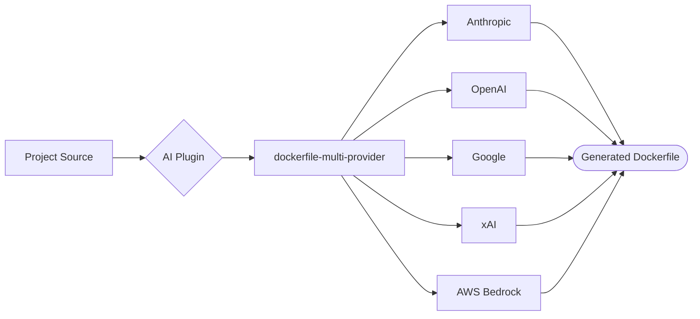

# AI Plugins

AI-powered Dockerfile generation using cloud AI models. A single multi-provider plugin scans your project's build and dependency files, then asks the AI provider of your choice to produce an optimized, production-ready Dockerfile — no per-language Dockerfile templates to maintain.

| Plugin | Provider | Compute | Secrets | Key Env Vars |
|--------|----------|---------|---------|--------------|
| dockerfile-multi-provider | Cloud AI (Anthropic, OpenAI, Google, xAI, Bedrock) | MEDIUM | `AI_API_KEY` (varies by provider) | `AI_PROVIDER`, `AI_MODEL`, `DOCKERFILE_LINT_MODE` |

## Supported Providers

The `dockerfile-multi-provider` plugin supports the following cloud AI providers. Set `AI_PROVIDER` to select the provider and supply the corresponding API key via `AI_API_KEY`.

| Provider | `AI_PROVIDER` Value | API Key Format |
|----------|---------------------|----------------|
| Anthropic | `anthropic` | `AI_API_KEY` set to your Anthropic API key (sk-ant-...) |
| OpenAI | `openai` | `AI_API_KEY` set to your OpenAI API key (sk-...) |
| Google | `google` | `AI_API_KEY` set to your Google AI API key (sent in the `x-goog-api-key` header, never the URL) |
| xAI | `xai` | `AI_API_KEY` set to your xAI API key |
| AWS Bedrock | `bedrock` | No `AI_API_KEY` required; uses AWS IAM credentials from the execution environment |

Set `AI_MODEL` to the model identifier for the selected provider. Left empty (the default), it resolves per provider:

| `AI_PROVIDER` | Default `AI_MODEL` |
|---------------|--------------------|
| `anthropic` (default) | `claude-sonnet-5-5` |
| `openai` | `gpt-5.6-sol` |
| `google` | `gemini-3.7-flash` |
| `xai` | `grok-4.6` |
| `bedrock` | `anthropic.claude-sonnet-5-5` (use the model or inference-profile id enabled in your account and region) |

`AI_API_KEY` is an optional secret: it is injected at build time from AWS Secrets Manager via CodeBuild and is required for every provider except `bedrock`, which authenticates with the CodeBuild role's IAM credentials.

## How It Works

The plugin runs as an AWS CDK `CodeBuildStep` (MEDIUM compute, 15-minute timeout) and follows these steps:

1. **Collect project context.** It scans common build and dependency files — `package.json`, `tsconfig.json`, `requirements.txt`, `pyproject.toml`, `Pipfile`, `go.mod`, `Cargo.toml`, `Gemfile`, `pom.xml`, `build.gradle`/`build.gradle.kts`, `*.csproj`/`*.sln`, `CMakeLists.txt`, `Makefile`, `docker-compose.yml`/`compose.yaml`, version-pinning files (`.nvmrc`, `.python-version`, `.tool-versions`), and the names of top-level entries — so the same plugin works across Node.js, Python, Go, Rust, Ruby, Java, .NET, and C/C++ projects.
2. **Redact before anything leaves the build.** `.env*`, `*.pem`, `*.key`, keystores, SSH keys and credential/secret-named files are neither read nor listed; compose `environment:`, `env_file:` and build `args:` values are replaced with `[REMOVED]` (keys kept); each file is capped (`AI_MAX_FILE_BYTES`, default 32 KB) and the whole context too (`AI_MAX_CONTEXT_BYTES`, default 128 KB). Secret-shaped values — cloud and vendor API keys, tokens, JWTs, private keys, URL credentials, `password=`/`token:` assignments — become `[REDACTED]`, ARN account fields are emptied and bare 12-digit AWS account ids masked.
3. **Generate the Dockerfile.** The output is a Dockerfile for *your application*, not a Pipeline Builder plugin image, so the platform's plugin-image rules (`plugin-base`, `fetch-verified`, uid 1000) deliberately do not apply. The system prompt asks for: official base images pinned to a version tag matching the project's declared runtime (never `:latest` or untagged, and no invented digests), a multi-stage build with a minimal runtime stage, an explicit numeric non-root `USER`, no pipe-to-shell installers or `ADD <url>`, no secrets in `ENV`/`ARG`, cache-friendly layer order, exec-form `CMD`, and a `HEALTHCHECK` only where the runtime image can run one. Requests retry 429 / 529 / 5xx and transport errors with backoff (`AI_MAX_RETRIES`, honouring `Retry-After`); a truncated or refused response fails the step.
4. **Lint, and regenerate once.** hadolint (pinned in the image; it honours a `.hadolint.yaml` in your repository) runs at `HADOLINT_FAILURE_THRESHOLD` (default `error`), alongside a policy check for the rules hadolint does not enforce: pinned base tags, a non-root final `USER`, no download piped into a shell. With `DOCKERFILE_LINT_MODE=enforce` (default) a failure sends the findings back to the model for one corrected attempt, and the step fails if that still does not pass; `report` keeps the Dockerfile and only prints the findings; `off` skips lint. Findings are written to `generated/dockerfile-lint.txt`.
5. **Write the output.** The generated Dockerfile is written to the `generated/` primary output directory (any stray Markdown fences are stripped). The step fails fast if the provider returns an empty or null response, so a bad generation never produces a silently broken artifact.
